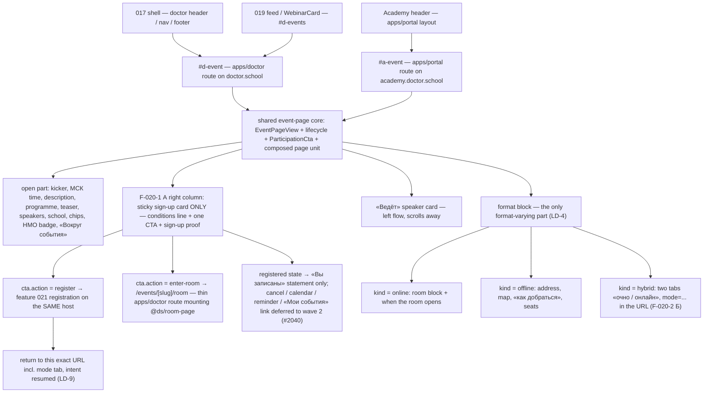
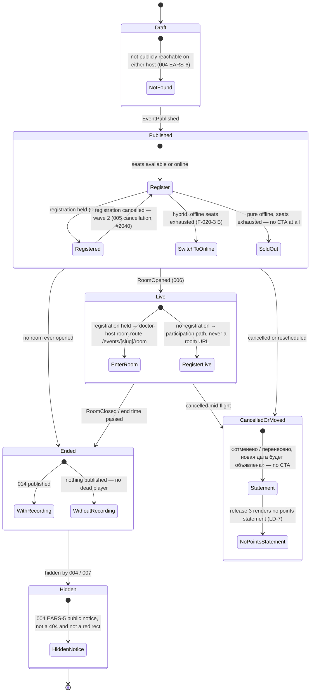
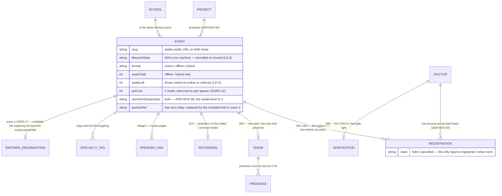
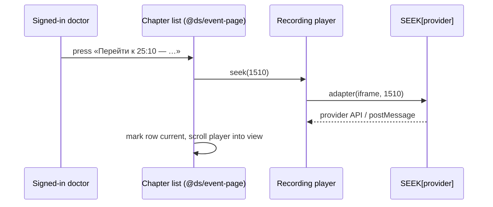

> Companion to [`020-requirements-en.md`](./020-requirements-en.md). Engineer-facing, EN-only per ADR-0006 §4. Composition source of truth is the vendored canvas [`design-source/archive/archive-event-page-variant-a.dc.html`](../../../../../../design-source/archive/archive-event-page-variant-a.dc.html) over its base [`design-source/event-page.dc.html`](../../../../../../design-source/event-page.dc.html); where this document and the canvas disagree on geometry, the canvas wins, and where they disagree on behaviour, the requirements win.

# 020 — The event page for both storefronts (Design)

## 1. Route topology and screen composition

Two thin host routes over one core (LD-1). The doctor route is the release-3 primary surface; the Academy route is a projection of the same core under the Academy header and ships in the same slice (LD-10).



**[Amended 2026-10-02 ([#2537](https://github.com/doctor-school/ds-platform/issues/2537)) — the open part's «МСК time» reads by 004 EARS-12 as amended (the viewer's timezone with an explicit zone label for an online or hybrid event, МСК for an offline one, through the shared event-time formatter, #2543), and the registered state carries «Вы записаны» plus feature 005 EARS-14's add-to-calendar control (#2545); cancel, reminder and «Мои события» stay deferred under #2040. See [020 «Amendment — 2026-10-02»](./020-requirements-en.md).]**

020 owns the two route compositions, the page core they mount and the way **into** the room. It owns no room, no registration form, no listing and no recording projection: those stay at features 006, 021 / 005, 019 and 014.

### 1.1 Cross-front ownership and extraction matrix (EARS-21)

This checked-in matrix is the required pre-implementation inventory. An implementation Issue verifies its row against repository reality and updates it before writing product code; a row that has moved is corrected in this file, not worked around in the app.

| Capability                       | Current owner / precedent                                                                                                                                                                                                                                                                                                                                                                                                                                                                                                                                                                                                                                                                                                                       | Canonical owner or extraction target                                                                                                                                                                                                                                                                                                                                                                                                                                                                                                                                                                                      | Host boundary                                                                                                                                                                                                                                                                                                                                                                                                                                                                                                                                                                                                                                                                                                                                                                                                                                                                                     |
| -------------------------------- | ----------------------------------------------------------------------------------------------------------------------------------------------------------------------------------------------------------------------------------------------------------------------------------------------------------------------------------------------------------------------------------------------------------------------------------------------------------------------------------------------------------------------------------------------------------------------------------------------------------------------------------------------------------------------------------------------------------------------------------------------- | ------------------------------------------------------------------------------------------------------------------------------------------------------------------------------------------------------------------------------------------------------------------------------------------------------------------------------------------------------------------------------------------------------------------------------------------------------------------------------------------------------------------------------------------------------------------------------------------------------------------------- | ------------------------------------------------------------------------------------------------------------------------------------------------------------------------------------------------------------------------------------------------------------------------------------------------------------------------------------------------------------------------------------------------------------------------------------------------------------------------------------------------------------------------------------------------------------------------------------------------------------------------------------------------------------------------------------------------------------------------------------------------------------------------------------------------------------------------------------------------------------------------------------------------- |
| Public event read                | **Widened in place (slice 1, #1764).** `packages/schemas/src/events/public-page.schema.ts` now exports `EventPageViewSchema`, carrying `format` (`online`/`offline`/`hybrid`), `seatsLeft` and — since slice 1 of EARS-2 (#1765) — `links: AroundEvent`, the per-host «Вокруг события» set resolved by `apps/api/src/events/around-event.resolver.ts` from a route table each storefront controller owns (every key absent on both hosts today), beside the existing allow-list and `recording`; `PublicEventPageSchema`/`PublicEventPage` remain aliases of it, so feature 004's consumers are untouched. Storage: `participation_format` + `seats_left` on `events` (`packages/db/src/schema/events.ts`, additive migration, back-fill safe). | Same owner, further widening as its own EARS lands: the `FormatBlock` sub-block union (EARS-8, #1771), sign-up proof (#1767), med gate (#1774). Still no 020-local read model and no second projection.                                                                                                                                                                                                                                                                                                                                                                                                                   | **Realised.** `GET /v1/storefront/doctor/events/:idOrSlug` delegates to the one `EventsService.publicEventPage`; `020 EARS-1` in `apps/api/test/events/event-page-view.e2e-spec.ts` pins deep-equal bodies across both hosts, and no-auth reachability per state.                                                                                                                                                                                                                                                                                                                                                                                                                                                                                                                                                                                                                                 |
| Page composition                 | `packages/event-page` (`@ds/event-page`) — one `EventPage` both hosts mount with their host config (`apps/portal/app/webinars/[slug]/(event-page)/page.tsx`, `apps/doctor/app/(storefront)/events/[slug]/page.tsx`; #2072 wave 3)                                                                                                                                                                                                                                                                                                                                                                                                                                                                                                               | **Realised (slice 2, #1764).** The composed page is now four shared blocks at `packages/design-system/src/blocks/` — `EventPageShell`/`EventPageHero`, `EventSignupCard`, `EventSpeakerCard`, `EventFormatBlock` (online only; offline and hybrid arrive with EARS-8, [#1771](https://github.com/doctor-school/ds-platform/issues/1771)) — built to the variant-А canvas and exported from `blocks/index.ts`. This is the one canonical composition both hosts mount (LD-1, LD-10); Hosts re-mounted (slice 3, #1764): `apps/portal/app/webinars/[slug]/page.tsx`, `apps/doctor/app/(storefront)/events/[slug]/page.tsx`. | `apps/doctor` and `apps/portal` supply route, header, envelope and copy defaults only. A second page composition in either app, or an `apps/doctor` → `apps/portal` import, fails EARS-1.                                                                                                                                                                                                                                                                                                                                                                                                                                                                                                                                                                                                                                                                                                         |
| Participation CTA policy         | **Server-resolved (slice 1, #1764).** One pure resolver `apps/api/src/events/participation-cta.resolver.ts` over lifecycle × registration × format × seats; portable contract `ParticipationCtaSchema` in `packages/schemas/src/events/participation.schema.ts` (LD-2) — `register` · `registered` · `enter-room` · `switch-to-online` · `sold-out` · `unavailable`, with RU label/reason defaults carried by the server.                                                                                                                                                                                                                                                                                                                       | Same owner. **Transport:** a per-viewer SIBLING read on each host — `GET /v1/public/events/:idOrSlug/participation` and `GET /v1/storefront/doctor/events/:idOrSlug/participation`, both `@Public()` with an OPTIONAL principal and `Cache-Control: private, no-store`. Not a field of the page body (that would break 004 EARS-1's guest/principal byte-identity and poison its shared cache), and not an extension of 005's authenticated `GET /v1/events/:idOrSlug/registration` (a guest there gets 401 instead of «Участвовать»).                                                                                    | The client renders the given policy object and computes no eligibility. Each host contributes only its route table (`eventPath` / `registrationEntry` / `roomPath`); on the doctor host `roomPath` resolves to `/events/[slug]/room` (the route mounting `@ds/room-page`), on the Academy host to `/webinars/[slug]/room`; a `null` `roomPath` yields `enter-room` with `href: null` — absent, never dead (EARS-4). Any host-side branch on lifecycle, registration, format or seats is a defect. The portal no longer builds a register href (its `registration-handoff.ts` is deleted; the carry helpers are `withReturnTarget` in `packages/schemas/src/auth/return-target-href.ts` and `withReturnContext` in `packages/auth-flow/src/return-context-href.ts`) — the portal-local `buildRegistrationHref`/`resolvePrimaryCta` pair was deleted in slice 3 and both hosts consume this policy. |
| Registration and cancellation    | `apps/api/src/registration/registration.service.ts`, `registration.controller.ts`, `my-events.controller.ts`, `return-target.guard.spec.ts`; `packages/schemas/src/events/registration.schema.ts`, `registration-intent.ts`                                                                                                                                                                                                                                                                                                                                                                                                                                                                                                                     | Unchanged canonical owner (features 005 / 021). 020 consumes the registration fact for `cta.action` and hands the return target over the existing intent/return-target contract (LD-9).                                                                                                                                                                                                                                                                                                                                                                                                                                   | The CTA enters 021 on the host the doctor is already on and returns there. 020 renders no form, no consent control and no attribution element.                                                                                                                                                                                                                                                                                                                                                                                                                                                                                                                                                                                                                                                                                                                                                    |
| Room state and room entry        | `apps/api/src/room/room.service.ts`, `room.repository.ts`, `presence-*.ts`; `packages/schemas/src/events/room.schema.ts`; composed room UI `packages/room-page` (`@ds/room-page`) over the shared room unit `packages/room` (`@ds/room`) and the primitive `packages/design-system/src/primitives/webinar-room.tsx`                                                                                                                                                                                                                                                                                                                                                                                                                             | Room truth, presence and entry policy stay at feature 006. The composed room **UI** is the shared cross-front package `@ds/room-page`; both hosts mount it from thin routes — `/events/[slug]/room` on the doctor host, `/webinars/[slug]/room` on the Academy host.                                                                                                                                                                                                                                                                                                                                                      | The doctor enters on `doctor.school` through the `apps/doctor` thin route `/events/[slug]/room`, mounted at `apps/doctor/app/(room)/events/[slug]/room/` — a sibling root route group OUTSIDE 017's `(storefront)` shell, because the room is viewport-bounded (006 EARS-11) (LD-3); an Academy-host doctor through the equivalent `apps/portal` route `/webinars/[slug]/room`. 020 builds no room, presence mechanism or live-state machine.                                                                                                                                                                                                                                                                                                                                                                                                                                                     |
| Lifecycle vocabulary             | `EventLifecycleState` at feature 004's owner in `packages/schemas/src/events/` + `apps/api/src/events/`                                                                                                                                                                                                                                                                                                                                                                                                                                                                                                                                                                                                                                         | Extended **at that owner** with the cancelled-or-moved value (LD-6). Never a 020-local enum, mapping table or parallel resolver.                                                                                                                                                                                                                                                                                                                                                                                                                                                                                          | Feed, card, calendar and page read the same machine, so they cannot contradict each other about one event.                                                                                                                                                                                                                                                                                                                                                                                                                                                                                                                                                                                                                                                                                                                                                                                        |
| Event card and list (consumed)   | `packages/design-system/src/primitives/webinar-card.tsx`, `blocks/event-list.tsx`, `day-agenda.tsx`, `events-filter.tsx`, `month-calendar-grid.tsx`                                                                                                                                                                                                                                                                                                                                                                                                                                                                                                                                                                                             | Already canonical in `@ds/design-system` (features 004 / 014 / 019). 020 consumes them as the entry point and widens nothing.                                                                                                                                                                                                                                                                                                                                                                                                                                                                                             | 020 is the destination of the card action and builds no listing, facet or calendar surface.                                                                                                                                                                                                                                                                                                                                                                                                                                                                                                                                                                                                                                                                                                                                                                                                       |
| Recording and archive projection | `apps/api/src/recordings/` + `packages/schemas/src/recordings/` (feature 014), surfaced through `recording: RecordingProjectionSchema` on the public page read                                                                                                                                                                                                                                                                                                                                                                                                                                                                                                                                                                                  | Unchanged at feature 014. The ended and archived renders show whatever that projection carries.                                                                                                                                                                                                                                                                                                                                                                                                                                                                                                                           | 020 models no recording state and no playback policy; the archived render is 004 EARS-5's notice, not a 020 variant.                                                                                                                                                                                                                                                                                                                                                                                                                                                                                                                                                                                                                                                                                                                                                                              |
| Med-status gate (CON-11)         | 004 EARS-10's response-body gating on the public read                                                                                                                                                                                                                                                                                                                                                                                                                                                                                                                                                                                                                                                                                           | `MedGate` on `EventPageView` at the same owner; the verification-status line is a shared unit whose full anatomy `#d-lk` (feature 022) will own, and this page realigns to it then.                                                                                                                                                                                                                                                                                                                                                                                                                                       | Closed material is absent from the response body on both hosts. No host hides a delivered payload in the client.                                                                                                                                                                                                                                                                                                                                                                                                                                                                                                                                                                                                                                                                                                                                                                                  |
| Format block and URL codec       | No precedent — 004's page has no format vocabulary beyond online                                                                                                                                                                                                                                                                                                                                                                                                                                                                                                                                                                                                                                                                                | New `FormatBlock` union in `packages/schemas/src/events/` plus one shared block in `@ds/design-system`; the `mode` codec lives beside 019's `event-listing-query.schema.ts` query vocabulary rather than in a route file (LD-4).                                                                                                                                                                                                                                                                                                                                                                                          | Both hosts read and write the same `mode` parameter; neither owns a tab-state store.                                                                                                                                                                                                                                                                                                                                                                                                                                                                                                                                                                                                                                                                                                                                                                                                              |

Thin host projections are intentional and bounded: the two storefronts differ in header, envelope and copy defaults, and in nothing else. A second read model, a second CTA resolver, a second page composition, a rival room or a forked format block fails EARS-1 and the ADR-0013 A1 reuse rule.

## 2. The guest round-trip: open → CTA → 021 → return → room entry (EARS-5, EARS-7, LD-9)

```mermaid
sequenceDiagram
  participant G as Doctor (guest, doctor.school)
  participant R as #d-event route (apps/doctor)
  participant API as event-page read (apps/api)
  participant P as ParticipationCta resolver
  participant F021 as feature 021 registration (same host)
  participant R006 as feature 006 room state
  participant RM as room route (apps/doctor /events/:slug/room mounting @ds/room-page)

  G->>R: GET /events/:slug?mode=online
  R->>API: read EventPageView(slug, host, session=none)
  API->>P: resolve(lifecycle, registration=none, format, seatsLeft)
  P-->>API: cta { action: 'register', label: «Участвовать» }
  API-->>R: EventPageView — open part + sticky card + format block
  R-->>G: full decision set, no account required (EARS-2)
  G->>R: activates «Участвовать»
  R->>F021: enter with { eventId, returnUrl = this URL incl. mode }
  Note over F021: 021 owns the form, the consents and the attribution element (ADR-0009)
  F021-->>R: registration created → return to returnUrl, intent resumed
  R->>API: re-read with the session
  API->>P: resolve(lifecycle, registration=held, format, seatsLeft)
  P-->>API: cta { action: 'registered' }
  R-->>G: «Вы записаны» statement only — no other control; cancel / calendar / «Мои события» wave 2, #2040 (EARS-6)

  Note over R006: эфир starts — RoomOpened
  R->>API: re-read
  API->>R006: is the room open for this event?
  R006-->>API: open { presenceCount }
  API->>P: resolve(lifecycle='live', registration=held, …)
  P-->>API: cta { action: 'enter-room', href: /events/:slug/room on doctor.school, presenceCount }
  R-->>G: room entry with the presence count
  G->>RM: enters /events/:slug/room on doctor.school — never academy.doctor.school (LD-3)
```

**[Amended 2026-10-02 ([#2537](https://github.com/doctor-school/ds-platform/issues/2537)) — the `registered` step renders «Вы записаны» together with feature 005 EARS-14's shared add-to-calendar control (`.ics` + Google Calendar link, #2545) and no other control; cancel and «Мои события» stay wave 2 under #2040. See [020 «Amendment — 2026-10-02»](./020-requirements-en.md).]**

**[Amended 2026-10-21 ([#3006](https://github.com/doctor-school/ds-platform/issues/3006)) — the hop into 021 enters the doctor storefront's `/register` entry, which redirects to the sign-in host; `returnUrl` is the return path stored in the storefront's server-side sign-in transaction (path and query, at most 2048 characters), and the callback's `303` is the return. See Amendment — 2026-10-21 at the end of this file.]**

Two properties of this trace are contract rather than convenience. The return target is **carried**, never re-derived from a referrer or a session breadcrumb, so the doctor lands on the same URL including the active hybrid tab. And `enter-room` is resolved by the server only for a viewer holding a registration: an unregistered or anonymous reader on a live event receives `register`, and no room URL is ever present in their response body or DOM.

## 3. Lifecycle (EARS-10, LD-6)

One machine — feature 004's `EventLifecycleState`, extended at its canonical owner with `cancelled-or-moved`. The page renders a state; it never computes one from `startsAt`.



`NotFound` and `HiddenNotice` are deliberately different renders: a draft is indistinguishable from a non-existent event, a hidden event is a readable public notice. `WithoutRecording` renders no player and no «скоро» marker. `CancelledOrMoved` carries no statement about the doctor's points in release 3, because such a statement would be a ledger fact and feature 025 asserts none yet (LD-7).

## 4. Entity fragment

The page reads across these entities; it writes none of them. The dashed relation is the wave-2 addition of EARS-17.



`events.partnerRef` stays free text through release 3 and is **not** rendered anywhere (CON-8): the modelled `PARTNER_ORGANISATION` link is wave-2 work behind feature 030 and feature 021's own attribution clause, and it changes no interface copy when it lands.

## 5. The format block and its URL codec (EARS-8, EARS-9, LD-4, LD-5)

`FormatBlock` is a discriminated union over `EventFormat`, and it is the only part of the page whose composition varies:

| `kind`    | Carries                                                         | CTA resolution                                                            | URL                                                        |
| --------- | --------------------------------------------------------------- | ------------------------------------------------------------------------- | ---------------------------------------------------------- |
| `online`  | room block, when the room opens relative to the start           | `register` → `registered` → `enter-room`                                  | no `mode` parameter                                        |
| `offline` | address, map reference, «как добраться», `seatsTotal/seatsLeft` | `register`; `sold-out` (no CTA at all) when `seatsLeft = 0`               | no `mode` parameter                                        |
| `hybrid`  | both sub-blocks behind two tabs «очно / онлайн»                 | `register`; `switch-to-online` with the reason when offline seats run out | `mode=online \| offline`, the default resolved server-side |

The tab is URL state, not component state: a shared link reproduces the tab, the back button moves between tabs rather than off the page, and a reload keeps it. `switch-to-online` therefore lands the doctor on the «онлайн» tab from the server's resolution, with no client-side redirect and no flash of the offline tab. No waiting list exists in the model, so none can be half-built in the UI.

`seatsLeft` is the one stored seat figure, kept on the event and counted down by the registration write itself (LD-5); it is `null` (no limit) unless set, and the admin field that sets and corrects it is #3918: the first registration on an `offline` event, or on a `hybrid` event while offline seats remain, locks the event row and takes one seat in the same transaction as the registration insert and the points reserve; a pure offline event with no seat left refuses that transaction as `sold-out`, a hybrid one registers the online half and takes nothing. `seatsLeft = null` (no limit) and an `online` event are never counted and take no lock on the event row, and an idempotent repeat takes no second seat. Interim rule: the registration carries no participation mode, so on a hybrid event every registration made while offline seats remain takes one — the order the CTA offers them in (`register`, then `switch-to-online`); the per-registration mode replaces it (#1771). No path ends a registration today, so none returns a seat; the cancel command returns it in its own transaction when it lands (#2040, and #1773 for a cancelled-or-moved event).

## 6. Build sequence — core → policy → composition → hosts

1. **Core.** Widen `PublicEventPageSchema` into `EventPageView` and extend `EventLifecycleState` with `cancelled-or-moved` at their canonical owners (`packages/schemas/src/events/`, `apps/api/src/events/`), with the `FormatBlock` union and the `mode` codec. Proved by Vitest e2e on the read; no route publishes.
2. **Policy.** The server-side `ParticipationCta` resolver over lifecycle × registration × format × seats, including the F-020-3 Б `switch-to-online` / `sold-out` split and the `enter-room` registration condition. Proved by Vitest e2e; still no route.
3. **Composition.** Extract the portal page composition into the shared `@ds/design-system` blocks built from the variant-А canvas — page shell, sticky sign-up card, «Ведёт» card, format block with its tabs — with the state matrix proved in the showcase at both breakpoints and in both themes.
4. **Hosts, in one slice (LD-10).** Publish `#d-event` in `apps/doctor` inside 017's shell **and** re-mount `#a-event` in `apps/portal` on the same unit, replacing the host-local composition. Only here do the route-level Playwright obligations of EARS-2, EARS-4, EARS-5, EARS-8, EARS-9, EARS-10, EARS-11, EARS-19 and EARS-20 run, plus the cross-host identity row of EARS-1 / EARS-18.
5. **Room entry**: the doctor-host thin route `/events/[slug]/room` (`apps/doctor/app/(room)/events/[slug]/room/`, outside 017's shell) mounts the shared room page `@ds/room-page` with the doctor host config — the same package the Academy route `/webinars/[slug]/room` mounts, composed over the shared room unit `packages/room` (`@ds/room`) — so neither host carries a room composition of its own.

Before step 1, §1.1 is verified against repository reality and the `build-ui-from-design-system` gate runs against the vendored canvas set (EARS-21). Steps 1–3 expose no partial public route: there is no intermediate build in which a reader can reach a half-composed event page.

### 6.1 Room-entry resolution and the doctor auth/unregistered branch

Room entry is decided by ONE pure function shared by both hosts, `resolveRoomEntry(access, routes)`, exported from `packages/room` (`@ds/room`) on its `./server` subpath. Its outcome set is closed — `render` · `redirect(href)` · `not-found` — and it is table-driven: each host supplies only its own `{ auth, register, notLive }` route table, so neither host carries a branch of its own.

| Outcome                      | Academy host (`apps/portal`, `/webinars/[slug]/room`)       | Doctor host (`apps/doctor`, `/events/[slug]/room`)        |
| ---------------------------- | ----------------------------------------------------------- | --------------------------------------------------------- |
| Registered viewer, room open | `render`                                                    | `render`                                                  |
| Not signed in (`auth`)       | `redirect` `/login?returnTo=<encoded /webinars/:slug/room>` | `redirect` `/login?returnTo=<encoded /events/:slug/room>` |
| Signed in, not registered    | `redirect` `/webinars/:slug?from=room`                      | `redirect` `/events/:slug?from=room`                      |
| Event not live (`notLive`)   | `redirect` `/webinars/:slug`                                | `redirect` `/events/:slug`                                |
| Unknown slug                 | `not-found`                                                 | `not-found`                                               |

The two hosts differ only in their paths. A caller who is not signed in is sent to **that host's own** `/login` with a same-origin `returnTo` to the room URL, built by the shared `buildRoomReturnHref` from the host's room template (`@ds/room`); the shared auth door completes that return back to the room without registering anyone, and the room gate re-runs. The doctor host never bounces to the Academy login: ADR-0015 §4 REQ-24 caps `doctor.school` at exactly one Academy trace, and a cross-origin `returnTo` pointing at `doctor.school` would be rejected by the Academy's same-origin guard regardless. A signed-in caller without a registration is the one the event page's participation card serves, so that branch lands there with `?from=room`.

**[Amended 2026-10-21 ([#3006](https://github.com/doctor-school/ds-platform/issues/3006)) — the host's `/login` is now an entry that renders no form: it stores the room URL as the return path of a server-side sign-in transaction and redirects to the sign-in host, whose callback lands back on the room with a `303`; and a doctor already signed in on the other storefront never reaches the `auth` outcome, because the storefront's silent check signs the room request in before the gate runs. The outcome table is unchanged. See Amendment — 2026-10-21 at the end of this file.]**

## 7. What release 3 deliberately does not draw (LD-8)

Seven product surfaces are postponed, and each renders **nothing at all** — no disabled control, no empty labelled box, no «скоро» marker. Their release-3 proof is an absence assertion in `020-scenarios.feature`, and each carries its own tracked Issue on the 020 parent.

| Deferred                                                                           | Clause  | Waits on                                                                                 | Release-3 render                                                                                                                                                                                                                                                                                                                                                                                                                                                 |
| ---------------------------------------------------------------------------------- | ------- | ---------------------------------------------------------------------------------------- | ---------------------------------------------------------------------------------------------------------------------------------------------------------------------------------------------------------------------------------------------------------------------------------------------------------------------------------------------------------------------------------------------------------------------------------------------------------------- |
| Points balance, shortfall paths, silent advance, accrual                           | EARS-12 | feature 025 (no spec, no Issues yet)                                                     | the Pul cost parameter only; zero reads «бесплатно для врача»                                                                                                                                                                                                                                                                                                                                                                                                    |
| Live-эфир interaction — questions, polls, vote, reminders                          | EARS-13 | feature 006 channel + 040 / 024 marking                                                  | nothing in any live render                                                                                                                                                                                                                                                                                                                                                                                                                                       |
| НМО check-in surface and outcome statement                                         | EARS-14 | feature 038                                                                              | НМО as a badge and a conditions-line value only                                                                                                                                                                                                                                                                                                                                                                                                                  |
| Ticket and its QR                                                                  | EARS-15 | features 022 and 038                                                                     | address, map, «как добраться», seats — nothing else                                                                                                                                                                                                                                                                                                                                                                                                              |
| Post-event rating, review and F-020-4 А mini-survey                                | EARS-16 | wave 2 in the decided F-020-4 А shape                                                    | the 014 recording and materials only                                                                                                                                                                                                                                                                                                                                                                                                                             |
| Event-level partner link                                                           | EARS-17 | feature 030 + 021's attribution clause                                                   | no attribution element, no marking field                                                                                                                                                                                                                                                                                                                                                                                                                         |
| Registered-card cancel, add-to-calendar, pre-start reminder and «Мои события» link | EARS-6  | feature 005's wave-2 cancellation and its notifications, a calendar Stage A, feature 022 | the «Вы записаны» statement only — no other control **[Amended 2026-10-02 ([#2537](https://github.com/doctor-school/ds-platform/issues/2537)) — add to calendar leaves this deferral: the registered card carries «Вы записаны» plus feature 005 EARS-14's shared add-to-calendar control (an `.ics` download and a Google Calendar link, #2545); cancel, reminder and «Мои события» stay here. See [020 «Amendment — 2026-10-02»](./020-requirements-en.md).]** |

The EARS-6 row is the deepest cut of the seven: release 3 ships the registered card at parity with what the Academy renders today (D-4) — the «Вы записаны» statement and nothing else. Cancellation waits on feature 005's wave-2 cancellation vertical and its notifications, the calendar affordance owes its own Stage A, no scheduling capability exists in the platform to back a reminder, and «Мои события» waits on feature 022; all four are tracked under [#2040](https://github.com/doctor-school/ds-platform/issues/2040) and promised nowhere on the page. **[Amended 2026-10-02 ([#2537](https://github.com/doctor-school/ds-platform/issues/2537)) — add to calendar leaves this deferral: the registered card carries «Вы записаны» plus feature 005 EARS-14's shared add-to-calendar control (an `.ics` download and a Google Calendar link, #2545); cancel, reminder and «Мои события» stay here. See [020 «Amendment — 2026-10-02»](./020-requirements-en.md).]**

## Amendment — 2026-10-21 — signed in on both storefronts through the sign-in host, one sign-out on both ([#3006](https://github.com/doctor-school/ds-platform/issues/3006))

> **Status:** the event page is live in production on both storefronts; this is recorded as an amendment rather than an inline rewrite of §2 and §6.1 (AGENTS.md §6). The requirements-side counterpart is [`020-requirements-en.md`](./020-requirements-en.md) / [`020-requirements-ru.md`](./020-requirements-ru.md) → «Amendment — 2026-10-21» (EARS-18 amended, EARS-22, EARS-23). The mechanism is feature 003's design amendment of the same date ([`003-design.md`](../003-user-authentication/003-design.md) → «Production amendment — the sign-in host and one sign-out on both storefronts») over ADR-0015 §4; nothing below restates or varies it.

**What 020 consumes, and where.**

- **The open page on the other storefront (EARS-18, EARS-22).** Both event routes (`/events/:slug` on the doctor storefront, `/webinars/:slug` on the Academy) and the room routes are top-level document `GET`s, so a signed-out request to them is checkable: the storefront middleware / proxy answers it with the silent-check redirect before the route renders and before the page cache answers (003 EARS-63). The route itself has no new branch — it renders for whatever session the request resolves to. A guest render of a public event page keeps its static / ISR caching; a page rendered for a session is `private, no-store` (ADR-0015 §4 step 4, «Caching»).
- **The guest round trip of §2.** «Участвовать» on a guest page enters the doctor storefront's `/register` entry with `returnTo` = this page's URL including the mode tab; the entry stores it as the return path of an interactive transaction (003 EARS-61: same-origin path and query, at most 2048 characters, else cut to the path or `/`) and redirects to the sign-in host, which renders 021's form (003 EARS-24 amended). The storefront callback answers `303` to that stored path (003 EARS-62), and the page re-reads with the new session. LD-9's carried target is that stored return path; nothing is re-derived from a referrer.
- **Room entry (§6.1).** The `auth` outcome still redirects to the host's own `/login?returnTo=<room URL>`; that `/login` is an entry that redirects to the sign-in host and returns to the room through the callback (003 EARS-43 amended). A doctor signed in on the other storefront is signed in by the silent check before the room gate runs and goes straight to `render` or the participation card.
- **Sign-out (EARS-23).** Sign-out on either storefront revokes the linked session on the other one synchronously (003 EARS-10 amended); the other event page's next request resolves no session, and its silent check finds no shared session (the sign-in-host record was deleted), ends in `login_required` and renders the guest page — one round trip, no form.

## Amendment — 2026-10-28 — the room-entry presence count follows the event's setting ([#2911](https://github.com/doctor-school/ds-platform/issues/2911))

> **Status:** the event page is live in production on both storefronts; this is recorded as an amendment rather than an inline rewrite of the room-entry sequence of §2 (`open { presenceCount }` → `cta { …, presenceCount }`) (AGENTS.md §6). The requirements-side counterpart is [`020-requirements-en.md`](./020-requirements-en.md) / [`020-requirements-ru.md`](./020-requirements-ru.md) → «Amendment — 2026-10-28» (EARS-7 amended, EARS-24). The rule and its emission points are [`006-design.md`](../006-webinar-room/006-design.md) → «Amendment — 2026-10-28».

- **The read.** `apps/api/src/events/participation.service.ts` resolves `presenceCount` through the one 006 visibility rule: `null` while the event's `show_presence_count` is `false` and the caller's session carries no role in `STAFF_ROLES`, the live aggregate otherwise. The participation schema's `presenceCount` is nullable already; nothing new is added to the contract.
- **The card.** `packages/design-system/src/blocks/event-signup-card.tsx` renders the room entry with no count line on `null` — no «0», no placeholder — on both storefronts; the hosts pass the read through unchanged.

## Amendment — 2026-11-09 — the post-live page: timecodes and seek, the bottom CTA, «К записи ↓», the end line ([#3014](https://github.com/doctor-school/ds-platform/issues/3014))

> **Status:** the event page is live in production on both storefronts; this is recorded as an amendment rather than an inline rewrite (AGENTS.md §6). The requirements-side counterpart is [`020-requirements-en.md`](./020-requirements-en.md) / [`020-requirements-ru.md`](./020-requirements-ru.md) → «Amendment — 2026-11-09» (EARS-3 amended, EARS-25…EARS-29); the chapter data is [`014-design.md`](../014-event-recordings/014-design.md) → «Amendment — 2026-11-09». All of it lives in the one core `packages/event-page` and is mounted unchanged by both host routes (ADR-0013 §A1); the hosts differ only in the route of «Записаться ↗» (their own event route).

**The read.** The public event read (`PublicEventPage`, feature 004) gains, for the post-live page only:

- `recording.chapters: { startSec, title, description? }[] | null` — the main-player recording's chapters (014 EARS-30); `null` for `preparing` and for an empty list.
- `nextSchoolEvent: { slug, startsAt } | null` — one bounded query: events joined to the same school record as this event (the target of EARS-2's school link), state `published`, not live, inside this storefront's content set (004 «Amendment — 2026-10-01» for the Academy, the doctor storefront's own set), `id <> this`, ordered by `starts_at` ascending, `LIMIT 1`. The storefront is the read's existing host context, never a client parameter.
- `signUps` is `null` on the post-live page (EARS-3 amended), so the hide rule and the past rule share one absent shape.
- `endedAt: string | null` — the new nullable `events.ended_at` (EARS-29), copied as is.

**The end instant (EARS-29).** One additive migration adds `events.ended_at timestamptz NULL` beside `live_at` (`packages/db/src/schema/events.ts`). `EventsService.closeRoom` (`apps/api/src/events/events.service.ts`, the `live → ended` named transition that writes `EVENT_ENDED_AUDIT_TYPE`) sets it to the transition instant inside the same transaction as that audit row, exactly as `OpenRoom` sets `live_at`; the closed lifecycle map allows `live → ended` once, so it is never overwritten. No back-fill: the audit ledger is not read on the public path, and a row closed before the column (or a legacy `in_archive` event, which has no transition at all) keeps `null` and renders the date-only line. Reading the instant from `audit_ledger.created_at` at request time was rejected — it would put the audit ledger on the public read path for one display field.

No expiry or availability field is added anywhere (owner decision 2026-11-09).

**The seek adapter (EARS-26).** `packages/room/src/model/room-player.ts` already keys the embed src on `StreamProvider`; a sibling table keys the seek on the same enum:

```ts
type SeekAdapter = (iframe: HTMLIFrameElement, sec: number) => void;
const SEEK: Record<StreamProvider, SeekAdapter | null> = {
  youtube: (f, s) => youTubeCommand(f, "seekTo", [s, true]), // IFrame Player API; src carries enablejsapi=1
  vk: (f, s) => VK.VideoPlayer(f).seek(s), // over js_api=1
  rutube: null, // → player:setCurrentTime postMessage once proven on a live embed
  cdnvideo: null, // Aloha embed: no public player API
};
```

`@ds/event-page`'s `recording-player.tsx` exposes `seek(sec)` only when `SEEK[provider]` is non-null; the chapter list reads that to choose buttons or a plain list. The YouTube recording src gains `enablejsapi=1` in `EMBED_SRC` (harmless for the room, which ignores it). CDNvideo reload-with-start-offset was rejected: no documented start parameter for the Aloha player was found, and a reload would drop the doctor's playback state; the plain list is the honest render.



**The page state (post-live only).**

| Element         | Shown when                                                                          | Source                                               |
| --------------- | ----------------------------------------------------------------------------------- | ---------------------------------------------------- |
| «К записи ↓»    | `montage` · `raw-only` · `preparing` (every post-live state)                        | fixed; scroll + focus to `#player`                   |
| Timecode list   | main-player recording has chapters                                                  | `recording.chapters`                                 |
| Rows as buttons | guest (scroll to gate, any provider) · signed in ∧ `SEEK[provider]` non-null (seek) | session + provider                                   |
| End line        | always; with time when `endedAt` non-null, date-only else                           | `endedAt` (EARS-19 time rule) · else `startsAt` date |
| Bottom CTA      | guest ∧ ready → always; otherwise `nextSchoolEvent` non-null                        | recording state + session + `nextSchoolEvent`        |
| Social proof    | never                                                                               | `signUps: null`                                      |

**Canvas differences carried by this amendment.** The canvas draws chapter marks on its own mock progress bar (`chapterMarks`); the real player is a provider iframe whose timeline cannot be drawn on, so no marks render and the list is the only seek control. The canvas draws a description under every chapter title (`c.desc`, `design-source/event-page.dc.html` :351, :357; `chapDefs` :1050-1052), so the chapter carries an optional description beside the owner's time + title. The canvas `range` line per chapter («19:00–19:25 МСК», :356) is not rendered: it appears only on the canvas's non-seekable rows (`fixed`), and it is the broadcast's wall-clock span of the chapter, which is redundant with the start offsets plus the broadcast start and is not a position in a recording — the seekable rows of the canvas show the recording offset instead (:350), and that offset is what EARS-25 renders. In `preparing` the canvas still draws the chapter list as those fixed rows with clock ranges (`fixed: !recPlayer`, :354-358); EARS-25 renders no list there, because no recording is published and so no chapters exist on the read. «К записи ↓» is drawn whenever the past page has a recording or one in preparation (`pastHasRec: recPlayer || recPrep`, :1120), so EARS-28 keeps it in `preparing`. The «нет записи» variants have no source state. «Доступна ещё 30 дней» leaves the canvas through a vendoring change.
