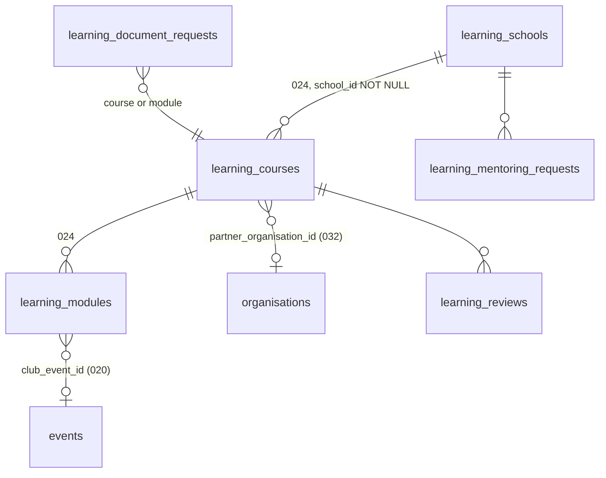
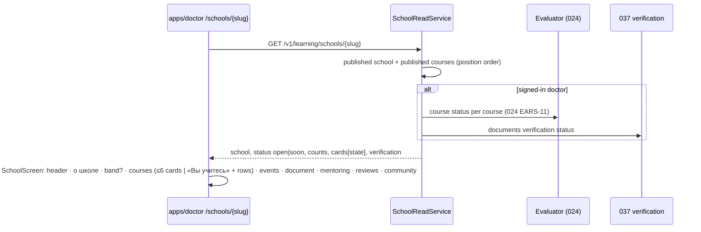
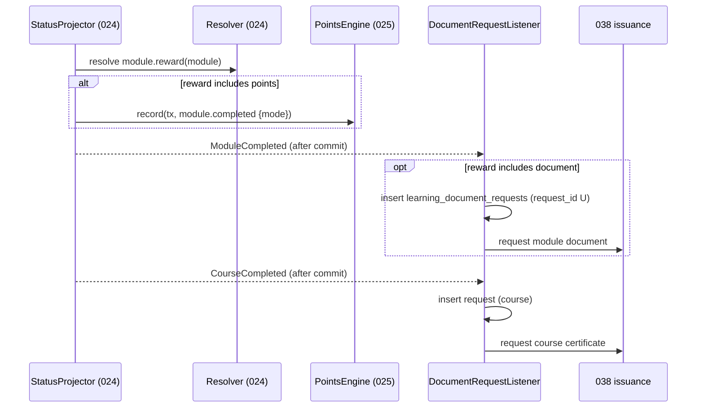
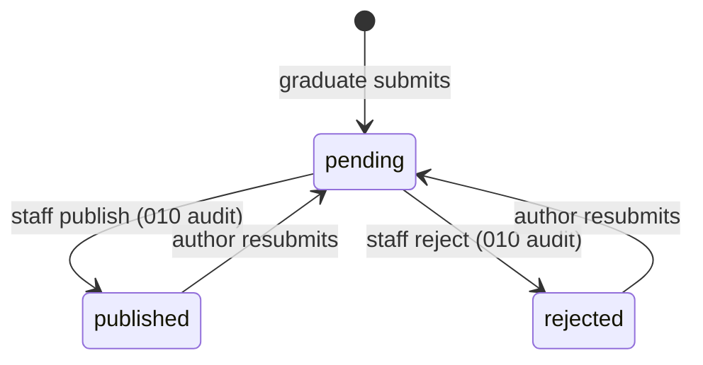

> Requirements: [`023-requirements-en.md`](./023-requirements-en.md) · Scenarios: [`023-scenarios.feature`](./023-scenarios.feature) · PRD: [`023-product.md`](./023-product.md) · Model: [`024-design.md`](../024-learning-module-path/024-design.md)

# 023 — Design

## 1. Package and host boundary (ADR-0013 §A1)

023 adds no package: everything lands in `packages/learning` (`@ds/learning`, 024 design §1) next to the 024 model.

| Subpath    | 023 adds                                                                                                                                                                                                                                                                                                                |
| ---------- | ----------------------------------------------------------------------------------------------------------------------------------------------------------------------------------------------------------------------------------------------------------------------------------------------------------------------- |
| `.`        | The `module.reward` setting key and its platform seed (EARS-2); the school-status and course-state derivations over the 024 evaluator (EARS-3); RU copy of the school screen.                                                                                                                                           |
| `./server` | The school read, the review and mentoring services, the module/course-done listener that requests 038 documents (EARS-14), the admin school / course / module editor endpoints.                                                                                                                                         |
| `./client` | `/v1/learning/schools/*`, `/v1/me/learning/reviews`, `/v1/me/learning/mentoring-requests`.                                                                                                                                                                                                                              |
| `./ui`     | `SchoolScreen` per `design-source/doctor-school.dc.html` (course cards as the 018 content card `FeedCard` (`packages/design-system/src/blocks/feed-card.tsx`; the canvas's `unit-content-card`), events via `unit-event-card`), `CourseHeader` over 024 `CoursePath`; the single-module mode of `CoursePath` (EARS-12). |
| `./admin`  | `SchoolEditor`, `CourseStructureEditor`, `ReviewModeration` — `@ds/design-system` primitives and the 012 list/form compositions; module reward and club in completion edit through 024 `RulesEditor` fields.                                                                                                            |

`apps/doctor` adds `app/schools/[schoolSlug]/page.tsx` and host-config fields; the course route is 024's. `apps/admin` adds route files under `app/learning/schools/`. `apps/portal` adds nothing (EARS-24).

## 2. Data model

- **Columns over 024 rows** (`doctor`): `learning_schools` + `description`, `facts jsonb` (≤4 `{label, text}`), `soon_note NULL`, `community_url NULL`, `mentoring_offer NULL`, `internship_offer NULL`; `learning_courses` + `description`, `academic_hours`, `document_kind: certificate | certificate-nmo`, `document_prerequisites`, `partner_organisation_id NULL`, `position`; `learning_modules` + `club_event_id NULL`. The 024 rows, keys and `school_id` NOT NULL are unchanged.
- **Reviews** (`doctor`; `state` `admin-only` until published): `learning_reviews (id, person_id, course_id, stars 1..5, text, state: pending | published | rejected, submitted_at, moderated_by NULL, moderated_at NULL, version; U (person_id, course_id))`. A resubmission updates the row back to `pending` (reviews are not facts; 010 audits staff moderation).
- **Mentoring requests** (`doctor`): `learning_mentoring_requests (id, person_id, school_id, requested_at, state: open | closed; U (person_id, school_id) WHERE state = open)`.
- **Document requests** (`doctor`): `learning_document_requests (request_id U, person_id, item_kind: module | course, item_id, requested_at)` — the outbox to 038, `request_id = learning:<kind>-document:<personId>:<itemId>`.
- **Erasure**: reviews, requests and document requests follow the platform's personal-data erasure procedure with the 024 facts.

## 3. Settings (over 024 design §3)

| Key             | Platform seed | Levels         | Read by                            |
| --------------- | ------------- | -------------- | ---------------------------------- |
| `module.reward` | `points`      | course, module | the module-done listener (EARS-14) |

`course.clubInCompletion` (seed `false`) is a 024 key (024 EARS-6, EARS-8); 023's editor writes it. Both go through 024 `SetRuleLayer`, so on a published course they need `learning_rules_editor` and the change dialog (024 EARS-30, EARS-31).

## 4. School read and screen (EARS-3…EARS-13)

- **Course state** on a card: `done` = 024 `CourseCompleted` status; `started` = any done or current step that is not the first; else `not-started`. No percent is stored or sent.
- **Over six courses**: the read returns all published cards (bounded by the school); search and «Показать ещё 10» are client-side over that list.
- **Course header** (`CourseHeader`) reads the course read of 024 extended with the EARS-1 columns and the rules summary from the 024 sentence builder for the course scope; the preset's name is stripped by design — the builder takes resolved values, not the `preset` field of the resolver.
- **Single module** (EARS-12): `CoursePath` receives `modules.length === 1` and renders lesson segments without section headers; the outline lists lessons.

## 5. Module and course done → 025 and 038 (EARS-14)

The reward check sits inside 024's projector transaction (024 EARS-12), so 025 hears `module.completed` only under points; the 038 request is an outbox row, so a replay is a duplicate on `request_id`. Until 038's contract exists, this slice is `blocked_by` 038 — no stand-in issuance.

## 6. Review lifecycle (EARS-18…EARS-20)

Only `published` rows reach a doctor read; the author line is the profile's specialty and city, never the name.

## 7. API

| Method and path                                                                                                                                                                                           | Who                         | Clause      |
| --------------------------------------------------------------------------------------------------------------------------------------------------------------------------------------------------------- | --------------------------- | ----------- |
| `GET /v1/learning/schools/{schoolSlug}`                                                                                                                                                                   | anyone (states per session) | EARS-3      |
| `GET /v1/learning/schools/{schoolSlug}/reviews?cursor=`                                                                                                                                                   | anyone                      | EARS-20     |
| `PUT /v1/me/learning/courses/{courseId}/review`                                                                                                                                                           | doctor, graduate            | EARS-18     |
| `POST /v1/me/learning/schools/{schoolId}/mentoring-requests`                                                                                                                                              | doctor, graduate            | EARS-16     |
| `POST /v1/me/learning/schools/{schoolId}/interest`                                                                                                                                                        | doctor                      | EARS-7      |
| `GET /v1/learning/courses/{courseSlug}` (024 course read + EARS-1 columns, rules summary)                                                                                                                 | anyone                      | EARS-11, 13 |
| `PATCH /v1/admin/learning/schools/{id}` · `…/publish` · `…/unpublish` (create is 024's)                                                                                                                   | staff (047 content editing) | EARS-26, 28 |
| `PATCH /v1/admin/learning/courses/{id}` · `…/publish` · `PUT /v1/admin/learning/schools/{id}/course-order` · `PUT /v1/admin/learning/courses/{id}/module-order` · `PATCH /v1/admin/learning/modules/{id}` | staff                       | EARS-27, 28 |
| `GET /v1/admin/learning/reviews?state=pending` · `POST …/{id}/publish` · `POST …/{id}/reject`                                                                                                             | staff                       | EARS-19     |
| `GET /v1/admin/learning/schools/{id}/mentoring-requests`                                                                                                                                                  | staff                       | EARS-16, 26 |

Problems are RFC 7807: `REVIEW_NOT_GRADUATE` (403), `MENTORING_NOT_ELIGIBLE` (403), `PUBLISH_REQUIREMENTS_NOT_MET` (409), `PRECONDITION_FAILED` (412). Rule settings (`module.reward`, `course.clubInCompletion`, `course.moduleSize`) use 024's `/v1/admin/learning/rules/*`.

## 8. UI mapping

- **School screen** — `design-source/doctor-school.dc.html` (Stage A «Го» 2026-11-12): poster header, loading, «О школе» with the verification band, courses (volumes 3 / 22 / 62: cards; «Вы учитесь» + rows + search + «Показать ещё 10»), «Школа готовится», the guest gate, events, document block (default / certificate available / waiting for verification), mentoring, reviews (ok / empty / error), community.
- **Course header** — over the 024 `CoursePath` of `design-source/doctor-course.dc.html` v16.
- **Admin** — no canvas, no Stage A (lead decision, Issue #1793 comment 6822255430): `build-ui-from-design-system` inventory → whitelist → report recorded in the slice PR.

## 9. Delivery slices

1. **School screen and course cards** (thinnest end-to-end): a school seeded through the 024 admin API with the EARS-1 columns, the school read, `SchoolScreen` with header, facts and course cards into the 024 path, the guest gate, the course header with the rules summary, the single-module path.
2. **Structure editor** — `SchoolEditor`, `CourseStructureEditor`, module club and reward, the admin envelope.
3. **«Скоро» and interest** — the soon state and the specialty capture through 017 / 021.
4. **Documents and the module reward** — the verification band (037), the document block and the 038 requests, the conditional 025 module fact.
5. **Graduate reviews** — form, moderation, section.
6. **Beyond lessons** — club events, mentoring requests, community.
7. **Browser journeys and the phone** — CI journeys, 390 px, axe.

## 10. Dependencies

- **024** — every row, the resolver, the evaluator, the projector, the path block and the admin envelope (slice 1: 024 «First course path»; slice 2: 024 «Rules editor and live changes»).
- **018** — the content card `FeedCard` (`packages/design-system/src/blocks/feed-card.tsx`) and the «урок дня» link (slice 1). **017** — the doctor's specialties and the shell (slices 1, 3). **021** — the registration return (slice 3).
- **037** — the verification status and upload entry; **038** — document issuance (slice 4).
- **020** — the club events (slices 2, 6). **032** — partner organisations (slice 1). **047** — the content-editing grant; **010** — change audit; **012** — admin compositions, idempotency and `If-Match`.
