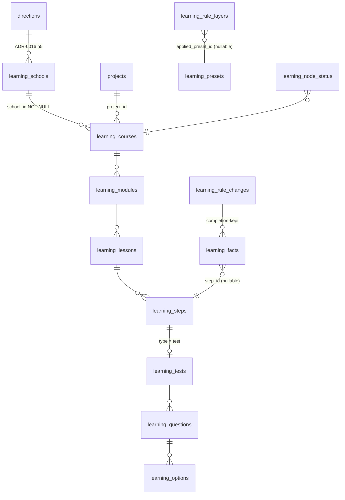
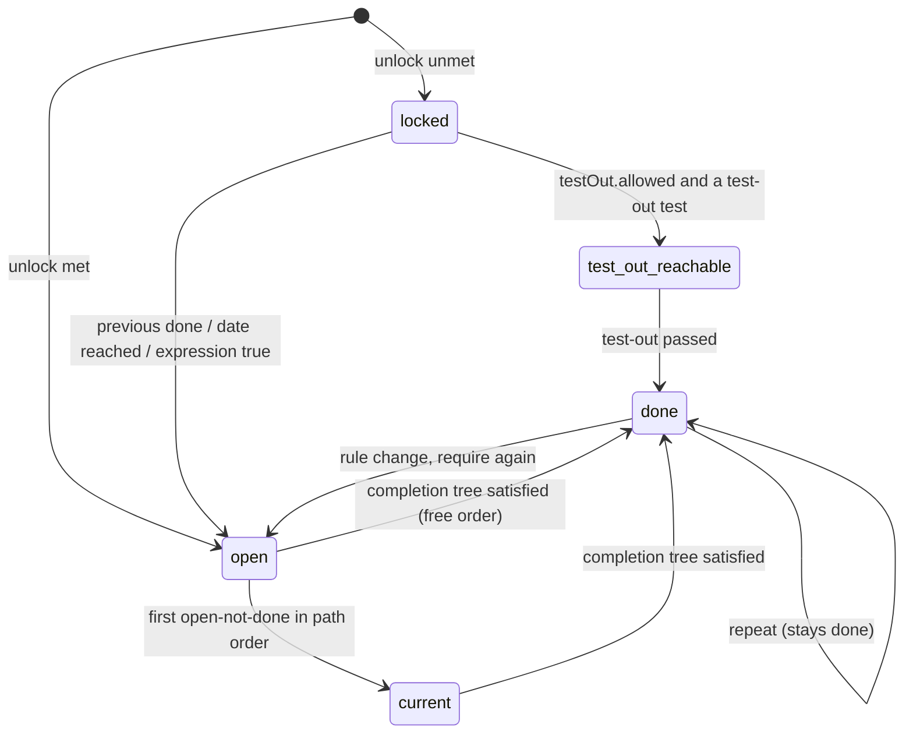

> Requirements: [`024-requirements-en.md`](./024-requirements-en.md) · Scenarios: [`024-scenarios.feature`](./024-scenarios.feature) · PRD: [`024-product.md`](./024-product.md)

# 024 — Design

## 1. Package and host boundary (ADR-0013 §A1)

`packages/learning` (`@ds/learning`) is the one owner of the capability (registry row «Learning path — course page and lesson»):

| Subpath    | Contents                                                                                                                                                                                                                                                  |
| ---------- | --------------------------------------------------------------------------------------------------------------------------------------------------------------------------------------------------------------------------------------------------------- |
| `.`        | Pure model: the element-type catalog (EARS-2), the condition-type catalog (EARS-3), the setting keys and their platform-seed values, the layer resolver (EARS-5), the evaluator (EARS-6, 7, 11, 20, 21), the sentence builder (EARS-17), RU copy. No I/O. |
| `./server` | Nest module consumed by `apps/api`: repositories over `packages/db/src/schema/learning.ts`, the facts intake, the attempt grader, the status projector, the rule-change service, the `PointsEngine` bridge (EARS-12).                                     |
| `./client` | Browser / app transport for `/v1/learning/*` and `/v1/me/learning/*`.                                                                                                                                                                                     |
| `./ui`     | `CoursePath` (the «snake», EARS-14), `StepScreen` with one body per element type (EARS-15, 16, 18–23), the guest gate; built from `@ds/design-system` per the vendored canvases.                                                                          |
| `./admin`  | `LessonComposition`, `RulesEditor`, `RuleChangeDialog` (EARS-28, 29, 31) — `@ds/design-system` primitives only, `AdminDataList` / form compositions of 012.                                                                                               |

Contracts are Zod in `packages/schemas/src/learning/` (ADR-0002); the mobile app reads the same REST API. `apps/doctor` adds `app/courses/[courseSlug]/page.tsx` and `app/courses/[courseSlug]/steps/[stepId]/page.tsx` plus host-config fields; `apps/admin` adds route files under `app/learning/`. `apps/portal` adds nothing (EARS-27). 023 adds the school route, the course header on the same course route and the school, course and module editor screens (`./admin`) over the same package and the same rows.

## 2. Data model



- **Structure** (`doctor`, ADR-0016 §8): `learning_schools (id, direction_id, lead_expert_id, project_id, slug U, title, state, version; U (direction_id, lead_expert_id))`; `learning_courses (id, school_id NOT NULL, project_id, slug U, title, state, version)` — `school_id` NOT NULL from the first migration; `learning_modules (id, course_id, position, title, version)`; `learning_lessons (id, module_id NOT NULL, project_id, position, title, description, teaser, state, version)`; `learning_steps (id, lesson_id, position, type, title, duration_min, payload jsonb, partner_organisation_id NULL, companion bool, version)`. `payload` is validated by the type's Zod schema from the catalog; media and files reference the 012 media contract. 023 adds descriptive columns and its own tables (023 design §2), never the school table or `school_id`.
- **Tests**: `learning_tests (step_id, kind: entry | exit | test-out, scope_item)`, `learning_questions (id, test_id, text, corrective_step_id NULL, corrective_text NULL)`, `learning_options (id, question_id, text, correct)`. A test-out test is attached to the item it reaches (a lesson or a module).
- **Rules** (`admin-only`): `learning_rule_layers (scope_kind: platform | school | course | module | lesson | step, scope_id, values jsonb, applied_preset_id NULL, version)` — one row per scope, `values` a partial map of setting keys validated by `packages/schemas/src/learning/settings.ts`; the platform row holds every key. `learning_presets (id, name U, values jsonb, version)`, seeded by migration with the three presets of EARS-9. `learning_rule_changes (id, scope, before jsonb, after jsonb, earned_progress: keep | require-again, actor, at)` — the record a status reason (EARS-24) and a `completion-kept` fact point to; the 010 audit row is written in the same transaction.
- **Facts** (`doctor`, append-only, ADR-0003 §2.7): `learning_facts (id, event_id U, person_id, kind, step_id NULL, item_ref NULL, data jsonb, source: web | app | system, occurred_at, recorded_at)`; kinds `position`, `opened`, `card-viewed`, `case-ended`, `attempt-submitted { testId, attempt, score, answers }`, `test-out-passed { item }`, `manual-mark { item, by }`, `club-attended { module }` (from the 020 attendance fact), `completion-kept { item, ruleChangeId }`. A `BEFORE UPDATE OR DELETE` trigger raises. Attempts in progress live in `learning_attempts (id, person_id, test_id, question_ids, started_at)` until submitted.
- **Projection**: `learning_node_status (person_id, item_kind, item_id, status, since, cause_kind: fact | rule-change, cause_id)` — rebuildable; used to detect transitions (EARS-11, 12) and to carry the reason of EARS-24. `learning_lesson_ratings (person_id, lesson_id PK, stars, at)` and `learning_feedback (id, person_id, step_id, text, at)`.
- **Erasure**: facts, ratings, feedback and the projection reference `person_id` and follow the platform's personal-data erasure procedure; the evaluator treats an erased person as having no facts.

## 3. Settings and resolution (EARS-5…9)

| Key                                                                                            | Platform seed               | Levels                         |
| ---------------------------------------------------------------------------------------------- | --------------------------- | ------------------------------ |
| `completion` (rule tree)                                                                       | per kind, EARS-6            | lesson, step, module, course   |
| `viewed.video.percent` / `viewed.podcast.percent`                                              | 100 / 90                    | any                            |
| `unlock`                                                                                       | `after-previous`            | module, lesson, step           |
| `order`                                                                                        | `strict`                    | course, module                 |
| `lockedVisibility`                                                                             | `locked`                    | any                            |
| `test.threshold` / `.attempts` / `.pauseMin` / `.questions`                                    | 80 / unlimited / 0 / all    | any                            |
| `test.entryRequired` / `test.entryCounts`                                                      | false / false               | any                            |
| `testOut.allowed` / `testOut.pauseMin`                                                         | false / 0                   | any (D17: per-course override) |
| `repeat.allowed`                                                                               | true                        | any                            |
| `course.deliveryMode` / `course.moduleSize` / `course.closingClub` / `course.clubInCompletion` | `online` / 6 / true / false | course                         |

`resolve(key, item)` walks step → lesson → module → course → school → platform and returns `{ value, level, preset }` from the nearest layer holding `key`. Presets are copies: `ApplyPreset` writes `values` of the target layer with the preset's map merged over the keys it names and sets `applied_preset_id`; the keys the preset does not name and every lower layer stay. A preset edit (platform scope, EARS-29) changes later applications only.

## 4. Evaluator and facts cascade (EARS-10…12)

```mermaid
sequenceDiagram
  participant C as Client (web / app)
  participant I as LearningFactsIntake
  participant V as Evaluator (pure)
  participant P as StatusProjector
  participant E as PointsEngine (025)
  C->>I: POST /v1/me/learning/facts {eventId, stepId, kind, data}
  I->>I: authz (signed in), step openable? (EARS-11, 22)
  alt locked or guest
    I-->>C: 403 LEARNING_STEP_LOCKED / 401
  else
    I->>I: BEGIN; insert learning_facts (event_id U)
    alt duplicate event_id
      I-->>C: duplicate
    else new
      I->>V: evaluate(course, person facts, resolved rules)
      V-->>P: statuses
      P->>P: diff vs learning_node_status; upsert changed rows (cause = fact)
      opt lesson / module first turns done
        P->>E: record(tx, lesson.completed | module.completed {mode})
      end
      I->>I: COMMIT
      P->>E: publishAfterCommit(); publish StepCompleted / TestPassed / CourseCompleted
      I-->>C: recorded + changed nodes
    end
  end
```

- **Event id to 025.** `learning:lesson.completed:<personId>:<lessonId>` (resp. module) — derived from the item, not the fact, so a repeat, a rule change back and forth or a replay from the app is a 025 duplicate (EARS-12, EARS-21). `mode` = `course.deliveryMode` resolved at that instant.
- **Evaluation order.** Facts → step `done` by its completion tree → lesson `done` → module → course; then unlock per item in path order with `order` and `unlock`; `current` = first open-not-done step; `test-out-reachable` = locked item with `testOut.allowed` and a test-out test. A `completion-kept` or `test-out-passed` fact satisfies `done` of its item directly. A `done` lesson under `repeat.allowed` stays `done` (the first-done is in the projection).
- **Cost.** One doctor × one course is evaluated per write and per path read (bounded by the course size); the rule-change impact (§5) evaluates the doctors holding facts in the scope in batches.

## 5. Rule change on a published course (EARS-31)

```mermaid
sequenceDiagram
  participant A as learning_rules_editor
  participant R as RuleChangeService
  participant V as Evaluator
  participant P as StatusProjector
  A->>R: POST /v1/admin/learning/rules/{scope}/preview {values}
  R->>V: for each doctor with facts in scope: evaluate(old) vs evaluate(new)
  R-->>A: {affectedDoctors, toDone, toNotDone}
  A->>R: PUT /v1/admin/learning/rules/{scope} {values, earnedProgress: keep|require-again} (If-Match)
  R->>R: BEGIN; write layer; insert learning_rule_changes; 010 audit row
  opt keep
    R->>R: insert completion-kept fact per (doctor, item) done→not-done
  end
  R->>R: COMMIT
  R->>P: recompute affected doctors in batches (cause = rule change), emit EARS-12 transitions
```

The recompute after commit is idempotent (the projection diff), so an interrupted batch resumes; reads compute live from facts and rules, so a doctor never sees a stale status while it runs. Status reasons (EARS-24) are the projection rows whose cause is the rule change, rendered from `before` / `after` by the sentence builder.

## 6. Node-state lifecycle (EARS-11)



## 7. API

| Method and path                                                                                                                                 | Who                             | Clause        |
| ----------------------------------------------------------------------------------------------------------------------------------------------- | ------------------------------- | ------------- |
| `GET /v1/learning/courses/{courseSlug}/path`                                                                                                    | anyone (states per session)     | EARS-13       |
| `GET /v1/learning/lessons/{lessonId}`                                                                                                           | anyone (no payload)             | EARS-15, 22   |
| `GET /v1/me/learning/steps/{stepId}`                                                                                                            | doctor, openable step           | EARS-15, 16   |
| `POST /v1/me/learning/facts`                                                                                                                    | doctor                          | EARS-10       |
| `POST /v1/me/learning/tests/{testId}/attempts` · `…/{attemptId}/submit`                                                                         | doctor                          | EARS-18, 19   |
| `POST /v1/me/learning/test-outs/{itemRef}`                                                                                                      | doctor                          | EARS-20       |
| `PUT /v1/me/learning/lessons/{lessonId}/rating` · `POST /v1/me/learning/steps/{stepId}/feedback`                                                | doctor                          | EARS-23       |
| `POST /v1/admin/learning/schools` · `…/courses` (takes `schoolId`) · `…/modules` · `…/lessons` · `…/steps`, `PATCH`, `…/publish`, `…/unpublish` | staff                           | EARS-1, 4, 28 |
| `GET` / `PUT /v1/admin/learning/rules/{scopeKind}/{scopeId}` · `POST …/preview` · `POST …/apply-preset`                                         | staff / `learning_rules_editor` | EARS-29–31    |
| `GET` / `PUT /v1/admin/learning/presets/{id}`                                                                                                   | `learning_rules_editor`         | EARS-9, 29    |

Problems are RFC 7807: `LEARNING_STEP_LOCKED` (403), `LEARNING_ATTEMPT_UNAVAILABLE` (409, `nextAt`), `PUBLISH_REQUIREMENTS_NOT_MET` (409, field errors), `PRECONDITION_FAILED` (412). The role `learning_rules_editor` is one more staff role of 047 «Доступы» (049's pattern: TOTP, staff, no implicit hierarchy).

## 8. UI mapping

- **Course path** — `design-source/doctor-course.dc.html` v16: the snake axis with node offsets, module sections, lesson segments, club and document nodes, states (done, «Вы здесь», open, locked, test-out), the «Модули и уроки» outline, loading / empty / error states. `CoursePath` takes the path read only; host-config gives the route builder.
- **Step screen** — `design-source/doctor-lesson.dc.html` v18: header, lesson step strip, one body per type, the completion sentences, the test question / wrong answer + corrective / passed / failed states, the guest gate, the points plate.
- **Admin** — no canvas, no Stage A (lead decision 4, c.6822255430): `build-ui-from-design-system` inventory → whitelist → report recorded in the slice PR.

## 9. 025 contract alignment

024 records only the catalog types 025 already registers (`packages/schemas/src/points/fact-types.ts`): `lesson.completed { mode }` ref `lesson` and `module.completed { mode }` ref `module`. «Element done» and «test passed» stay in-process events (`StepCompleted`, `TestPassed`); registering them as point facts is a 025 catalog change, not a 024 one. A failed attempt and a mistake produce no 025 fact (025 EARS-7).

## 10. Delivery slices

1. **First course path** (thinnest end-to-end): one school (the minimal row of EARS-1), one course in it and one module, created through the admin API, lessons of `video`, `download` and an exit `test` composed on the admin screen, «Путь (Duolingo)» applied on the course, the doctor's path page with computed states and the step screen for those types, facts, evaluator, 025 emission. Every table, the catalogs, the resolver and the presets land here.
2. **Rules editor and live changes** — the full editor, the role, the impact preview, D16, status reasons.
3. **Every step type** — microlearning, podcast companion, clinical case, partner download with the 032 mark, ratings, feedback.
4. **Tests in depth** — attempts, pauses, entry test, corrective material, test-out.
5. **Repeat and the guest gate** — repeat, the guest path, the 021 return target.
6. **Browser journeys and the phone** — CI journeys, 390 px, axe.

## 11. Dependencies

- **017** — doctor shell and the session on `apps/doctor` (slice 1).
- **025** — `PointsEngine.record(tx, fact)` (the overload that records inside the producer's transaction as a savepoint; publication follows that transaction's commit) and the two fact types, on `main` since #3858 and in the release tags from release-2026.11.10-1 (slice 1).
- **023** — the school screen, the course header and the structure editor build on slice 1's school, course and module rows; 023 does not block 024.
- **032** — the organisation registry (slice 3). **021** — the registration return target (slice 5). **047 / 049** — the staff-role grant in «Доступы» (slice 2). **010** — change audit. **012** — media contract, admin list/form compositions, idempotency and `If-Match`.
