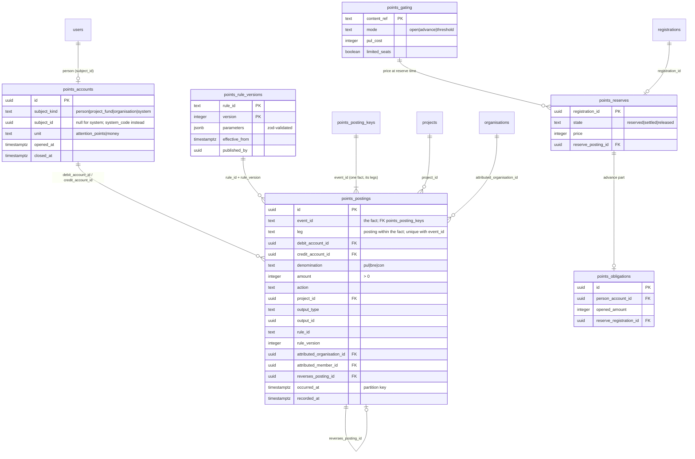
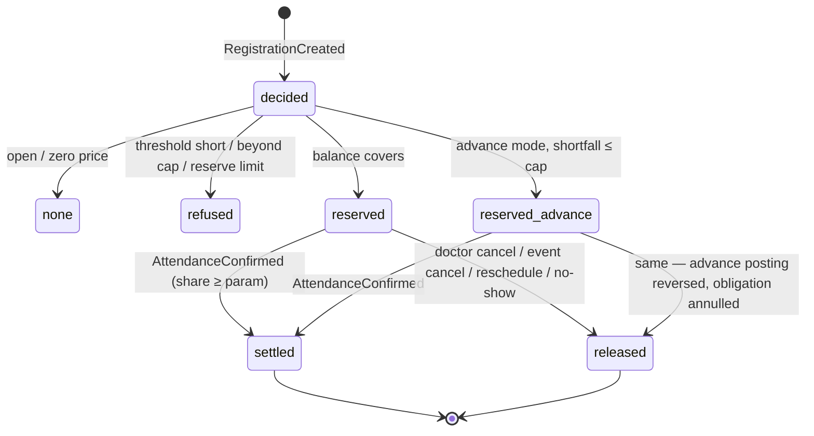

> Requirements: [`025-requirements-en.md`](./025-requirements-en.md) · PRD: [`025-product.md`](./025-product.md) · Scenarios: [`025-scenarios.feature`](./025-scenarios.feature)

# 025 — Design

## 1. Placement

One NestJS module `apps/api/src/points/` owns the ledger, the rule book, the gating decision and the read models; its request/response contracts live in `packages/schemas/src/points/` (the SDK is regenerated into `packages/api-client/`), its tables in `packages/db/src/schema/points-*.ts`. Consumers never import the module's internals: storefronts and the mobile app read over HTTP, and producer features (020, 022, 024, the room) hand facts to the module's in-process fact intake (`PointsFactIntake.accept(fact)`) inside their own transaction boundary, or over the internal endpoint the mobile offline sync replays through. No package outside `apps/api` holds points logic (capability registry row «Attention points engine (025)»).

## 2. Data model



- **Accounts.** Unique (`subject_kind`, `subject_id`, `unit`) for subjects; system accounts are keyed by a `system_code` (`issuance`, `reserve`, `sink`, `advance`) — one per unit. `amount` is a positive integer; direction is the debit/credit pair, so a fold is `Σ credits − Σ debits` per (account, denomination).
- **Event id, leg and dedupe key** (ADR-0016 §6 / design §2.12 as rewritten in this PR). **One domain fact = one `event_id`**: the producer's event id, or a derived fact id for the engine's own facts (`reserve:<registration>`, `settle:<registration>`, `release:<registration>`). A fact may write several postings — a module award in three denominations, a reserve plus an advance, a release reversing both, an accrual plus its obligation settlement — so a posting is unique on (`event_id`, `leg`), where the `leg` names the posting within the fact (denomination + entry kind: `accrual:pul`, `accrual:bre`, `reserve:balance`, `reserve:advance`, `settle:pul`, `release:balance`, `obligation-settle:pul`, …). Postgres requires the partition key in every unique constraint of a partitioned table, which is why `audit_ledger` scopes its `event_id` uniqueness to `(event_id, created_at)` — dedup within one monthly partition, acceptable for an audit trail. For points that is **not** acceptable: a lesson completed in March and replayed by an offline sync in April must still be a duplicate (EARS-4). So global dedupe lives in the non-partitioned **`points_posting_keys (event_id PK, dedupe_key UNIQUE NULLS DISTINCT, occurred_month)`** — **one row per fact**, the dedupe key being the PRD key `<personId>:<contentRef>:<action>` for an accrual fact and null for a spend fact (whose `event_id` alone is its key) — inserted in the same transaction **before** the fact's postings, so the key is known before the rule is evaluated. The postings of one fact share its `occurred_at` and therefore one partition, so the partition-local unique index on (`event_id`, `leg`, `occurred_at`) is effectively (`event_id`, `leg`). This is how the points ledger satisfies ADR-0003 §3; it is the one deliberate departure from the `audit_ledger` template.
- **Derived state tables** (`points_reserves`, `points_obligations`) are projections rebuilt from postings; they hold no amount the postings do not already prove and carry the `audit_row_change()` trigger like `registration_attendance`. A cached balance, if ever needed, is the same kind of rebuildable projection.

## 3. Immutability and partitions

Mirrors `audit_ledger` (`packages/db/src/schema/audit-ledger.ts`, migration `0003_audit_ledger_partitioning.sql`): `points_postings` is `PARTITION BY RANGE (occurred_at)` with monthly partitions `points_postings_yYYYY_mMM` plus a `DEFAULT` safety-net partition; a `BEFORE UPDATE OR DELETE` trigger raises for every row (EARS-27); `rule_id` / `rule_version` are `NOT NULL` and a `CHECK` requires `amount > 0`. The migration is hand-written SQL beside the drizzle schema, as for `audit_ledger`.

## 4. Accrual cascade (EARS-3, 4, 20)

```mermaid
sequenceDiagram
  participant P as Producer (024 / 022 / 020)
  participant I as PointsFactIntake
  participant R as RuleBook
  participant L as Ledger (tx)
  participant B as Event bus
  P->>I: fact {eventId, personId, action, contentRef, occurredAt}
  I->>L: BEGIN; lock person account (SELECT … FOR UPDATE)
  I->>L: insert points_posting_keys(eventId, dedupeKey)
  alt unique violation
    L-->>I: conflict → ROLLBACK
    I-->>P: duplicate (original postings)
  else new
    I->>R: activeVersion(action, occurredAt)
    R-->>I: {ruleId, version, amounts per denomination}
    I->>L: insert postings issuance→person, one leg per non-zero denomination (eventId, leg accrual:<denomination>)
    opt open obligation and Pul > 0
      I->>L: insert leg obligation-settle:pul person→advance (min(pul, remaining))
    end
    I->>L: COMMIT
    I->>B: PointsCredited (+ AdvanceSettled)
    I-->>P: credited
  end
```

The account row lock serialises every posting of one person (EARS-22); concurrent first facts race on the account's unique constraint and the loser re-reads (EARS-1). The mobile offline sync replays its queued facts through the same intake; its pending entries become `credited` or `duplicate` from the intake's answer (EARS-4).

## 5. Reserve lifecycle (EARS-14–21)



- **Postings per transition** (each transition is one fact with its own `event_id`, its postings told apart by `leg`). reserve (`reserve:<registration>`): leg `reserve:balance` person→reserve and leg `reserve:advance` advance→reserve (shortfall, opening the obligation); settle (`settle:<registration>`): leg `settle:pul` reserve→sink (full price); release (`release:<registration>`): one reversal leg per reserve-side posting.
- **No-show.** A scheduled sweep after `EventEnded` + the no-show window [24 h, rule-book parameter `noShow.window`, EARS-18] releases every still-`reserved` registration of that event with reason `no-show`; the sweep is idempotent through the derived `release:<registration>` event id. A late `AttendanceConfirmed` for a released registration finds the `release:` key row, writes no `settle:` fact and accrues only the participation award (EARS-18).
- **After settle**, the obligation stays open and is netted by later Pul accruals (§4); it is never a negative balance — the read model reports `advance.remaining`, and `pul.available` is the fold of the person account, which no posting takes below zero.
- **Gating decision** (EARS-13) is a pure function `decide(gating, balance, openObligations, ruleVersion)` in `packages/schemas/src/points/gating.ts` — `shortfall = price − available`, `pulToEarn = shortfall + Σ remaining obligations` (EARS-20 nets new Pul to obligations first), `lessonsNeeded = ceil(pulToEarn / lesson award)` — shared by the read endpoint and the reserve command so the advertised decision and the enforced one cannot diverge. It never takes an attribution argument (EARS-15 invariant).

## 6. Rule book (EARS-25, 26)

Each `rule_id` has a zod parameter schema in `packages/schemas/src/points/rules.ts` — `accrual.<action>` (amount per denomination, non-negative), `cap.engagement`, `cap.referral.monthly`, `presence.share`, `advance.cap`, `reserve.limitedSeats.max`, `noShow.window`, `leaderboard.{conWeight, breWeight, top, neighbours}`. The seed migration inserts version 1 of every rule with the PRD defaults. `activeVersion(ruleId, at)` = the highest version with `effective_from ≤ at`. The action set is a closed enum; the schema has no field that could take an arrival source, a sponsor or a sales input. Gating rows live in `points_gating`; until an admin sets a row, an event is `open` with price 0, which is today's `eventEconomyFacts()` behaviour and its `DEBT.md` line closes once 020 reads `GatingDecision`.

## 7. Leaderboard read model (EARS-23, 24)

A SQL view over postings of the month (credits to person accounts in `bre` / `con`, minus reversals in the month), joined to `doctor_specialties` and to the active `leaderboard-dissemination` records in `consent_records` (ADR-0009), ranked with `RANK()` over the consenting set only. A non-consenting requester's own position is computed as `1 + count(consenting scores > own score)` and returned only to them. The view reads consent at query time, so a revocation takes effect on the next response with no cache to invalidate; if a materialised refresh is ever introduced, consent filtering stays at read time.

## 8. Admin API and audit (EARS-25, 26, 28)

`/v1/admin/points/*` sits behind the admin role guard (ADR-0001). Each write runs through the request audit context so `audit_ledger` records the actor `sub`, source `admin-ui` / `api`, and the payload (rule version, gating row, correction with its reason and posting ids). The admin UI is a follow-up Issue; the API is complete without it.

## 9. Erasure (EARS-31)

`CloseAccount` sets `closed_at` on the person account; the intake refuses a fact for a closed account with `points-account-closed`. Open reserves are left to the ordinary release path of their events; the anonymised re-pointing of the subject is the ADR-0009 erasure procedure's, not 025's.
