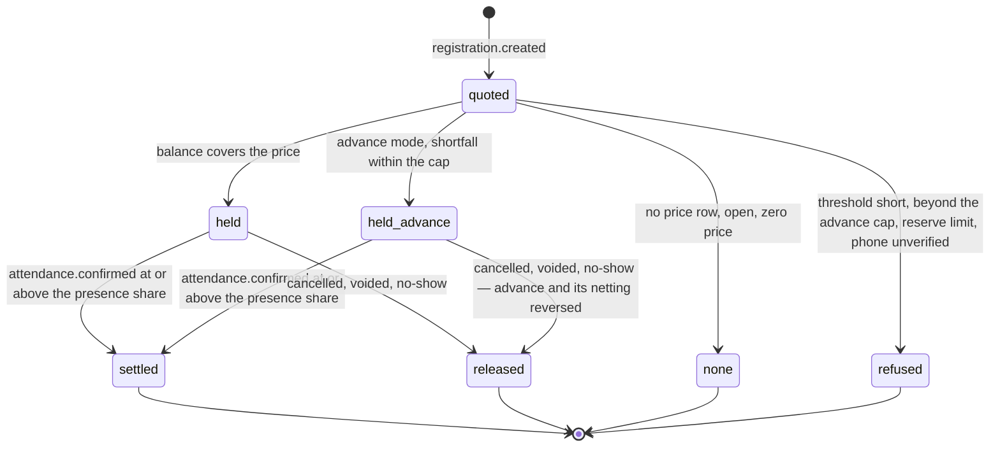
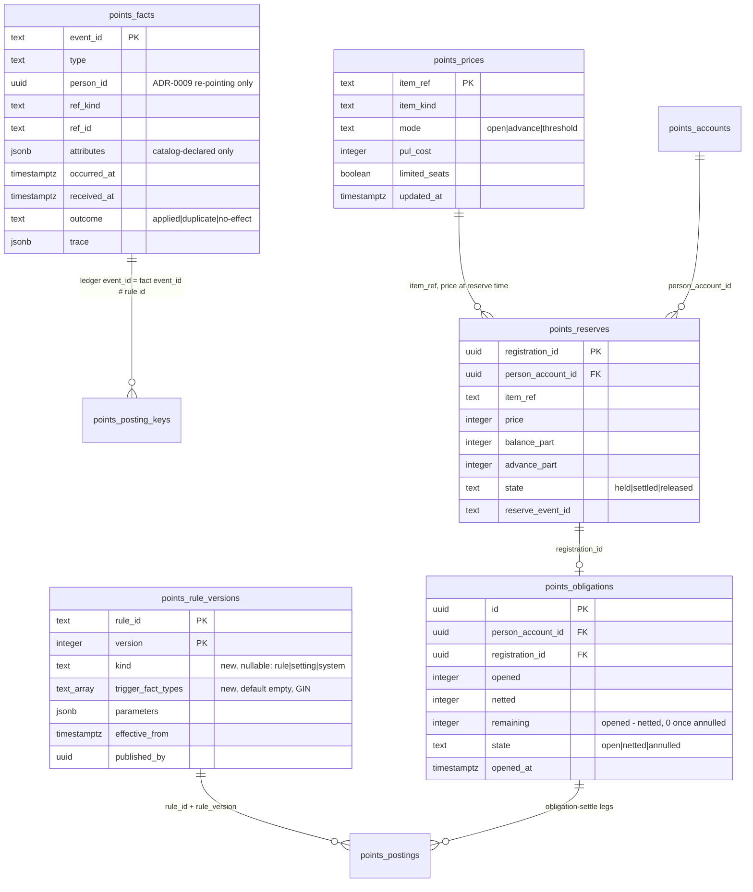
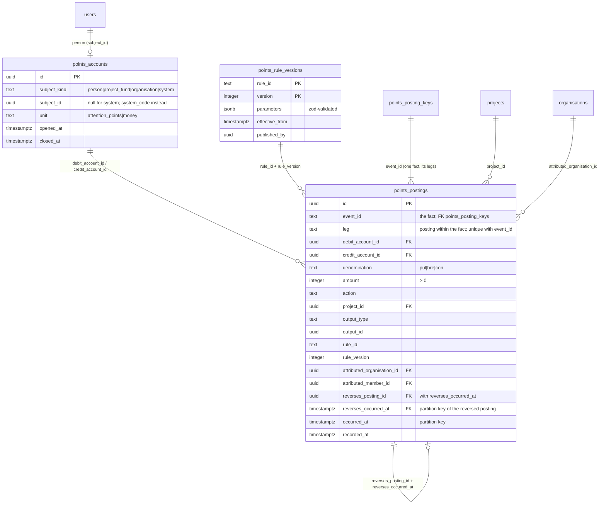

> Requirements: [`025-requirements-en.md`](./025-requirements-en.md) · PRD: [`025-product.md`](./025-product.md) · Scenarios: [`025-scenarios.feature`](./025-scenarios.feature)

# 025 — Design

## Production amendment — one universal rule engine (2026-11-09, #3835)

The ledger core (migration 0058) and the rule book with its accrual intake (migration 0059) run in production since release-2026.11.07-1 with no producer calling the intake. This amendment overrides §4 (the accrual cascade becomes the `record` evaluation of D), §6 (the per-id parameter schemas and the closed action set become the one rule schema of B and the clause map of G), the producer entry point named in §1 (`PointsFactIntake.acceptWithin/accept` becomes `PointsEngine.record/quote`, A) and the «Event id, leg and dedupe key» paragraph of §2 (derived `reserve:/settle:/release:<registration>` fact ids, the `obligation-settle:pul` leg and one `points_posting_keys` row per fact keyed `<personId>:<contentRef>:<action>` become the `<fact>#<rule>` ledger facts with one key row per applied rule of D and the `obligation-settle:<obligationId>` legs of E). The rest of §1 and §2 (shipped with 0058/0059), §3, §7, §8 and §9 stand; §5 — never shipped — is rewritten inline to point here. Requirements: production amendment of `025-requirements-en.md` (amended EARS-3, EARS-4, EARS-25; added EARS-32…46).

### A. Layers

| Layer                       | Lives in                                                   | Changed by                                                     |
| --------------------------- | ---------------------------------------------------------- | -------------------------------------------------------------- |
| Fact-type catalog           | `packages/schemas/src/points/facts.ts`                     | a developer (code; unit test + lint over forbidden attributes) |
| Predicate registry          | `apps/api/src/points/predicates/` (types in `schemas`)     | a developer                                                    |
| Effect and limit kinds      | `apps/api/src/points/engine/` (closed unions in `schemas`) | a developer                                                    |
| Rules and settings          | `points_rule_versions` rows                                | an admin (`POST /v1/admin/points/rules/:ruleId/versions`)      |
| Price list                  | `points_prices` rows                                       | an admin (`PUT /v1/admin/points/prices/:itemRef`)              |
| Ledger core and projections | `apps/api/src/points/ledger/`, `points_*` tables           | nobody at run time — invariants (§3, EARS-12, 20, 22, 27)      |

The engine stays the one module `apps/api/src/points/` on the platform database. `PointsFactIntake` is replaced by `PointsEngine` with `record(tx, fact)`, `record(fact)` and `quote(personId, draftFact)`; the after-commit contract of §4 («Event publication») is unchanged — `record(tx, fact)` returns `publishAfterCommit`.

### B. Rule schema

One discriminated union in `packages/schemas/src/points/rules.ts`, stored in `points_rule_versions.parameters`; `kind` is also a column (F) so a reader never parses the body to tell a rule from a setting.

```jsonc
// kind: "rule"
{
  "kind": "rule",
  "label": "Lesson award, Pul part, online", // admin-facing text
  "trigger": ["lesson.completed"], // ≥1 registered fact type (EARS-32)
  "condition": { "eq": [{ "attr": "mode" }, "online"] }, // C; absent = true
  "effect": {
    // exactly one (EARS-35)
    "kind": "credit", // credit | debit | reserve | settle | release
    "beneficiary": "subject", // credit: "subject" | { "pred": "person.referrer" }
    "amounts": { "pul": 10, "bre": 0, "con": 0 }, // credit: per denomination; debit: { "pul": n } | "price"
    // reserve: { "allowAdvance": true } — price and mode read from points_prices
  },
  "limits": [{ "oncePer": ["subject", "ref"], "key": "lesson.pul" }], // ≥1, or [{ "unlimited": true }]
  // { "countPer": { "scope": ["beneficiary"], "period": "month", "n": 5 | { "setting": "…" } } }
  // { "concurrentOpen": { "n": { "setting": "setting.reserve.limitedSeats.max" }, "filter": { "limitedSeats": true } } }
  "validFrom": null,
  "validUntil": null, // EARS-37, ISO instants or null
  "active": true,
  "stacking": { "priority": 0, "exclusiveGroup": null }, // EARS-38
}
// kind: "setting" — the body is that setting's own strict schema, e.g. { "kind": "setting", "value": 30 }
// kind: "system" — manual-correction only; no body fields
```

Publish-time validation (amended EARS-25) runs in this order and stops at the first failing field path: shape → trigger types registered → condition type-check (C) against every trigger type → effect legality (denominations, `debit`/`reserve`/`settle`/`release` Pul-only, no Pul credit on a type the catalog marks `earnsPul: false`) → limit scope fields present on every trigger type, a credit with ≥1 limit or `unlimited` → amounts ≤ `setting.effect.maxAmount` → `kind` equal to the id's earlier versions → the stacking check (warning only). `effectiveFrom` stays a column, as in 0059.

### C. Condition grammar

```text
Cond    := { "all": Cond[] } | { "any": Cond[] } | { "not": Cond }
         | { Cmp: [Operand, Operand] }              Cmp := eq | ne | gt | gte | lt | lte
         | { "in": [Operand, Literal[]] }
Operand := { "attr": Name }                          a declared attribute of the trigger type
         | { "pred": Name, "args"?: { Name: Operand } }  a registered predicate
         | { "setting": SettingId }
         | Literal                                   string | integer | boolean | null
```

Language constants (not settings): depth ≤ 8, ≤ 64 nodes, `in` lists ≤ 100 literals. Types are `string`, `integer`, `boolean`, `instant` and nullable variants; `gt`…`lte` take integers or instants, `eq`/`ne`/`in` take equal types. A predicate declares its argument and result types and its subject (`person` of the fact, `item` of the ref); it runs inside the evaluation transaction after the locks of D, reads only, and is memoised per evaluation. **Timing:** a predicate evaluated for a fact sees the state **including that fact** — a journal-reading predicate counts the fact under evaluation as if it were already journaled (its journal row is inserted at the end of D), so the invitee's first `lesson.completed` counts itself in `person.completedLessons` (distinct `ref`s of the person's `lesson.completed` facts) and EARS-11 fires on that fact; account and projection reads see the state before this fact's own effects, because every condition is evaluated before any effect is applied. Seeded predicates: `person.registered`, `person.phoneVerified`, `person.completedLessons` (integer), `person.referrer` (person id or null), `item.price`, `item.mode`, `item.limitedSeats`.

### D. `record` evaluation

```mermaid
sequenceDiagram
  participant P as Producer
  participant E as PointsEngine
  participant J as points_facts
  participant R as Rule versions
  participant L as Ledger core
  participant B as PointsEventsPublisher
  P->>E: record(tx, fact) — type, eventId, personId, ref, occurredAt, attributes
  E->>E: validate against the catalog entry (throws, nothing written)
  E->>L: SAVEPOINT in the producer's tx (record(fact): BEGIN)
  E->>J: lookup eventId
  alt already journaled
    J-->>E: original outcome
    E-->>P: duplicate (original applications)
  else new
    E->>R: rules whose active version at occurredAt triggers on type
    R-->>E: candidate versions (GIN on trigger_fact_types)
    E->>L: lock person accounts of subject and beneficiaries, ascending account id
    E->>E: per candidate — validity, active, condition, limits (trace)
    E->>E: resolve exclusive groups (trace superseded)
    E->>L: apply debit, reserve, settle, release, then credit — each as ledger fact eventId#ruleId
    alt a debit-side effect refuses
      L-->>E: problem (insufficient Pul / threshold short / reserve limit / phone unverified)
      E->>L: ROLLBACK TO SAVEPOINT
      E-->>P: throw problem, nothing written
    else applied or no-effect
      L->>L: posting_keys row and postings per ledger fact; EARS-20 netting after each Pul credit; projections
      E->>J: insert journal row with outcome and trace
      E-->>P: outcome, applied, publishAfterCommit
      P->>B: publishAfterCommit() after the producer's COMMIT
    end
  end
```

- **Duplicate detection** is the journal's unique `event_id` (amended EARS-4, first sentence); a race between two equal event ids ends on that constraint, the loser answers `duplicate`. The **limit dedupe** is `points_posting_keys.dedupe_key = <limit key>:<scope values>` (unique), inserted per application before its postings; a unique violation under the per-application savepoint becomes `limit-reached`, never an error.
- **Locks.** The subject's account and every beneficiary a predicate names are locked `FOR UPDATE` in ascending account id before any limit is read, so `countPer`, `concurrentOpen` and the available-Pul check read a stable state and two facts touching the same two people cannot deadlock. A missing account is opened first (EARS-1 race unchanged).
- **countPer** counts distinct ledger `event_id`s on postings with that `rule_id` crediting the beneficiary in the Europe/Moscow calendar period of `occurredAt` (index in F).
- **Trace** (EARS-40): `{ ruleId, version, trigger: true, valid, active, condition, limits: [{ kind, verdict }], stacking, ledgerEventId? }[]`, verdicts `applied` · `not-valid` · `inactive` · `condition-false` · `limit-reached` · `superseded` · `no-open-hold`.
- **No cache.** The candidate query is index-backed per fact; a published version is visible to the next fact, so no invalidation exists to get wrong.
- **quote** runs the same functions in a `READ ONLY` transaction with no locks and no inserts; limits are evaluated by reading the same keys and counts. `GET /v1/me/points/gating/:itemRef` is `quote` of a draft `registration.created` (EARS-13); `lessonsNeeded` reads the Pul credit of the active `accrual.lesson` version.

### E. Hold lifecycle



| Transition (ledger fact)         | Legs                                                                                                                                                                     | Projection                                                                                                      |
| -------------------------------- | ------------------------------------------------------------------------------------------------------------------------------------------------------------------------ | --------------------------------------------------------------------------------------------------------------- |
| reserve (`<fact>#spend.reserve`) | `reserve:balance` person→reserve (available part, omitted when 0) · `reserve:advance` advance→reserve (shortfall)                                                        | `points_reserves` row `held`, `balance_part`, `advance_part`; `points_obligations` row opened at `advance_part` |
| settle (`<fact>#spend.settle`)   | `settle:pul` reserve→sink, the full price                                                                                                                                | reserve `settled`; the obligation stays open and nets (EARS-20)                                                 |
| release (`<fact>#spend.release`) | one `reverse:<postingId>` leg per reserve-side posting and per `obligation-settle:<obligationId>` leg of this registration's obligation, each with `reverses_posting_id` | reserve `released`; obligation `annulled`, `remaining` 0                                                        |
| Pul credit (`<fact>#<rule>`)     | `accrual:pul` issuance→person, then `obligation-settle:<obligationId>` person→advance per open obligation, oldest `opened_at` first, `min(left, remaining)`              | each obligation's `netted` grows, `remaining` falls; `netted` when 0                                            |

- **Projections.** The diagram's `held_advance` is a `held` row with `advance_part > 0`. `pul.reserved` = Σ `balance_part` of `held` rows; `advance.remaining` = Σ `remaining` of open obligations; `pul.available` stays the fold of the person account (§2). A reserve wholly from the advance writes no person-account posting, so `reserved` cannot be folded from the person account alone — that is why the projections exist. Both are written in the transaction of their postings, carry `audit_row_change()`, and are rebuildable: the ledger `event_id` names the journal row whose `attributes.registrationId` and person identify the hold.
- **Release of a partly netted obligation.** Reversing that obligation's own `obligation-settle` legs returns its netted Pul to the person, and reversing `reserve:advance` closes the advance side; other obligations' legs are untouched, so their `remaining` stays true and the person ends as if the registration had never been made (EARS-35, EARS-18).
- **No-show sweep.** A scheduled job, after each item end + `setting.noShow.window`, records `registration.no-show` with event id `no-show:<registrationId>` for every still-held registration; a re-run answers `duplicate`. A late `attendance.confirmed` meets no open hold (`no-open-hold`) and still credits participation.

### F. Data model delta



- `points_facts` is not partitioned: its `event_id` must be globally unique (the reason `points_posting_keys` is not partitioned, §2). A `BEFORE UPDATE OR DELETE` trigger raises except an UPDATE that changes only `person_id` under the erasure procedure's session flag — the same carve-out as postings. Index (`person_id`, `received_at DESC`) serves EARS-45.
- `points_rule_versions` gains `kind` (nullable, so the 0059 rows stay untouched; every new row sets it) and `trigger_fact_types text[] NOT NULL DEFAULT '{}'` with a GIN index. `ALTER TABLE … ADD COLUMN` with a constant default is a catalog change that fires no row trigger, so the immutability trigger of 0059 is not bypassed or edited.
- `points_postings` gains the index (`rule_id`, `credit_account_id`, `occurred_at`) for `countPer`. `points_posting_keys` keeps its shape; only the content of `dedupe_key` changes.
- `points_prices`, `points_reserves`, `points_obligations` carry `audit_row_change()`; a price-list write also goes through the request audit context (§8).

### G. Clause map

No EARS number moves; Issues #3809–#3816 keep their references.

| Clause         | Rule or mechanism                                                                                                                                                                                                                       |
| -------------- | --------------------------------------------------------------------------------------------------------------------------------------------------------------------------------------------------------------------------------------- |
| EARS-3, 4      | D (evaluation, journal and limit dedupe)                                                                                                                                                                                                |
| EARS-5         | `accrual.registration` on `account.registered`, `phone.verified`; key `welcome`; phone check in debit-side effects                                                                                                                      |
| EARS-6         | `accrual.profile`                                                                                                                                                                                                                       |
| EARS-7, 8      | `accrual.lesson` (online, Pul, key `lesson.pul`) + `accrual.lesson.any-mode` (Bre, key `lesson`); `accrual.module` (online, Pul, key `module.pul`) + `accrual.module.any-mode` (Bre and Con, key `module`) — the mode-order table below |
| EARS-9         | `accrual.participation`, condition `presenceSharePercent ≥ setting.presence.share`                                                                                                                                                      |
| EARS-10        | `accrual.question`, `accrual.rating`, `accrual.interactive`, `oncePer(subject, ref)`                                                                                                                                                    |
| EARS-11        | `accrual.referral-inviter` (beneficiary `person.referrer`, `countPer` month 5), `accrual.referral-invitee`                                                                                                                              |
| EARS-13        | `quote` (D)                                                                                                                                                                                                                             |
| EARS-14…17, 21 | `spend.reserve` with `allowAdvance`, `setting.advance.cap`, `concurrentOpen` (E)                                                                                                                                                        |
| EARS-18        | `spend.release` on cancelled / voided / no-show (E)                                                                                                                                                                                     |
| EARS-19        | `spend.settle`                                                                                                                                                                                                                          |
| EARS-20        | ledger-core netting step, not a rule (E)                                                                                                                                                                                                |
| EARS-26        | `points_prices` + `spend.debit` on `item.access-requested`                                                                                                                                                                              |
| EARS-43        | `accrual.starter-bonus` (key `welcome`) + J                                                                                                                                                                                             |

Mode order of one lesson (EARS-7; a module behaves the same under `module.pul` / `module`). The Pul part and the Bre part carry separate `oncePer(subject, ref)` keys, so Bre is credited once whatever the mode and the Pul is credited once on the first online completion — the lead's default, an open question for the Product Lead (requirements, Open questions):

| Completions of lesson L, in order | `accrual.lesson` (key `lesson.pul`)      | `accrual.lesson.any-mode` (key `lesson`) | Doctor ends with | Second answer |
| --------------------------------- | ---------------------------------------- | ---------------------------------------- | ---------------- | ------------- |
| online                            | applied, +10 Pul                         | applied, +1 Bre                          | 10 Pul, 1 Bre    | —             |
| online, then online again         | applied; then `limit-reached`            | applied; then `limit-reached`            | 10 Pul, 1 Bre    | `duplicate`   |
| offline, then online              | `condition-false`; then applied, +10 Pul | applied, +1 Bre; then `limit-reached`    | 10 Pul, 1 Bre    | `applied`     |
| online, then offline              | applied; then `condition-false`          | applied; then `limit-reached`            | 10 Pul, 1 Bre    | `duplicate`   |
| offline only                      | `condition-false`                        | applied, +1 Bre                          | 0 Pul, 1 Bre     | —             |

Fate of the 21 rows 0059 seeded (all stay as stored):

| 0059 rule id                                                                                                                                                 | Fate                                                                                                                      |
| ------------------------------------------------------------------------------------------------------------------------------------------------------------ | ------------------------------------------------------------------------------------------------------------------------- |
| `accrual.registration`, `.profile`, `.lesson`, `.module`, `.participation`, `.question`, `.rating`, `.interactive`, `.referral-inviter`, `.referral-invitee` | version 2 at the epoch in the rule schema, same PRD amounts; v1 never selected again (empty trigger)                      |
| `cap.engagement`                                                                                                                                             | retired — `oncePer(subject, ref)` of each engagement rule                                                                 |
| `cap.referral.monthly`                                                                                                                                       | retired — `countPer` literal 5 inside `accrual.referral-inviter`                                                          |
| `presence.share`, `advance.cap`, `reserve.limitedSeats.max`, `noShow.window`                                                                                 | retired — `setting.presence.share`, `setting.advance.cap`, `setting.reserve.limitedSeats.max`, `setting.noShow.window` v1 |
| `leaderboard.conWeight`, `.breWeight`, `.top`, `.neighbours`                                                                                                 | retired — `setting.leaderboard.*` v1                                                                                      |
| `manual-correction`                                                                                                                                          | unchanged (`kind: system`, EARS-28)                                                                                       |

`accrual.lesson` and `accrual.module` version 2 carry only the Pul part of their PRD award (online `mode`); the Bre and Con part moves to the `any-mode` rules, so an online completion still totals the PRD award.

New at the epoch: `accrual.lesson.any-mode`, `accrual.module.any-mode`, `accrual.starter-bonus`, `spend.reserve`, `spend.settle`, `spend.release`, `spend.debit`, the eight `setting.*` above and `setting.effect.maxAmount` [500]. Publishing to a retired id answers `points-rule-retired` (422).

### H. Migration path

One new hand-written migration after 0059, forward-only like 0058/0059:

1. A guard `DO` block raises — applying nothing — when `points_postings` has any row or `points_rule_versions` any `version > 1` (EARS-44).
2. `ALTER TABLE points_rule_versions` adds `kind`, `trigger_fact_types` and the GIN index; creates `points_facts`, `points_prices`, `points_reserves`, `points_obligations` with their triggers; adds the postings index.
3. Inserts the rows of G with `effective_from` at the epoch and `published_by` null.

The implementation PR declares `Release-requires:` an Issue for a read-only prod pre-check of the guard's two counts before the release that carries the migration. The live `/v1/admin/points/rules/:ruleId/versions` route keeps its path; its body schema becomes B.

### I. Problem codes

| Code                                                                         | Status | Raised by                                                 |
| ---------------------------------------------------------------------------- | ------ | --------------------------------------------------------- |
| `points-insufficient-pul`                                                    | 422    | ledger core (EARS-22)                                     |
| `points-threshold-short`                                                     | 422    | `reserve` (EARS-17), body carries `shortfall`, `earnHint` |
| `points-reserve-limit`                                                       | 422    | `concurrentOpen` on `reserve` (EARS-21)                   |
| `points-phone-unverified`                                                    | 422    | `debit` / `reserve` (EARS-5)                              |
| `points-rule-parameters-invalid`                                             | 422    | publish (amended EARS-25), body carries the field path    |
| `points-rule-effective-from-past`                                            | 422    | publish                                                   |
| `points-rule-retired`                                                        | 422    | publish to a retired 0059 id (G)                          |
| `points-gating-invalid`                                                      | 422    | price list (EARS-26)                                      |
| `points-starter-bonus-no-rule`                                               | 422    | starter-bonus grant (EARS-43)                             |
| `points-account-closed`, `points-bre-con-debit`, `points-occurred-at-future` | 422    | ledger core, unchanged (§3, §4)                           |

`points-rule-unknown` (live in 0059's publish route) disappears: any new slug is accepted.

### J. Starter-bonus grant

`POST /v1/admin/points/starter-bonus { registeredBefore, reason }` (admin role):

1. Refuse with `points-starter-bonus-no-rule` unless an active version triggers on `person.starter-bonus-eligible`; refuse `registeredBefore` after now (`points-rule-parameters-invalid`).
2. Allocate a run id; write the opening `audit_ledger` record (run id, admin `sub`, reason, `registeredBefore`).
3. Walk doctors with `created_at < registeredBefore` in keyset batches of 500 by user id; skip a closed points account (counted `skipped`); for each doctor call `record(fact)` in its own transaction with `type: person.starter-bonus-eligible`, `eventId: starter-bonus:<personId>`, `attributes: { runId }`.
4. Write the closing `audit_ledger` record with the counts; answer them.

A run cut short by a timeout or a deploy is resumed by running it again: every already-granted doctor answers `duplicate` on the journal. The shared limit key `welcome` makes the bonus and the registration grant mutually exclusive whichever comes first, and publishing `accrual.starter-bonus` never starts a run (EARS-42).

## 1. Placement

One NestJS module `apps/api/src/points/` owns the ledger, the rule book, the gating decision and the read models; its request/response contracts live in `packages/schemas/src/points/` (the SDK is regenerated into `packages/api-client/`), its tables in `packages/db/src/schema/points-*.ts`. Consumers never import the module's internals: storefronts and the mobile app read over HTTP, and producer features (020, 022, 024, the room) hand facts to the module's in-process fact intake inside their own transaction boundary (`PointsFactIntake.acceptWithin(tx, fact)`, which returns the outcome with a `publishAfterCommit` the producer calls after its COMMIT; `accept(fact)` when the fact is the producer's whole write and the intake owns the transaction; _overridden by the production amendment: producers call `PointsEngine.record(tx, fact)` / `record(fact)` and `quote(personId, draftFact)`, A, with the same after-commit contract_), or over the internal endpoint the mobile offline sync replays through. No package outside `apps/api` holds points logic (capability registry row «Attention points engine (025)»).

## 2. Data model



- **Accounts.** Unique (`subject_kind`, `subject_id`, `unit`) for subjects; system accounts are keyed by a `system_code` (`issuance`, `reserve`, `sink`, `advance`) — one per unit. `amount` is a positive integer; direction is the debit/credit pair, so a fold is `Σ credits − Σ debits` per (account, denomination).
- **Event id, leg and dedupe key** (ADR-0016 §6 / design §2.12 as rewritten in this PR). **One domain fact = one `event_id`**: the producer's event id, or a derived fact id for the engine's own facts (`reserve:<registration>`, `settle:<registration>`, `release:<registration>`). A fact may write several postings — a module award in three denominations, a reserve plus an advance, a release reversing both, an accrual plus its obligation settlement — so a posting is unique on (`event_id`, `leg`), where the `leg` names the posting within the fact (denomination + entry kind: `accrual:pul`, `accrual:bre`, `reserve:balance`, `reserve:advance`, `settle:pul`, `release:balance`, `obligation-settle:pul`, …). Postgres requires the partition key in every unique constraint of a partitioned table, which is why `audit_ledger` scopes its `event_id` uniqueness to `(event_id, created_at)` — dedup within one monthly partition, acceptable for an audit trail. For points that is **not** acceptable: a lesson completed in March and replayed by an offline sync in April must still be a duplicate (EARS-4). So global dedupe lives in the non-partitioned **`points_posting_keys (event_id PK, dedupe_key UNIQUE NULLS DISTINCT, occurred_month)`** — **one row per fact**, the dedupe key being the PRD key `<personId>:<contentRef>:<action>` for an accrual fact and null for a spend fact (whose `event_id` alone is its key) — inserted in the same transaction **before** the fact's postings, so the key is known before the rule is evaluated. The postings of one fact share its `occurred_at` and therefore one partition, so the partition-local unique index on (`event_id`, `leg`, `occurred_at`) is effectively (`event_id`, `leg`). This is how the points ledger satisfies ADR-0003 §3; it is the one deliberate departure from the `audit_ledger` template. _(Overridden by the production amendment, D and E: a ledger fact is one applied rule, `event_id = <fact event id>#<rule id>`, so a journal fact has 0…n `points_posting_keys` rows — one per applied rule, its dedupe key the rule's limit key `<limit key>:<oncePer scope values>`; the engine's hold transitions are the ledger facts `<fact>#spend.reserve` / `#spend.settle` / `#spend.release`, and netting writes `obligation-settle:<obligationId>` legs, not `obligation-settle:pul`. The table shapes, the (`event_id`, `leg`) uniqueness and the non-partitioned global dedupe stand.)_
- **Reversal reference.** A reversing posting names the posting it reverses by its full key (`reverses_posting_id`, `reverses_occurred_at`) — a two-column foreign key into `points_postings` (`id`, `occurred_at`). Postgres requires the partition key in every unique key of a partitioned table, so the primary key is (`id`, `occurred_at`) and a foreign key into it must carry both columns; a `CHECK` keeps the pair all-null or all-set.
- **Engine tables** — the fact journal, the price list, the hold and obligation projections and the new rule-version columns — are in the production amendment, F. The projections hold no amount the postings and the journal do not already prove and carry the `audit_row_change()` trigger like `registration_attendance`. A cached balance, if ever needed, is the same kind of rebuildable projection.

## 3. Immutability and partitions

Mirrors `audit_ledger` (`packages/db/src/schema/audit-ledger.ts`, migration `0003_audit_ledger_partitioning.sql`): `points_postings` is `PARTITION BY RANGE (occurred_at)` with monthly partitions `points_postings_yYYYY_mMM` plus a `DEFAULT` safety-net partition; a `BEFORE UPDATE OR DELETE` trigger raises for every row (EARS-27); `rule_id` / `rule_version` are `NOT NULL` and a `CHECK` requires `amount > 0`. A posting dated beyond the clock skew would sit in the `DEFAULT` partition and later block the creation of its month's partition, so a `CHECK` bounds `occurred_at <= recorded_at + interval '1 day'` and the ledger core refuses such a fact first, writing nothing, with `points-occurred-at-future` (422). The ledger core's other refusals are `points-insufficient-pul` (a leg would take a person's available Pul below zero, EARS-22) and `points-account-closed` (§9, EARS-31); a replay of an already-recorded fact answers `duplicate` before any of them, even for a since-closed account. The migration is hand-written SQL beside the drizzle schema, as for `audit_ledger`.

## 4. Accrual cascade (EARS-3, 4, 20)

```mermaid
sequenceDiagram
  participant P as Producer (024 / 022 / 020)
  participant I as PointsFactIntake
  participant R as RuleBook
  participant L as Ledger core (tx)
  participant B as PointsEventsPublisher
  P->>I: fact {eventId, personId, action, contentRef, occurredAt}
  I->>L: BEGIN (accept) or a savepoint in the producer's transaction (acceptWithin)
  I->>R: activeVersion(accrual.<action>, occurredAt)
  R-->>I: {ruleId, version, amounts per denomination}
  I->>L: post(fact: dedupe key <personId>:<contentRef>:<action>, one leg accrual:<denomination> issuance→person per non-zero denomination)
  L->>L: lock person account (SELECT … FOR UPDATE); insert points_posting_keys(eventId, dedupeKey)
  alt unique violation
    L-->>I: duplicate (original postings), nothing written
    I-->>P: duplicate
  else new
    opt open obligation and Pul > 0
      I->>L: leg obligation-settle:pul person→advance (min(pul, remaining))
    end
    L->>L: insert postings
    I->>L: COMMIT (accept; acceptWithin: the producer commits)
    I->>B: PointsCredited (+ AdvanceSettled) — after COMMIT: accept itself, or the producer's publishAfterCommit()
    I-->>P: credited
  end
```

The rule is read before the ledger core runs, because the legs are built from it; the dedupe key is computed from the fact alone, so a replay still answers `duplicate` from the key row and never from the rule. The account row lock serialises every posting of one person (EARS-22); concurrent first facts race on the account's unique constraint and the loser re-reads (EARS-1). The mobile offline sync replays its queued facts through the same intake; its pending entries become `credited` or `duplicate` from the intake's answer (EARS-4).

- **Event publication.** apps/api has no event bus; `PointsCredited` is published through the module's one typed in-process provider, `PointsEventsPublisher`, strictly after COMMIT, so a subscriber never sees a credit that rolled back. A duplicate or a zero credit (a rule version crediting 0 in every denomination writes nothing, not even a key row) publishes nothing. `accept(fact)` owns its transaction and publishes after its own COMMIT. `acceptWithin(tx, fact)` posts inside the producer's transaction, whose commit is the producer's: it returns `{ outcome, publishAfterCommit }`, so the obligation sits in the return type — the producer calls `publishAfterCommit()` after its COMMIT, and a producer that rolled back never calls it. Delivery is in-process and at-most-once; the postings, not the event, are the record.
- **EARS-12 in the ledger core.** Whatever the caller, the ledger core refuses a leg that debits Bre or Con from a person account without reversing a specific earlier posting (`points-bre-con-debit`, 422, nothing written). Every leg carries one denomination, so no fact can express a penalty or a conversion between denominations.
- **Built by later slices.** The `obligation-settle:pul` leg (#3811), the per-action award conditions — offline/open learning without Pul, the presence share (#3809) — and the referral monthly cap (#3816). The engagement cap of EARS-10 needs no state: the dedupe key per (person, event, action) is the cap.

## 5. Reserve lifecycle (EARS-14–21)

A hold is reserved, settled and released by the effects of the seeded rules `spend.reserve`, `spend.settle` and `spend.release` on the registration facts; its state diagram, the legs of each transition, the projections and the no-show sweep are in the production amendment, E.

- **After settle**, the obligation stays open and is netted by later Pul accruals (EARS-20); it is never a negative balance — the read model reports `advance.remaining`, and `pul.available` is the fold of the person account, which no posting takes below zero.
- **Gating decision** (EARS-13) is `quote` of a draft `registration.created` on the item (amendment D): the same evaluation the `record` of the sign-up runs, so the advertised decision and the enforced one cannot diverge. `shortfall = price − available`, `pulToEarn = shortfall + Σ remaining obligations` (EARS-20 nets new Pul to obligations first), `lessonsNeeded = ceil(pulToEarn / the Pul credit of the active accrual.lesson version)`. No rule can read an attribution (EARS-15 invariant, EARS-33).

## 6. Rule book (EARS-25, 26)

Each `rule_id` has a strict zod parameter schema in `packages/schemas/src/points/rules.ts` — `accrual.<action>` for the closed action set (`registration`, `profile`, `lesson`, `module`, `participation`, `question`, `rating`, `interactive`, `referral-inviter`, `referral-invitee`; `{ pul, bre, con }`, non-negative integers), `cap.engagement` (fixed at 1 by EARS-10), `cap.referral.monthly`, `presence.share` (whole percent), `advance.cap`, `reserve.limitedSeats.max`, `noShow.window` (hours), `leaderboard.{conWeight, breWeight, top, neighbours}`, and `manual-correction` (no parameters — the rule identity a manual adjustment cites, EARS-28). The seed migration (0059) inserts version 1 of every rule with the PRD defaults (`POINTS_RULE_DEFAULTS`), `effective_from` at the epoch so a back-dated fact always finds a version, `published_by` null; a trigger keeps a stored version immutable (only `published_by` may be re-pointed by the erasure procedure). Publishing (`POST /v1/admin/points/rules/:ruleId/versions`) refuses an unknown rule (`points-rule-unknown`, 404), parameters failing the rule's schema (`points-rule-parameters-invalid`, 422, field errors) and an `effectiveFrom` before now (`points-rule-effective-from-past`, 422); the next version number is allocated under a per-rule transaction-scoped advisory lock. `activeVersion(ruleId, at)` = the highest version with `effective_from ≤ at`. The action set is a closed enum; the schema has no field that could take an arrival source, a sponsor or a sales input. Gating rows live in `points_gating`; until an admin sets a row, an event is `open` with price 0, which is today's `eventEconomyFacts()` behaviour and its `DEBT.md` line closes once 020 reads `GatingDecision`.

## 7. Leaderboard read model (EARS-23, 24)

A SQL view over postings of the month (credits to person accounts in `bre` / `con`, minus reversals in the month), joined to `doctor_specialties` and to the active `leaderboard-dissemination` records in `consent_records` (ADR-0009), ranked with `RANK()` over the consenting set only. A non-consenting requester's own position is computed as `1 + count(consenting scores > own score)` and returned only to them. The view reads consent at query time, so a revocation takes effect on the next response with no cache to invalidate; if a materialised refresh is ever introduced, consent filtering stays at read time.

## 8. Admin API and audit (EARS-25, 26, 28)

`/v1/admin/points/*` sits behind the admin role guard (ADR-0001). Each write runs through the request audit context so `audit_ledger` records the actor `sub`, source `admin-ui` / `api`, and the payload (rule version, gating row, correction with its reason and posting ids). The admin UI is a follow-up Issue; the API is complete without it.

## 9. Erasure (EARS-31)

`CloseAccount` sets `closed_at` on the person account; the intake refuses a fact for a closed account with `points-account-closed`. Open reserves are left to the ordinary release path of their events; the anonymised re-pointing of the subject is the ADR-0009 erasure procedure's, not 025's.
