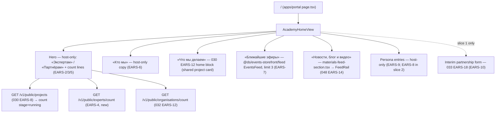

# 029 — Academy home relaunch (Design)

Requirements: [`029-requirements-en.md`](./029-requirements-en.md) · PRD: [`029-product.md`](./029-product.md) · Canvas: `design-source/academy-home.dc.html` (switch defaults; rail `scope` = «срез 1»).

## 1. Composition

`apps/portal/app/page.tsx` keeps mounting `AcademyHomeView` (`apps/portal/app/academy-home-view.tsx`, host-only surface row of the registry). The view becomes a server composition of owner blocks plus the host-only hero, «Кто мы» and persona entries:



The canvas hero actions point at in-page anchors (`#apply`, `#invest`); 033 EARS-2 already fixes that every «Экспертам → Подать заявку» entry leads to `/apply`, so the hero actions link to the pages directly (EARS-2, EARS-8). The canvas text «Все события и эфиры →» and its empty-state wording are not carried: the shared block's own link and states are the copy (registry, «Existing block before a new one», #3616).

## 2. Count lines

```mermaid
sequenceDiagram
  participant V as AcademyHomeView (server)
  participant API as apps/api
  par
    V->>API: GET /v1/public/projects
    V->>API: GET /v1/public/experts/count
    V->>API: GET /v1/public/organisations/count
  end
  API-->>V: items[] / {count} / {count} (each may fail)
  V->>V: segments = [running>0 ? plural(running,"проект")+" в производстве", experts>0 ? plural(experts,"эксперт")]
  V->>V: drop failed / zero segments; no line if none
```

- The three reads run in parallel with the page's other reads; each is settled on its own (`Promise.allSettled`-shaped), so a rejected read drops only its segment (EARS-3, EARS-5) and never fails the page.
- The projects read is the same `GET /v1/public/projects` the 030 home block uses; the running count is the number of items with `stage === "running"` — no new projects endpoint.
- Plural forms come from one Russian plural helper (one/few/many by the last two digits); the helper is a host-local pure function unless the design system already exports one — the implementer checks `@ds/design-system` first.
- Caching: the reads follow the home's current fetch policy (no `revalidate` beyond what 048 / 030 use), so a publish shows on the next request (US-9).

## 3. Expert count read (EARS-4)

- `GET /v1/public/experts/count` → `{ count: number }`, contract `PublicExpertCount` in `packages/schemas/src/taxonomy/` next to `PublicOrganisationCount`; controller beside the existing `public/experts` controller in `apps/api/src/taxonomy/project-experts.public.controller.ts` (or its own file, per the module's layout); a `count(*) where status = 'published'` over the 012 `experts` table. Public, unauthenticated, like 032 EARS-12.
- No migration: `experts.status` exists (`packages/db/src/schema/taxonomy.ts`).
- The route is registered before `:idOrSlug` routes so `count` is never read as a slug (the 032 controller precedent).

## 4. Retirement of the 013 sections (EARS-1)

| Today (`academy-home-view.tsx`)                                              | 029                                                                                     |
| ---------------------------------------------------------------------------- | --------------------------------------------------------------------------------------- |
| `AcademyHero`                                                                | replaced by the split hero (EARS-2, EARS-3, EARS-5)                                     |
| `WhatSection`, `WhySection`, `PartnerValueSection`, `FormatsSection`         | removed                                                                                 |
| `ExpertsSection` (fixture `EXPERTS`)                                         | removed                                                                                 |
| `EventsSection` (fixture `WebinarCard`s)                                     | replaced by `EventsFeed` (EARS-7)                                                       |
| `ProjectsSection` (fixtures)                                                 | replaced by the 030 EARS-12 block (#3506 lands it)                                      |
| `MaterialsFeedSection`                                                       | kept (048 EARS-14)                                                                      |
| `LeadDemoSection` + `lead-demo-fields.tsx` + `academy-partnership-action.ts` | kept in slice 1 (EARS-10, 033 EARS-18 writes to the queue); removed in slice 2 (EARS-8) |
| `fixtures.ts`                                                                | deleted; its host-allowlist row removed in the same PR                                  |
| `AcademyHomeFooter`                                                          | unchanged (shell)                                                                       |

## 5. Reuse (ADR-0013 §A1, capability-ownership registry)

| Home part                      | Owner (registry row)                                                                                  | 029 adds                                                                          |
| ------------------------------ | ----------------------------------------------------------------------------------------------------- | --------------------------------------------------------------------------------- |
| «Что мы делаем»                | Project card (030) + 030 EARS-12 home block — `packages/design-system`                                | placement only                                                                    |
| «Ближайшие эфиры»              | Events feed block — `packages/events-storefront` `./feed` `EventsFeed` (#1485)                        | `limit: 3`, Academy host config, heading                                          |
| «Новости, блог и видео»        | Materials feed — `packages/design-system` `FeedRail`, host binding `materials-feed-section.tsx` (048) | nothing                                                                           |
| Partner count                  | Organisation registry — `apps/api/src/taxonomy` (032 EARS-12)                                         | the line                                                                          |
| Expert count                   | 012 expert registry — `apps/api/src/taxonomy`                                                         | `GET /v1/public/experts/count` (EARS-4)                                           |
| Expert entries                 | Application queue / `@ds/applications` (033) — route `/apply`                                         | links                                                                             |
| Partner entries                | 034 investor page (slice 1, unspecified yet)                                                          | links (slice 2)                                                                   |
| Interim partnership form       | Application queue (033 EARS-18)                                                                       | kept as the last section in slice 1                                               |
| Hero, «Кто мы», persona blocks | host-only surface (`academy-home-view.tsx` row)                                                       | the copy and layout from `@ds/design-system` primitives (Button, Container, Link) |

No new shared package and no new host file beyond what these rows hold; if the count-line formatting is extracted to its own module it takes a host-allowlist row in the same PR.

## 6. UI composition and states

From the canvas at its defaults (goal А — «Миссия | Эволюционная цель» row inside «Кто мы»; the wide goal plaque of variants Б/В is not used). States per part:

- Hero count lines — data / segment dropped / line absent (EARS-3, EARS-5).
- «Что мы делаем» — data / absent (030 EARS-12).
- «Ближайшие эфиры» — the block's skeleton / data / empty / error with «Повторить» (019).
- Rail — the 048 states (EARS-16).
- Persona row — slice 1: «Экспертам» alone (EARS-9, EARS-10); slice 2: «Экспертам» + «Инвесторам» (EARS-8). The single-card row of slice 1 is not drawn on the canvas and goes to the owner with the Stage-A pick (PRD «Approved mockup»).

Copy deviation from the canvas: «бесплатное» / «бесплатным» removed from the goal, «Кто мы» and the mission (owner 2026-11-10). The canvas switch panel («Панель развилок и состояний») is a canvas tool, not page content.

## 7. Delivery slices

| Slice | Work package     | EARS                                    | `blocked_by` (technical dependency → why)                                                                                                                                                                                                                                                                                                                                           |
| ----- | ---------------- | --------------------------------------- | ----------------------------------------------------------------------------------------------------------------------------------------------------------------------------------------------------------------------------------------------------------------------------------------------------------------------------------------------------------------------------------- |
| 1     | Home composition | EARS-1…EARS-7, EARS-9, EARS-10, EARS-11 | **#3506** (030 home block + shared project card — «Что мы делаем» mounts it); **#4031** (033 `/apply` page — both «Экспертам» entries lead there, a link to a missing route is a dead end); **#4032** (033 EARS-18 — the interim form kept by EARS-10 must write to the queue, not to files). Satisfied: #3492 / #3494 (032 count), #3516 / #3517 (048 rail), #1485 (`EventsFeed`). |
| 2     | Partner entries  | EARS-8                                  | **#1824** (034 slice 1 — both «Как это работает» actions lead to its page; re-pointed to 034's page EARS Issue once 034's spec opens its Issues); slice 1 (EARS-8 replaces the EARS-10 state).                                                                                                                                                                                      |

Order is the owner's: the home is first on the Academy track queue and its prerequisites run in parallel (owner 2026-11-25). Whether slice 1 ships before slice 2 is an open owner fork the lead holds (PRD «Open questions»); the spec supports both: if the home waits, the two slices ship in one release and EARS-10 never reaches production.
