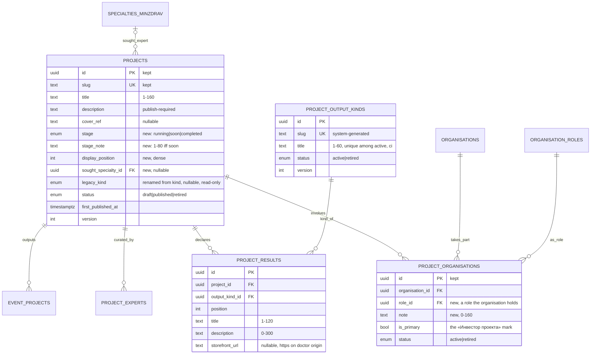
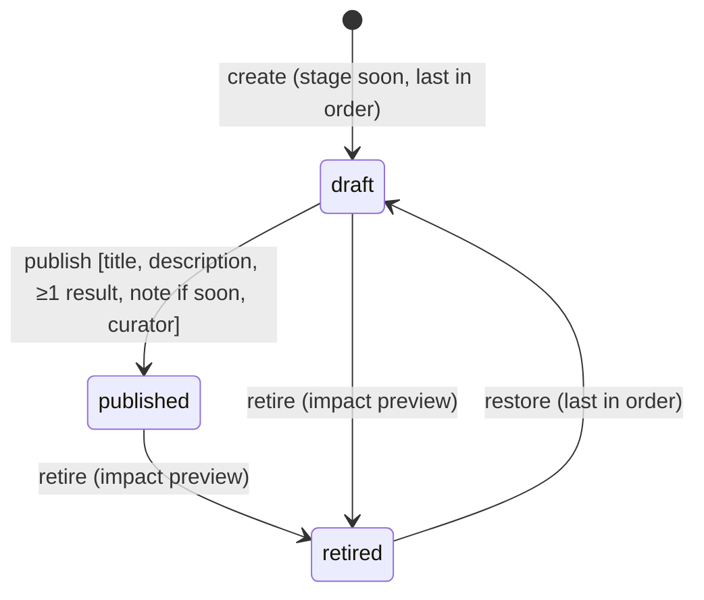
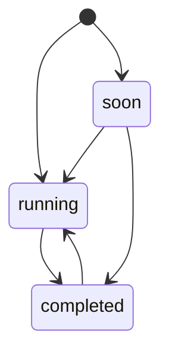
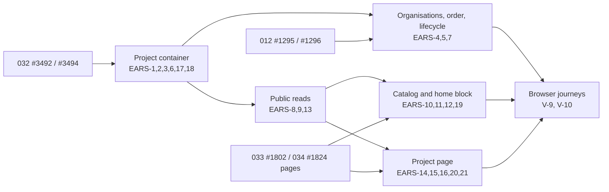

# 030 — Projects: the container, its admin, the «Все проекты» catalog and the project page (Design, slice 1)

Requirements: [`030-requirements-en.md`](./030-requirements-en.md) · PRD: [`030-product.md`](./030-product.md) · Domain: ADR-0016 §4 / design §2.5–§2.6 (project, outputs), §8 (storefront ownership), §9 (absorb, never rewrite) · Absorbed vertical: [`012-design.md`](../012-content-taxonomy/012-design.md) (projects, lifecycle, impact preview, media) · Registry: [`032-design.md`](../032-investors-leaderboard/032-design.md) · Access: [`047-design.md`](../047-staff-access/047-design.md).

## Current behaviour → replacement delta

There is **no running counterpart** of the catalog or the project page: PRD [015](../015-projects-catalog/015-product.md) was never built, and no storefront route lists or shows projects. What exists today is the 012 project vertical, admin-only plus relationship reads:

| Exists today                                                                                                                                                                                                                                                           | Slice 1                                                                                                                                                             |
| ---------------------------------------------------------------------------------------------------------------------------------------------------------------------------------------------------------------------------------------------------------------------- | ------------------------------------------------------------------------------------------------------------------------------------------------------------------- |
| `packages/db/src/schema/taxonomy.ts` `projects` with the closed `project_kind` enum (`school` / `media` / `program`), `default_audience`, the retained-row lifecycle                                                                                                   | `kind` becomes the nullable read-only `legacy_kind`; new `stage`, `stage_note`, `display_position`; new `project_results`, `project_output_kinds` (EARS-1…3, 5, 17) |
| `project_experts` (role `curator` / `member`; the published-project curator invariant of 012 EARS-5)                                                                                                                                                                   | unchanged; the curator's display name and the expert count are read for the hero (EARS-13)                                                                          |
| `project_partners` (`is_primary`, ≤ 1 active primary) — renamed `project_organisations` by 032 slice 1 (#3492)                                                                                                                                                         | gains `role_id` and `note`; `is_primary` is the «Инвестор проекта» mark (EARS-4)                                                                                    |
| `event_projects` (project ↔ event output)                                                                                                                                                                                                                              | unchanged; the scale line and the since-year read it (EARS-9, EARS-13)                                                                                              |
| `apps/api/src/taxonomy/projects.admin.controller.ts` — list, create, detail, patch, publish; **no retire / restore** (they are 012 EARS-13 / EARS-14, #1295 / #1296, open)                                                                                             | form fields change; new results, order, output-kind endpoints; retire / restore come from #1295 / #1296 (see Dependencies)                                          |
| Public reads `GET /v1/public/projects/{key}/events·experts·partners` and the reverse traversals embedding `PublicProjectSummary { kind, … }` — **no storefront consumer** (no import in `apps/portal`, `apps/doctor` or `packages/*` outside `schemas` / `api-client`) | `PublicProjectSummary` drops `kind`, gains `stage`; new `GET /v1/public/projects`, `/scale`, `/{key}`, `/{key}/results` (EARS-8, 9, 13)                             |
| `apps/admin/app/projects/` (list, `create`, `[id]` with tabs incl. `ProjectPartnersPanel`, `PublishAction`); `apps/admin/components/project-form.tsx` with the kind select                                                                                             | kind select removed; stage + stage note; «Результаты» tab; panel reshaped to «Организации»; new «Порядок показа» and «Виды результатов» (EARS-1…5)                  |
| `apps/portal/app/academy-home-view.tsx` `ProjectsSection` renders the hard-coded `FEATURED_PROJECTS` fixture and «Все проекты» → `#projects`                                                                                                                           | the section renders the first three catalog items with the shared card, «Все проекты →» → `/projects` (EARS-12)                                                     |
| `apps/portal/lib/navigation-model.ts` — one storefront item «Эфиры»                                                                                                                                                                                                    | adds «Проекты» → `/projects` (EARS-10)                                                                                                                              |

## Placement

- **Schema** `packages/db/src/schema/taxonomy.ts` — `projects` extended; new `project_output_kinds`, `project_results`; `project_organisations` (from 032) extended. One absorbing forward migration in `apps/api/drizzle/` (EARS-17); the project-page package adds its own forward migration for the nullable `projects.sought_specialty_id` (EARS-21), so the column ships with its reader and writer.
- **API** `apps/api/src/taxonomy/` — `projects.*` (fields, publish rule), new `project-results.*`, `project-order.*`, `project-output-kinds.*`, `project-partners.*` → per-project role and note, new `public-projects.{controller,service,repository}.ts` for the four public reads. The module's problem filter, idempotency service and `lifecycle-impact.service.ts` are reused.
- **Contract** `packages/schemas/src/taxonomy/` — `project.ts` (admin form, results, order), `project-output-kind.ts`, `public-project.ts` (catalog item, scale, project, results). `PublicProjectSummary` changes in place (EARS-8).
- **Admin** `apps/admin/app/projects/` (form, «Результаты» tab, «Организации» tab), `apps/admin/app/projects/order/`, `apps/admin/app/project-output-kinds/`; `ADMIN_SECTION_NAV` in `apps/admin/lib/admin-access.ts` gains «Порядок показа» (under «Проекты») and «Виды результатов» as `full`-access (`platform_admin`) entries.
- **Shared card** `packages/design-system/src/blocks/project-card.tsx` (`ProjectCard`), exported from `./blocks`, built from `design-source/unit-project-card.dc.html`.
- **Academy routes** `apps/portal/app/projects/page.tsx` and `apps/portal/app/projects/[slug]/page.tsx`, each a route-file-registry row `— host-only surface (Academy projects; ADR-0016 §8 — no doctor projection)`, `permanent`. The page sections (hero, results, organisations, «Войти в проект») are `@ds/design-system` blocks `project-hero.tsx`, `project-results.tsx`, `project-organisations.tsx`, `project-entry.tsx`; the routes only fetch through `@ds/api-client` and compose.
- **Storefront ownership** (ADR-0016 §8): `projects`, `project_results`, `project_output_kinds`, `project_organisations` are `academy`; the admin is their only writer. `apps/doctor` imports none of the project contract and has no `/projects` route (EARS-19).

### Capability owner (ADR-0013 §A1)

`capability-ownership.md` has no project row today. The project card is shared by two Academy surfaces — the catalog and the home block — and must not fork (PRD US-6), so the first implementation PR adds the row «Project card + catalog projection»: owner **`@ds/design-system` `ProjectCard` + `apps/api/src/taxonomy/public-projects*`**, Academy consumer `apps/portal` (`/projects`, home block), doctor column «none (ADR-0016 §8)». No cross-host projection exists, so no boundary line is written. No stub package is graduated.

## Data model



- **Results are child rows replaced as a set** under the project's version (032 role-set pattern): `PUT /v1/admin/projects/{id}/results` deletes missing, inserts new, rewrites `position`, bumps `projects.version`, so the form keeps one ETag. A result has no lifecycle of its own: it is part of the project's description, not an output entity (ADR-0016 design §2.6 outputs arrive with 023 / 024 and will reference the project directly).
- **The output-kind list is a reference table**, not an enum (US-11 «adding one changes no page»): partial unique index on `lower(title)` where `status = 'active'`; retire takes the kind's row lock then checks holders among draft and published projects, so it cannot interleave with a results save that adds the kind (the save locks the project, then reads the kind as active under `FOR SHARE`).
- **Stage** is a closed enum — three values the badge vocabulary depends on; `stage_note` CHECK: `(stage = 'soon') = (stage_note IS NOT NULL)`. A new project defaults to `soon`.
- **Display order** is `display_position` on `projects` — dense over non-retired rows, assigned `max + 1` on create, compacted on retire and on restore (restored project goes last). The order's ETag is a hash of the ordered `(id, version)` pairs of the non-retired rows; `PUT /v1/admin/projects/order` takes the full ordered id list and refuses a stale ETag or a list that is not exactly the current non-retired set (`412 PRECONDITION_FAILED`). Every touched row's `version` is bumped, so a concurrent form save on one of them fails its own `If-Match`.
- **Per-project organisation role**: `role_id` NOT NULL, FK `organisation_roles`; the service refuses a role the organisation does not hold (an assignment-table check under the organisation row lock). The investor of the catalog and the page is the active `is_primary` link — the existing ≤ 1 partial unique index carries the «at most one investor» rule; its role is ordinarily «Инвестор», but the mark, not the role slug, decides attribution, so renaming or retiring the role never removes an investor (the role list is data, 032 EARS-3).
- **Sought expert specialty** (EARS-21): `sought_specialty_id` nullable, FK `specialties_minzdrav(id)` `ON DELETE RESTRICT` — the Минздрав specialty book of `packages/db/src/schema/specialties.ts`, the same book the 012 taxonomy already links through `direction_specialties` and 017 serves through `packages/schemas/src/specialties/specialties.schema.ts`. Its rows survive a re-seed by `code`, so the reference stays valid across an amended nomenclature order; the book has no retirement, so the only refusal is an unknown id. The public label is the entry's verbatim `name` (never declined or abbreviated), which is why the sentence quotes it after «по специальности» instead of inflecting it as the canvas sample «по регенеративной медицине» does. It is not part of the publish-required set.
- **Storefront URL**: absolute `https:`; its origin must equal `DOCTOR_STOREFRONT_ORIGIN` of the API config (the same value the Academy footer's crossing link uses). Validated in the Zod contract with the origin injected server-side.

## Public projection (EARS-8, 9, 13)

One predicate, `public_project`: `status = 'published' AND deleted_at IS NULL AND EXISTS (SELECT 1 FROM project_results WHERE project_id = p.id)`. Every public read and the scale line use it, so a published 012 project without results (EARS-17) is invisible everywhere rather than shown half-filled.

- **Catalog order**: `ORDER BY (stage = 'completed'), display_position, id`.
- **Outputs**: the titles of the distinct kinds of the project's results ordered by the first result of each kind, lower-cased by the card, joined « · ».
- **Investor**: the active `is_primary` link whose organisation passes 032's display predicate; `logoUrl` resolved only with `public_logo_visible`. `investorPlaceOpen` = no active `is_primary` link at all — a name-hidden investor closes the place without being disclosed (EARS-15).
- **Scale**: `projects` = count of `public_project`; `partners` = the 032 EARS-12 query (`count(*) FROM organisations WHERE status = 'published'`, shared from the 032 public repository, never re-written); `broadcasts` / `firstBroadcastYear` = `count(DISTINCT e.id)` / `min(extract(year from e.starts_at))` over events in `published | live | ended | in_archive` joined by active `event_projects` to a `public_project`.
- **Hero counts**: results = `count(project_results)`; experts = active `project_experts` whose expert is published; since-year = `min(year of public event start)` else `year(first_published_at)`.
- **Sought specialty**: `soughtSpecialty { code, name }` of the referenced book entry or `null`; only the project read carries it, not the catalog item (EARS-21).
- **Curator**: the expert's public display name as the 012 public expert projection composes it — no slug, no URL, no other field, so the page cannot link to an expert page before 031.
- `404` for draft, retired, non-public and unknown alike; the key resolves by id or slug per 012 (`/:idOrSlug`).
- The reads are anonymous, served by the Academy BFF server-side per request; `revalidate` follows the existing public taxonomy reads. No cache table.

## Absorbing migration (EARS-17)

```mermaid
sequenceDiagram
  participant M as forward migration
  participant DB as Postgres
  M->>DB: CREATE project_output_kinds; INSERT Школа, Курс, Подкаст, Событие, Конгресс, Клуб (active)
  M->>DB: CREATE TYPE project_stage; ADD stage DEFAULT 'running', stage_note NULL, display_position
  M->>DB: UPDATE display_position = row_number() OVER (ORDER BY title, id) for non-retired rows
  M->>DB: RENAME kind TO legacy_kind; DROP NOT NULL
  M->>DB: CREATE project_results (empty)
  M->>DB: ADD project_organisations.role_id, note; SET role_id = investor role for every row; SET NOT NULL
  M->>DB: audit triggers on project_results, project_output_kinds
  M->>DB: assert row counts of projects and every link table unchanged
```

- Runs after 032's absorbing migration (it needs `project_organisations` and the `investor` seed role). One transaction; the final assertion aborts on any mismatch.
- The column default `running` is dropped after the backfill; new rows get `soon` from the service (EARS-1).
- `legacy_kind` is a hint for the operator only — no public read, no form input, no write path; it is dropped by a later slice once every row has results (recorded as a `DEBT.md` line by the first implementation PR, not a seam: nothing reads it as behaviour).
- `default_audience` is untouched (012 EARS-30 prefill for events).
- The append-only 010 ledger is not touched (032 precedent).

## Endpoints

Headers (`Idempotency-Key`, `If-Match`, `Lifecycle-Impact-Token`), problem codes and the multipart media contract of today's `admin/projects` controller are kept.

| Method + path                                                   | Purpose                                          | EARS    |
| --------------------------------------------------------------- | ------------------------------------------------ | ------- |
| `POST /v1/admin/projects` · `PATCH /v1/admin/projects/{id}`     | fields, stage, stage note (no kind)              | EARS-1  |
| `PATCH /v1/admin/projects/{id}` `soughtSpecialtyId` (nullable)  | set / clear the sought expert specialty          | EARS-21 |
| `GET` / `PUT /v1/admin/projects/{id}/results`                   | read / replace the ordered result set            | EARS-2  |
| `GET` / `POST /v1/admin/project-output-kinds` · `PATCH …/{id}`  | kind list (with result counts), create, rename   | EARS-3  |
| `POST /v1/admin/project-output-kinds/{id}/retire` / `…/restore` | retire (refused while held) / restore            | EARS-3  |
| `POST` / `PATCH /v1/admin/project-partners…` (paths kept)       | link with `roleId`, `note`, `isPrimary`          | EARS-4  |
| `GET` / `PUT /v1/admin/projects/order`                          | ordered ids + order ETag / save the order        | EARS-5  |
| `POST /v1/admin/projects/{id}/publish`                          | publish with the 030 requirement set             | EARS-6  |
| `…/{id}/lifecycle-impact` + `…/{id}/retire` / `…/restore`       | 012 EARS-13 / EARS-14 for projects (#1295/#1296) | EARS-7  |
| `GET /v1/public/projects`                                       | ordered catalog items                            | EARS-8  |
| `GET /v1/public/projects/scale`                                 | scale line                                       | EARS-9  |
| `GET /v1/public/projects/{idOrSlug}` · `…/{idOrSlug}/results`   | project page and its results block               | EARS-13 |
| `GET /v1/public/projects/{idOrSlug}` `soughtSpecialty`          | the expert entry's specialty or `null`           | EARS-21 |

`/scale` and `/order` are literal segments registered before `/:idOrSlug` (a slug can never equal them: `scale` and `order` are added to the reserved-slug list of the slugifier). Every admin route: `roles: [platform_admin]`, the MFA admin session, CSRF, `revalidate: "live"` on writes (EARS-18). The `endpoint-authz` and `route-mount` guards see the new routes as rows of their matrices.

## Lifecycles





- The stage is free editorial data: any value may follow any other; only the publish rule reads it (stage note while `soon`).
- Output kinds: `active → retired [held by no result of a draft or published project] → active`.

## UI composition

### Academy (canvases, Stage A pending)

| Surface             | Canvas → state                                                                                                                        | Notes                                                                                                                                                                                                                                                                                                                                                                                                                                                                       |
| ------------------- | ------------------------------------------------------------------------------------------------------------------------------------- | --------------------------------------------------------------------------------------------------------------------------------------------------------------------------------------------------------------------------------------------------------------------------------------------------------------------------------------------------------------------------------------------------------------------------------------------------------------------------- |
| Project card        | `unit-project-card.dc.html` — props `kind` → fixed «Проект», `stage`, `count` → outputs line / stage note, `partnerName`, `emblem`    | The demo kickers «Школа» / «Медиа» / «Программа» and counts «24 эфира» are replaced (PRD lead decision); emblem = first two letters of the title, first upper-case.                                                                                                                                                                                                                                                                                                         |
| Catalog `/projects` | `academy-projects.dc.html` — header, scale line, grid, «Завершён» card last, closing plate                                            | Plate actions: «Предложить проект» → 033, «Стать партнёром» → 034. The header wording is not pinned by EARS: the canvas «Всё для врачей бесплатно» is replaced at Stage A of the catalog-UI Issue (Lead decision 17). Empty and error states are not drawn: composed from `EmptyState` and the platform error block (approved kit), recorded at Stage A.                                                                                                                    |
| Project page        | `academy-project.dc.html`, «Объём» = «срез 1», «Результаты» = А (grid), «Партнёр» = Б (separate block), «Инвестор» лого / текст / нет | Hero, «Результаты» with its loading / error / plan states, «Организации в проекте», «Войти в проект». Hidden in «срез 1»: number row, team, «Закулисье», dashboard. The expert card's canvas sentence «Проект ищет эксперта по регенеративной медицине.» becomes «Проект ищет эксперта по специальности «<name>».» from `soughtSpecialty`, and is absent when it is `null` (EARS-21). The investor card shows neither the contract line nor the period (late slice of 032). |
| Home block          | `academy-home.dc.html` «Что мы делаем» — three `unit-project-card`                                                                    | Same `ProjectCard`; the rest of the home is 029.                                                                                                                                                                                                                                                                                                                                                                                                                            |

### Admin (approved-non-canvas)

| State                   | Composition                                                                                                                                                                                                                                                                                                                       |
| ----------------------- | --------------------------------------------------------------------------------------------------------------------------------------------------------------------------------------------------------------------------------------------------------------------------------------------------------------------------------- |
| `project-form`          | full-page form: «Название», «Описание», «Обложка» (012 media slot), «Стадия» (radio: «Проект идёт» / «Скоро» / «Завершён»), «Что происходит сейчас» (shown for «Скоро»), «Ищем эксперта по специальности» (clearable `Combobox` over the specialty book, EARS-21); read-only «Прежний тип (012)» notice when `legacy_kind` is set |
| `project-results`       | «Результаты» tab: ordered repeatable rows («Вид» select of active kinds, «Название», «Описание», «Ссылка на doctor.school»), move up / down, remove, «Добавить результат»; a held retired kind marked «Вид снят»                                                                                                                  |
| `project-organisations` | «Организации» tab: rows (organisation, role, note, «Инвестор проекта» mark); add dialog with a registry `Combobox` and a role select limited to the organisation's roles                                                                                                                                                          |
| `project-order`         | «Порядок показа»: `AdminDataList` of non-retired projects (title, stage, status) with move up / down and «Сохранить порядок»; stale save → reload notice                                                                                                                                                                          |
| `project-list-flags`    | project list adds the stage column and the mark «Не на сайте: нет результатов» for a published project without results                                                                                                                                                                                                            |
| `project-lifecycle`     | «Опубликовать» (field errors linking to the tab of each missing item); «Снять с публикации» with `lifecycle-impact-dialog`; «Вернуть» → draft                                                                                                                                                                                     |
| `output-kinds`          | «Виды результатов»: `AdminDataList` with result counts + «Добавить вид»; a refused retire lists the holding projects                                                                                                                                                                                                              |

## Dependencies

- **032 slice 1 «Registry and roles» (#3492)** — `blocked_by`: `project_organisations`, `organisation_roles` and the investor seed role must exist (EARS-4, EARS-17). **032 «Public projections» (#3494)** — `blocked_by` for EARS-8 / 9 / 13 / 15 (display predicate and the count).
- **012 EARS-13 / EARS-14 for projects (#1295 / #1296)** — `blocked_by` of the «Organisations, order, lifecycle» package (EARS-4, 5, 7): project retire and restore do not exist today (`apps/admin/app/projects/[id]/page.tsx` publishes only). Both Issues are open and tracked; EARS-7 of 030 states the catalog consequences, the transitions themselves (#1295 retirement through the signed impact preview, #1296 restore) are those Issues' deliverable (Lead decisions 13, 15).
- **033 slice 1 (#1802) and 034 slice 1 (#1824) pages** — PRD-only today. The catalog plate and «Войти в проект» lead to both, the free investor place to 034; the «Catalog and home block» package (EARS-10, 11, 12, 19) and the «Project page» package (EARS-14, 15, 16, 20, 21) are each `blocked_by` #1802 and #1824 until those pages exist, so no link ships to a missing page (PRD «no link leads to a missing page»; Lead decision 16).
- **Specialty book** (`specialties_minzdrav`, 017) — on `main` and seeded; EARS-21 references it, no edge.
- **029** consumes the shared card and the catalog read for its relaunched home; 030 already replaces the fixture section (EARS-12), so 029 moves the block, never re-implements it.

## Delivery slices



- **Project container** goes first: the migration, the form without kind and the publish rule must ship together — a release with the migration but the old form would let the operator save a project with no stage note and no results.
- **Public reads** depend only on it; the two Academy UI packages depend on the reads and on the 033 / 034 pages; the journeys close the slice.

## Lead decisions

The PRD's _agent-proposed — UNCONFIRMED_ items, specified as the PRD writes them (032 precedent), plus the design choices made here:

1. **Publish-required set** (US-14): title, description, ≥ 1 result, stage (always set) with its note while «Скоро», plus the existing 012 single-curator rule (EARS-6).
2. **Closing invitation** of the catalog re-pointed from 013's lead form to 033 («Предложить проект») and 034 («Стать партнёром»); the canvas label «Предложить школу» becomes «Предложить проект» under ADR-0016 §4 (EARS-10).
3. **Empty catalog**: says projects are being prepared and keeps the invitation; the home block is hidden (EARS-10, EARS-12).
4. **012 records**: kept with every link, stage `running`, no results; the old kind survives only as the admin hint `legacy_kind`; a published one stays off public reads until the operator states its results (EARS-17 and the `public_project` predicate).
5. **Output kinds are an admin-maintained list** seeded with Школа, Курс, Подкаст, Событие, Конгресс, Клуб (EARS-3).
6. **Outputs = declared results**: the outputs line is derived from the result rows' kinds, so «what a project produces» and «its results» cannot disagree (EARS-2, EARS-8).
7. **Investor = the «Инвестор проекта» mark** (existing `is_primary`), not the role slug; every link carries the organisation's role in the project and an optional note (EARS-4).
8. **Storefront links only to the doctor-storefront origin** (EARS-2).
9. **Since-year** = earliest public event of the project, else the first publish (EARS-13).
10. **Scale-line partners** = 032 EARS-12 count of all published organisations, the counting rule the PRD defers to (EARS-9).
11. **«Проекты» joins the Academy navigation** in slice 1 (canvas nav set А); «Эксперты» waits for 031 (EARS-10).
12. **The home's existing projects section is wired in slice 1** to the real read and the shared card, rather than waiting for 029, so the fixture never coexists with a real catalog (EARS-12).
13. **Project retire / restore stay owned by 012 #1295 / #1296**; 030's lifecycle package is `blocked_by` them instead of re-implementing the 012 transition protocol.
14. **Sought expert specialty** (canvas `academy-project.dc.html` «Войти в проект», both the `full` and the slice-1 branch): an optional project field referencing one entry of the Минздрав specialty book `specialties_minzdrav`, edited on the admin project form and projected by the project read; set, the expert card reads «Проект ищет эксперта по специальности «<name>».» with the verbatim book name (book wording is never inflected, so the canvas's declined sample is not reproduced); empty, the card shows no sentence about a specialty and keeps its heading and action (EARS-21).
15. **Retire / restore prerequisites are real**: #1295 (012 EARS-13) and #1296 (012 EARS-14) are open, tracked Issues and stay the `blocked_by` of the «Organisations, order, lifecycle» package (Dependencies).
16. **Application pages first**: the «Catalog and home block» and «Project page» packages are `blocked_by` #1802 (033 slice 1) and #1824 (034 slice 1) until those pages exist; no link is shipped to a missing page (Dependencies).
17. **Catalog header copy is not pinned by EARS**: the canvas header «Всё для врачей бесплатно» conflicts with ADR-0016 §4 and with the platform rule that the wording «бесплатно» is not used; the header wording is a Stage-A copy item of the catalog-UI Issue (EARS-10 pins only the scale line).
18. **Results are their own read**: `GET /v1/public/projects/{idOrSlug}/results` is separate from the project read, so the «Результаты» block loads, fails and retries alone while the rest of the page works (EARS-13, EARS-14).
19. **A published project without results stays off the site**: the `public_project` predicate requires at least one result, so a migrated 012 project is invisible on every public read until the operator states its results, rather than shown half-filled (EARS-8, EARS-17).
