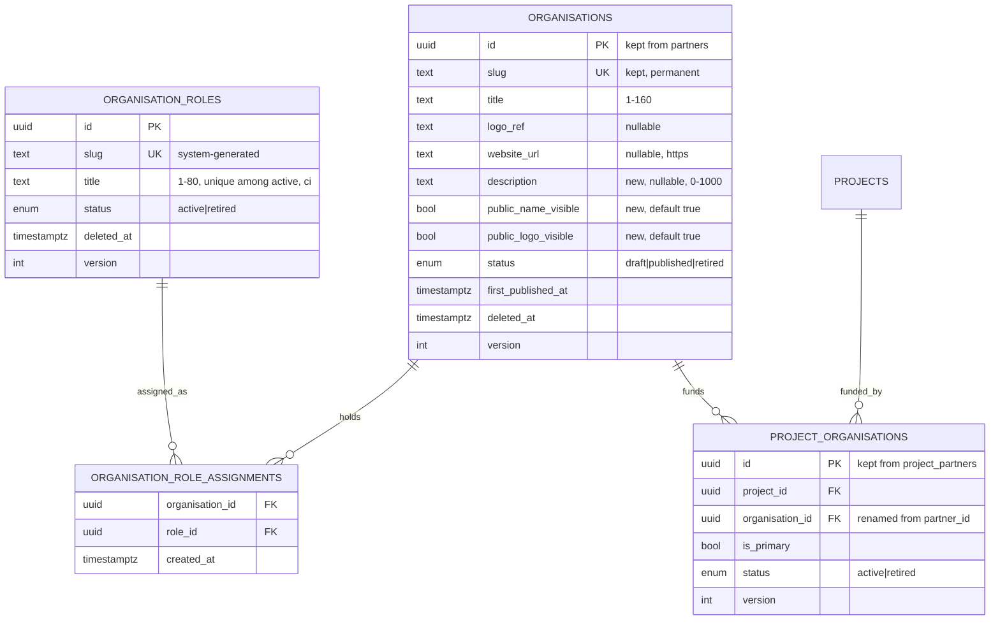
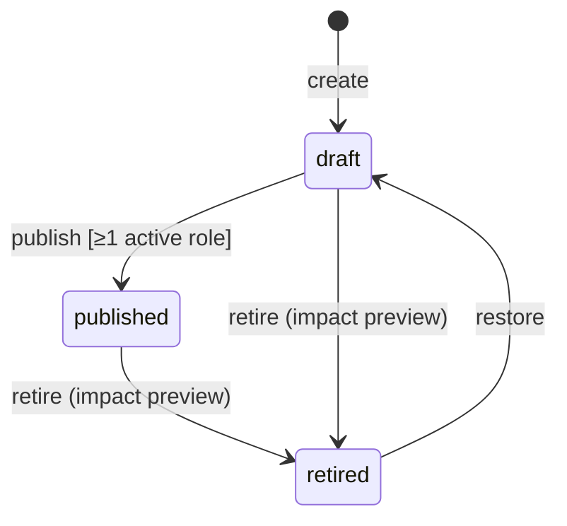
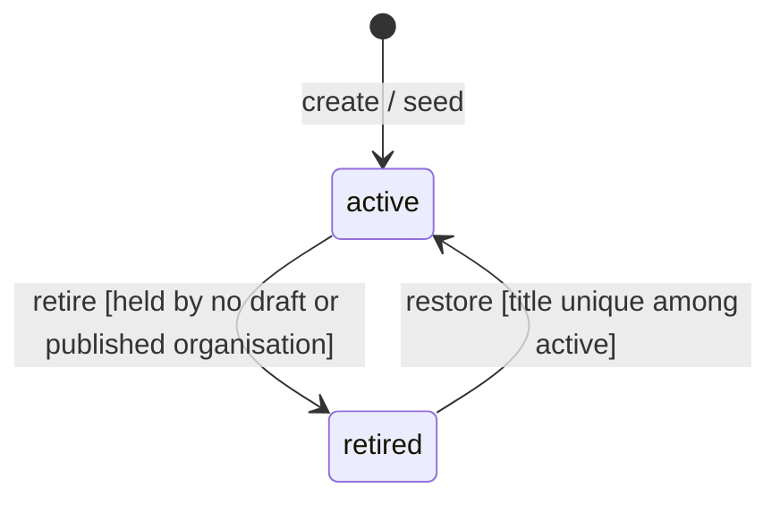
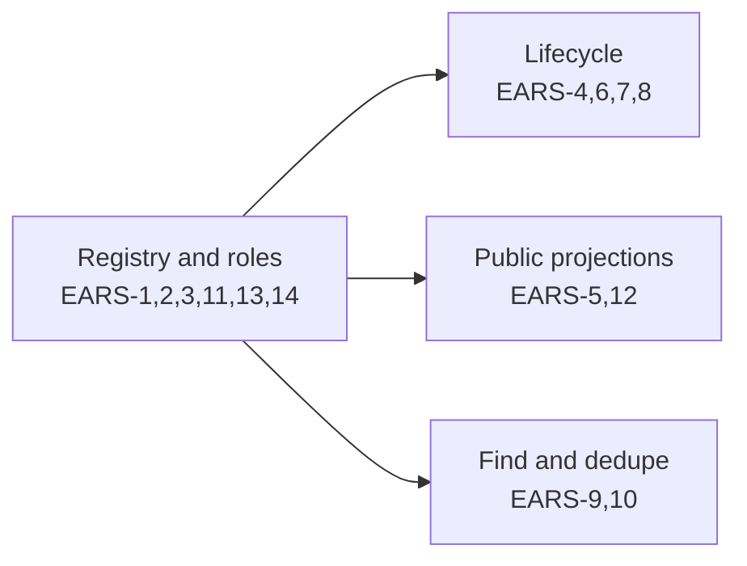

# 032 — Organization registry and its admin (Design, slice 1)

Requirements: [`032-requirements-en.md`](./032-requirements-en.md) · PRD: [`032-product.md`](./032-product.md) · Domain: ADR-0016 §2 / design §2.3 (organisation), §8 (storefront ownership), §9 (absorb, never rewrite) · Absorbed vertical: [`012-design.md`](../012-content-taxonomy/012-design.md) (partners, lifecycle, impact preview, media) · Access: [`047-design.md`](../047-staff-access/047-design.md) (`platform_admin`, admin session).

## Placement

- **Schema** `packages/db/src/schema/taxonomy.ts` — `partners` becomes `organisations`, `project_partners` becomes `project_organisations`; new `organisation_roles` and `organisation_role_assignments` tables in the same file. One forward migration in `apps/api/drizzle/` (EARS-11).
- **API** `apps/api/src/taxonomy/` — `partners.*` become `organisations.*` (controller, service, repository); new `organisation-roles.*`; `project-partners.*` read `project_organisations`. The module keeps its problem filter, idempotency service and `lifecycle-impact.service.ts`.
- **Contract** `packages/schemas/src/taxonomy/` — `organisation.ts` (admin create/update/detail/list item, similar-organisations response, public count) and `organisation-role.ts`. The public `PublicPartner` DTO and the relationship DTOs keep their names and shapes (EARS-5).
- **Admin** `apps/admin/app/organisations/` (list, `create`, `[id]`) replaces `apps/admin/app/partners/`; `apps/admin/app/organisation-roles/` (list, `create`, `[id]`). `ADMIN_SECTION_NAV` in `apps/admin/lib/admin-access.ts` replaces «Партнёры» with «Организации» and adds «Роли организаций»; both are `full`-access (`platform_admin`) entries.
- **Storefront ownership** (ADR-0016 §8): `organisations`, `organisation_roles`, `organisation_role_assignments` and `project_organisations` are `academy`; the admin is their only writer. `apps/doctor` imports none of the organisation contract.

### Capability owner (ADR-0013 §A1)

`apps/docs/content/specs/product/two-site-ia/capability-ownership.md` has no organisation row today. Slice 1 has no cross-front UI — the admin is one app, and the Academy home renders a number — so the owner is the backend contract: **`packages/schemas` (`taxonomy/organisation*.ts`) + `apps/api/src/taxonomy/organisations*`**. The first implementation PR adds the row «Organisation registry» naming that owner, `academy` as the only storefront, and the doctor column «none (ADR-0016 §8)». The late slice's public investor page adds its own shared-package row when it exists.

No stub package is graduated.

## Data model



- **The role set is a reference table plus a join**, not a Postgres enum and not a `uuid[]` column. ADR-0016 design §2.3 writes `kinds` as an «enum set» on the row; an enum cannot be extended by an operator without a migration, which Q-40 / US-3 require, and an array cannot carry foreign keys. The join keeps the ADR's point — one row per organisation, the kinds a set on it, no table per kind — and makes the set referentially sound. Primary key `(organisation_id, role_id)`; replacing the set is delete-missing + insert-new in the organisation's version-checked transaction, so `organisations.version` is the one ETag of the form.
- `organisation_roles` title uniqueness: a partial unique index on `lower(title)` where `status = 'active'` (EARS-3); retired roles keep their title for the history.
- The CHECK family of `partners` (slug pattern, bounds, HTTPS, `retired iff deleted_at`, `published ⇒ first_published_at`) is renamed with the table, never re-declared.
- «A published organisation holds an active role» (EARS-6) is a service check under the organisation row lock, not a constraint: it spans two tables, and role retirement (EARS-4) takes the role row lock then checks holders, so the two never interleave into a published organisation with only retired roles.

## Absorbing migration (EARS-11)

```mermaid
sequenceDiagram
  participant M as forward migration
  participant DB as Postgres
  M->>DB: CREATE organisation_roles; INSERT investor, clinical-base, educational-licensee (active)
  M->>DB: ALTER TABLE partners RENAME TO organisations (+ indexes, checks)
  M->>DB: ADD description NULL, public_name_visible DEFAULT true, public_logo_visible DEFAULT true
  M->>DB: ALTER TABLE project_partners RENAME TO project_organisations; RENAME partner_id TO organisation_id
  M->>DB: CREATE organisation_role_assignments
  M->>DB: INSERT (id, investor) for every organisations row
  M->>DB: assert count(organisations) = count(assignments) and project_organisations unchanged
```

- One transaction; rename, not copy, so ids, slugs, versions, timestamps and every `project_organisations` FK survive by construction. The final assertion aborts the migration on any mismatch rather than leaving a partially absorbed registry.
- Display rules start on: every absorbed partner was publicly shown before, so the migration changes nothing a visitor sees.
- The 010 audit rows of the former partners keep their entity reference; the entity type label is updated to `organisation` by the same migration so the edit history of one organisation reads as one history.

## Endpoints

The shapes, headers (`Idempotency-Key`, `If-Match`, `Lifecycle-Impact-Token`), problem codes and multipart media contract of today's `admin/partners` controller are kept; the paths move.

| Method + path                                                                                 | Purpose                                          | EARS         |
| --------------------------------------------------------------------------------------------- | ------------------------------------------------ | ------------ |
| `GET /v1/admin/organisations?q&roleId&status&page&pageSize`                                   | list, search, filters                            | EARS-9       |
| `POST /v1/admin/organisations` · `PATCH /v1/admin/organisations/{id}`                         | create / edit fields, `roleIds[]`, display rules | EARS-1, 2, 6 |
| `GET /v1/admin/organisations/{id}`                                                            | detail                                           | EARS-1       |
| `POST /v1/admin/organisations/{id}/publish`                                                   | publish                                          | EARS-6       |
| `…/{id}/lifecycle-impact` + `…/{id}/retire` / `…/{id}/restore`                                | 012 EARS-13 / EARS-14 impact, retire, restore    | EARS-7, 8    |
| `GET /v1/admin/organisations/similar?title&websiteUrl&excludeId`                              | duplicate hint                                   | EARS-10      |
| `GET`/`POST /v1/admin/organisation-roles` · `PATCH …/{id}`                                    | role list (with holder counts), create, rename   | EARS-3       |
| `POST /v1/admin/organisation-roles/{id}/retire` / `…/restore`                                 | role retire (refused while held) / restore       | EARS-4       |
| `GET /v1/public/organisations/count`                                                          | `{ count }` for the Academy home                 | EARS-12      |
| `GET /v1/public/projects/{idOrSlug}/partners` · `GET /v1/public/partners/{idOrSlug}/projects` | unchanged paths and DTOs, display-filtered       | EARS-5       |

Every admin route: `roles: [platform_admin]`, the dedicated MFA admin session, CSRF, `revalidate: "live"` on writes (EARS-13), as the taxonomy routes of 012 EARS-16. The `endpoint-authz` and `route-mount` guards see the moved routes as new rows of their matrices.

## Display rules on public reads (EARS-5)

One predicate in the public repository, shared by every partner projection: `status = 'published' AND deleted_at IS NULL AND public_name_visible`, and `logoUrl` resolved only when `public_logo_visible`. A name-hidden organisation is omitted rather than returned without a title: `PublicPartner.title` is required, and its logo alone would still identify it. The embedded primary partner of a project summary therefore becomes `null` when its organisation is name-hidden — a state the DTO already allows (012 EARS-10).

## Partner count (EARS-12)

`SELECT count(*) FROM organisations WHERE status = 'published'` — no role filter, no display filter, no cache table. The Academy home (029) reads it server-side per request; a short HTTP cache, if 029 wants one, is its own decision and never a stored figure here.

## Duplicate hint (EARS-10)

The create form calls `…/similar` debounced on title and website blur. Match rules: `lower(trim(title))` equality, or the website host lower-cased with one leading `www.` stripped. All retained rows are searched (a retired match is the likeliest real duplicate). The answer is advisory: `POST` never consults it, so «Всё равно создать» is simply the ordinary save.

## Lifecycles





- Retiring an organisation keeps its `project_organisations` rows (status untouched); the public reads drop it by the EARS-5 predicate, and the impact preview lists the projects whose display it leaves (012 `LifecycleImpact`).
- Retiring a role keeps its assignment rows. A retired organisation that holds a retired role is restorable; publishing it again needs an active role (EARS-6).

## UI composition

Route **approved-non-canvas**: owner decision «1» of 2026-10-29 on Issue #1823 ([decision](https://github.com/doctor-school/ds-platform/issues/1823#issuecomment-6490439540)) for the states of [comment 6490331448](https://github.com/doctor-school/ds-platform/issues/1823#issuecomment-6490331448), which is the `approvalProvenance` anchor of their ui-approved-sources entries. No canvas, no further Stage-A question.

| State                | Composition                                                                                                                                                    |
| -------------------- | -------------------------------------------------------------------------------------------------------------------------------------------------------------- |
| `org-nav`            | «Организации» in `ADMIN_SECTION_NAV`, in place of «Партнёры»; «Роли организаций» beside it                                                                     |
| `org-list`           | `AdminDataList` (`admin-list-block-tier-v1`): «Название», «Роли», «Статус», «Обновлено»; search by name; role and status filters as chips with Reset all       |
| `org-form`           | full-page form: «Название», «Логотип» (012 media slot), «Сайт», «Описание», roles as checkboxes, «Показывать название публично», «Показывать логотип публично» |
| `org-duplicate-hint` | inline notice under the title/site fields: «Похожая организация уже есть: <название>» + «Открыть» + «Всё равно создать»                                        |
| `org-lifecycle`      | «Опубликовать»; «Снять с публикации» with `lifecycle-impact-dialog` (`feature-012-publish-lifecycle-v1`); «Вернуть» → draft                                    |
| `org-roles`          | `AdminDataList` of roles with holder counts + «Добавить роль»; a refused retire shows the holding organisations                                                |

Narrow-screen behaviour and axe come from the same kit compositions; EARS-14 verifies them, it adds no bespoke layout.

## Delivery slices



- **Registry and roles** goes first: the migration, the renamed module and the replaced admin section must ship together — a release with the rename but without the admin section would leave the operator with no way to edit partners.
- The other three depend only on it and can run in parallel. 030 slice 1 (project ↔ organisation panel) and 029 (home count line) depend on «Registry and roles» and «Public projections» respectively.
