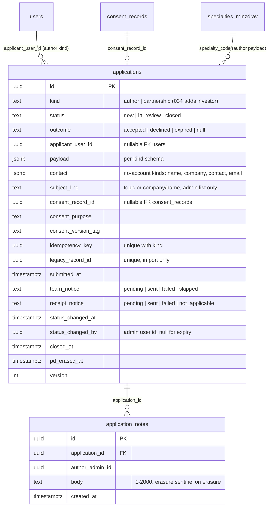
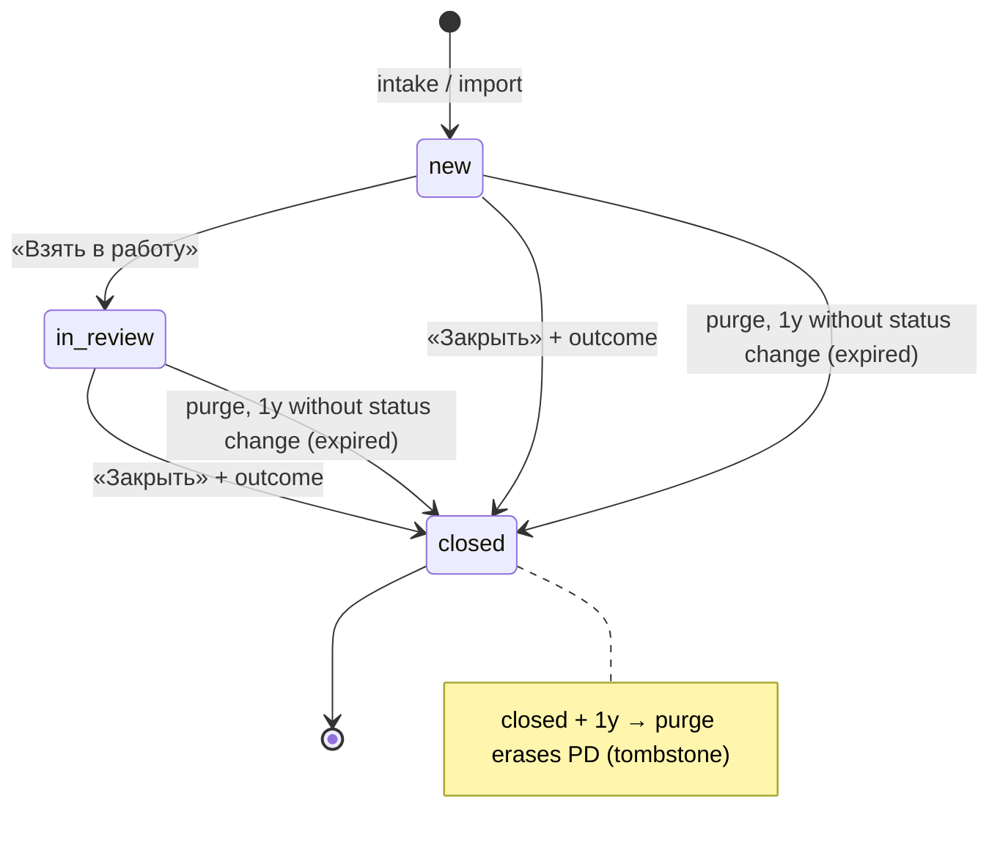

# 033 — Author application: the «Подать заявку» page and the shared application queue (Design, slice 1)

Requirements: [`033-requirements-en.md`](./033-requirements-en.md) · PRD: [`033-product.md`](./033-product.md) · Domain: ADR-0016 §1 (one account), §7 (consent per purpose), §8 (storefront ownership) · PD lifecycle: ADR-0009 §2.3, §2.6 and its design §3 · Sibling: [`034-product.md`](../034-investment-marketplace/034-product.md) (adds the investor kind) · Access: [`047-design.md`](../047-staff-access/047-design.md).

## Current behaviour → replacement delta

| Today                                                                                                                                                                                                                                                                                                                                                                         | Slice 1                                                                                                                                                                   |
| ----------------------------------------------------------------------------------------------------------------------------------------------------------------------------------------------------------------------------------------------------------------------------------------------------------------------------------------------------------------------------- | ------------------------------------------------------------------------------------------------------------------------------------------------------------------------- |
| The Academy home «Экспертам → Подать заявку» entries have no page behind them.                                                                                                                                                                                                                                                                                                | `apps/portal` route `/apply` (EARS-1…EARS-10, EARS-21); the home entries point at it (EARS-2).                                                                            |
| The interim home partnership form (`apps/portal/app/academy-partnership-action.ts`, `lib/academy-partnership-{schema,store}.ts`) writes one private JSON file per request to the portal volume `academy_partnership_submissions` (`/var/lib/ds-platform/academy-submissions`, ops doc `operations/academy-partnership-submissions.md`). Nobody is notified; there is no list. | The form posts to the queue's partnership intake (EARS-18); the stored files are imported once (EARS-19); the store module, the volume mount and the ops doc are removed. |
| No request queue exists in `apps/api` or `apps/admin`.                                                                                                                                                                                                                                                                                                                        | New `apps/api/src/applications/` module, `packages/schemas/src/applications/`, `packages/db/src/schema/applications.ts`, admin «Заявки».                                  |

## Placement

- `packages/db/src/schema/applications.ts` — `applications`, `application_notes`; forward migration in `apps/api/drizzle/`.
- `packages/db/src/audit.ts` — `AUDIT_PD_COLUMNS` gains `applications: ["payload", "contact", "subject_line"]` and `application_notes: ["body"]`; the same migration regenerates the SQL `audit_pd_columns()` from it, so the 010 trigger masks those columns in every ledger row of an insert, update or erasure (EARS-25). `applicant_user_id` stays unmasked, like `registrations.user_id`: it is the structural link the ledger answers for, and the erasure unlinks it on the row.
- `packages/schemas/src/applications/` — `ApplicationKind` enum, per-kind payload schemas (`AuthorApplicationPayload`, `PartnershipRequestPayload`), intake bodies, the applicant read item, admin list / detail / status / note contracts, the problem codes.
- `apps/api/src/applications/` — `applications.me.controller.ts` (author intake + applicant read), `applications.public.controller.ts` (partnership intake; 034 adds its investor intake here), `applications.admin.controller.ts`, `applications.service.ts`, `applications.repository.ts`, `application-notices.ts` (after-commit sends), `applications-retention.purge.ts` (daily, precedent `apps/api/src/sign-in-host/sign-in-host-record.purge.ts`), `import-partnership-records.ts` (the one-off command), README.
- Email bodies in `apps/api/src/mailer/notice-emails.ts` (`applicationTeamNoticeMessage`, `applicationReceiptMessage`) in `email-layout.ts`. Neither takes the application as an argument: the team notice takes kind, time and admin URL, the receipt takes nothing but the projects URL, so no body can carry application content (EARS-11, EARS-12). The look of «Заявка получена» is an applicant-facing email: its Stage A is the owner's pick on #4029, which builds it; the team notice is internal (lead's call).
- `apps/portal/app/apply/page.tsx` (route file) mounting the page from the application package (below); `apps/portal/app/academy-partnership-action.ts` re-pointed at the API.
- `apps/admin/app/applications/` — list and detail.

### Capability owner (ADR-0013 §A1)

The queue is one capability with one owner: **`apps/api/src/applications/` + `packages/schemas/src/applications/`** (the backend core) and **`packages/applications`** (`@ds/applications`: RU copy, the browser transport for `/v1/me/applications*`, the form, gate, states and banner UI, the route component taking a host config). The Academy is its only storefront consumer; 034 consumes the backend core by adding a kind and its own page. The row «Application queue (033 + 034)» is added to [`capability-ownership.md`](../../product/two-site-ia/capability-ownership.md) in this PR; the shared project card of «Пока не готовы?» stays the 030 row's (EARS-21 consumes it, never re-implements it).

## Data model



Checks: `kind = 'author'` ⇒ `applicant_user_id` and `consent_record_id` not null until erasure; `status = 'closed'` ⇔ `outcome` not null ⇔ `closed_at` not null; the author payload holds exactly one of `specialtyCode` (FK-by-value to `specialties_minzdrav.code`, precedent `packages/db/src/schema/registrations.ts:72`) or `specialtyOther`, or neither (specialty optional). Indexes: `(submitted_at desc, id)`, `(kind, status, submitted_at desc)`, `(applicant_user_id) where status <> 'closed'`, `(coalesce(status_changed_at, submitted_at)) where status <> 'closed'` (the expiry scan), unique `(kind, idempotency_key)`.

**Idempotency on the row.** The intake's result is the row itself (`{ id, submittedAt }`), so the key lives on `applications` and the replay is one lookup inside the intake transaction, with no second stored response needing its own retention row; the admin mutations use 012's `idempotency_keys` as every admin endpoint does. The key is unique per kind, and a replay counts only for the same caller: for `author` the stored `applicant_user_id` must equal the session's user, for a public kind the stored payload must equal the body; anything else is `422 IDEMPOTENCY_KEY_REUSED`.

**Erasure tombstone.** `payload = {"erased": true}` (each kind's schema admits that form only together with `pd_erased_at`), `contact = null`, `subject_line = null`, `applicant_user_id = null`, every note `body = '[стёрто]'` (the sentinel satisfies the 1–2000 check; no row is deleted, ADR-0009 §2.3), `pd_erased_at = now()`. The `author` not-null check holds «until erasure», i.e. while `pd_erased_at` is null.

### Request kinds (the 034 seam)

`ApplicationKind` is a closed `z.enum` in `packages/schemas`; each kind owns `{ payloadSchema, contactSchema, subjectLine(payload, contact), intake: "me" | "public", consentPurpose, receiptTo: "account-email" | "contact-email" | null }` in one `APPLICATION_KINDS` table in `apps/api/src/applications/`. The receipt resolver reads `receiptTo`: `account-email` resolves the applicant's `users.email` live, `contact-email` the `email` field the kind's `contactSchema` requires, `null` records `receipt_notice = not_applicable`. Slice 1: `author` → `account-email`; `partnership` → `null` (the interim form promises no letter). 034 adds `investor` → `contact-email` (the representative's work email of 034 US-7) by extending the enum and the table, adding its public intake (`@BotProtected`) beside the partnership one, and a migration widening the `kind` check — the list, detail, status, notes, notifications, retention and erasure work unchanged. The admin kind filter and labels come from the same table.

### Retention (ADR-0009 §2.6 row)

| Table               | PD fields                                                        | Legal basis                                                                                     | Retention                                                                                                                            | Retained-row erasure mechanism                                                                 | Audit exception                                              |
| ------------------- | ---------------------------------------------------------------- | ----------------------------------------------------------------------------------------------- | ------------------------------------------------------------------------------------------------------------------------------------ | ---------------------------------------------------------------------------------------------- | ------------------------------------------------------------ |
| `applications`      | applicant_user_id, payload (about, topic), contact, subject_line | 152-FZ art. 6 p. 1 — consent `author-application-personal-data` / `academy_partnership_contact` | open: closed as `expired` after 1y with no status change (EARS-23); closed: 1y after `closed_at`; account erasure: at once (EARS-24) | value erasure + tombstone (EARS-20): payload, contact and subject_line replaced, user unlinked | none — the PD columns are masked in the 010 ledger (EARS-25) |
| `application_notes` | body (may name the applicant)                                    | operational (legitimate interest) under the application's purpose                               | follows its application                                                                                                              | body replaced with the erasure sentinel with the application's erasure                         | none — `body` masked in the 010 ledger (EARS-25)             |

The consent row itself follows `consent_records` (ADR-0009 matrix rows 4–5: proof retained). The queue-core Issue adds both rows to the master matrix (ADR-0009 design §3) in the same PR as the migration, as that matrix requires.

## Intake and notification sequence (EARS-7, EARS-11, EARS-12)

```mermaid
sequenceDiagram
  participant P as apps/portal /apply
  participant A as apps/api applications
  participant DB as Postgres
  participant M as mailer chain (Postbox → mail.ru → Resend)
  P->>A: POST /v1/me/applications/author (Idempotency-Key, x-smartcaptcha-token)
  A->>A: session → 401; BotProtectionGuard → 403 codes; Zod → 400
  A->>DB: BEGIN; idempotency lookup; insert consent_records + applications (team/receipt = pending); COMMIT
  A-->>P: 201 { id, submittedAt }
  A->>DB: emails of active staff accounts with role platform_admin (047)
  A--)M: team notice (kind, time, admin link) to each, or none
  M--)A: ok | error
  A->>DB: team_notice = sent | failed | skipped (no recipient)
  A--)M: «Заявка получена» (generic) to the kind's receipt recipient
  A->>DB: receipt_notice = sent | failed | not_applicable
```

The sends run after the response, on the request's process (no outbox, no scheduler — the congress precedent of `apps/api/src/congress/README.md`): the row is the record of truth, a crash between commit and send leaves `pending`, which the admin list shows like `failed` and `skipped` («Команда не уведомлена»). An idempotent replay returns the stored `{ id, submittedAt }` and sends nothing. The team is read at send time from 047: the active staff accounts holding `platform_admin`, the same people who can open the queue. There is no team-list config, no env and no prod step; zero recipients records `skipped` and never touches boot.

**Egress (ADR-0011 §2, channel 7).** Email is a channel whose processors must be RF-located; the 003 chain's Resend reserve is outside the RF and is admitted only for «the recipient address and short-lived code, never medical/profile payload», any wider scope reopening the decision (`003-design.md` §14, line 887). The queue emails stay inside that scope: the recipient address plus non-personal text — the kind, the submission time, an admin link carrying the application's opaque id, the projects link. No topic, name, company, contact, about or note is ever in a body, so a reserve send carries nothing the 003 posture does not already admit, and ADR-0011 is not reopened. The team recipients are the `platform_admin` accounts' own emails, the same class of address the 003 chain already sends sign-in codes to.

## Lifecycle (EARS-15, EARS-20, EARS-23, EARS-24)



The daily purge runs two steps in one pass: first it closes every open application whose `coalesce(status_changed_at, submitted_at)` is a year old with outcome `expired`, `status_changed_by = null`, `closed_at = now()` (EARS-23); then it erases every application closed for a year (EARS-20). An expired application so carries PD at most two years from its last status change. One year without a status change means the team never took it up; the imported interim partnership rows enter as `new` and fall under the same clock from their original `submitted_at`. `expired` is not in the admin status contract: the admin can choose only `accepted` / `declined`.

Erasure is orthogonal to status: it can run in any status, sets `pd_erased_at`, and the row keeps kind, status, outcome and times. The subject's request reaches the team by any channel; the administrator runs «Стереть персональные данные заявителя» on each of that subject's applications (the detail lists the subject's other applications for an author account).

**Account erasure (EARS-24).** `applications.service.ts` exports `eraseApplicationsOfAccount(userId, tx)`: it applies the EARS-20 tombstone to every application whose `applicant_user_id = userId` that is not yet erased, in the caller's transaction, and is idempotent. It is the queue's per-table step of the ADR-0009 §2.3 erasure execution and is named as the erasure mechanism of the `applications` row the core Issue adds to the ADR-0009 retention matrix (design §3), the per-table policy the erasure executor follows. #4028 delivers the step, its matrix registration and its test. The executor itself (ADR-0009 §2.3 forward reference, the `pd-lifecycle` `erasure-execute` job) is ADR-0009's delivery, not 033's, and is not on `main` today; until it lands an account-erasure request reaches the team like any subject request and the administrator erases each listed application (EARS-20), so no application PD is left without a path to erasure.

## Import of the interim records (EARS-19)

`pnpm --filter @ds/api applications:import-partnership <dir>` reads each `<id>.json` (`AcademyPartnershipRecord` of `academy-partnership-store.ts`), validates it against `PartnershipRequestPayload`, inserts `kind = partnership`, `legacy_record_id = id`, `submitted_at` from the record, consent purpose / version tag from the record, `team_notice = skipped`, `receipt_notice = not_applicable`, on conflict of `legacy_record_id` do nothing; prints `imported / already present / invalid` and the invalid names. Run order on prod: deploy with the re-pointed form → run the import against the volume mounted read-only into a one-off api container → compare counts with the file count → remove the volume from Compose. Removing the volume is an irreversible data action and waits for the owner's explicit «go» (AGENTS.md §6), tracked in the partnership Issue as a deferred prod action.

## Endpoints

| Method + path                                          | Caller                                            | Contract                                                                                       |
| ------------------------------------------------------ | ------------------------------------------------- | ---------------------------------------------------------------------------------------------- |
| `POST /v1/me/applications/author`                      | signed-in account, `@BotProtected("application")` | `Idempotency-Key`; body `AuthorApplicationIntake` → `201 { id, submittedAt }` (EARS-6, EARS-7) |
| `GET /v1/me/applications?kind=author`                  | signed-in account                                 | `{ items: [{ id, submittedAt, topic, state: "received" }] }` — own, not closed (EARS-10)       |
| `POST /v1/public/applications/partnership`             | anyone, `@BotProtected("partnership")`            | `Idempotency-Key`; body `PartnershipRequestIntake` → `201 { id }` (EARS-18)                    |
| `GET /v1/admin/applications?kind&status&cursor`        | `platform_admin` + 2FA                            | `AdminDataList` page (EARS-13)                                                                 |
| `GET /v1/admin/applications/{id}`                      | `platform_admin` + 2FA                            | detail + notes + `ETag` version (EARS-14)                                                      |
| `POST /v1/admin/applications/{id}/status`              | `platform_admin` + 2FA, CSRF                      | `Idempotency-Key`, `If-Match`; `{ status, outcome? }` (EARS-15)                                |
| `POST /v1/admin/applications/{id}/notes`               | `platform_admin` + 2FA, CSRF                      | `Idempotency-Key`; `{ body }` (EARS-16)                                                        |
| `POST /v1/admin/applications/{id}/erase-personal-data` | `platform_admin` + 2FA, CSRF                      | `Idempotency-Key`; `409 ALREADY_ERASED` on a second call (EARS-20)                             |

Admin endpoints use `AdminAuthorityGuard` (`apps/api/src/auth/admin-session/admin-authority.guard.ts`) and the 012 EARS-16/17 envelope; every mutation writes a 010 change-audit row. The doctor storefront imports none of these contracts (EARS-2).

## UI composition

### Academy (canvas, Stage A pending)

Canvas `design-source/academy-apply.dc.html`, switch «Объём» = «срез 1», and the «Экспертам» entries of `design-source/academy-home.dc.html`.

| State           | Canvas branch                              | Notes                                                                                                         |
| --------------- | ------------------------------------------ | ------------------------------------------------------------------------------------------------------------- |
| `page`          | hero, «Что будет дальше», «Условия автора» | slice-1 path: administrator, then programme, production, medical expertise, publication; no producer sentence |
| `gate`          | guest                                      | account gate in place of the form (EARS-3)                                                                    |
| `form`          | «заполнено» / empty                        | «Отправите как», fields, required tags, consent row (EARS-4, EARS-6)                                          |
| `form-errors`   | attempted                                  | inline errors, consent error (EARS-5)                                                                         |
| `network-error` | «сбой сети»                                | banner + «Попробовать ещё раз» (EARS-8)                                                                       |
| `sent`          | `scr = sent`                               | «Заявка отправлена», «Пока ждёте — посмотрите», «Отправить ещё одну заявку» (EARS-9, EARS-21)                 |
| `repeat`        | `repV = on`                                | «Ваша предыдущая заявка в работе…» (EARS-10)                                                                  |
| `not-ready`     | «Пока не готовы?»                          | projects link + first catalog card; no expert card in slice 1 (EARS-21)                                       |

The specialty select lists the whole `specialties_minzdrav` book (the canvas shows a sample of five) with search, from `@ds/design-system` `Combobox`; «Другое» stays the last option.

### Admin (approved-non-canvas)

| State                | Composition                                                                                                                                                                                                                                                                                                 |
| -------------------- | ----------------------------------------------------------------------------------------------------------------------------------------------------------------------------------------------------------------------------------------------------------------------------------------------------------- |
| `applications-list`  | «Заявки»: `AdminDataList` — «Вид», «Получена», «Заявитель», «Тема / компания», «Статус»; filters «Вид» (Все / Авторы / Партнёрство / …) and «Статус» (Новые / На рассмотрении / Закрытые); closed outcomes «Принята» / «Отклонена» / «Истекла»; marks «Команда не уведомлена», «Персональные данные стёрты» |
| `application-detail` | sent fields with labels; applicant card (account name, email, phone, or the given contact); consent purpose / version / time; notice outcomes; «Взять в работу», «Закрыть» (dialog with «Принята» / «Отклонена»); notes list + «Добавить заметку»                                                           |
| `application-erase`  | «Стереть персональные данные заявителя» → confirm dialog naming what is erased and what stays                                                                                                                                                                                                               |
| `stale`              | `412` → reload notice, nothing changed                                                                                                                                                                                                                                                                      |

## Dependencies

- **030 #3505** (public catalog read) — merged; EARS-21 reads it.
- **030 #3506** (shared project card, `/projects`) — the «Project links of the page» package (#4033) is `blocked_by` #3506: the card and its target page must exist before the page links to them.
- **030 #3506 / #3507 edges on #1802** — 030 blocked its catalog and project-page packages on this parent so no link points at a missing `/apply`. Kept on the parent they would deadlock with the project-links package (which waits for #3506 and must close before #1802 does); they are rewired to the «Подать заявку» page Issue #4031, the precise prerequisite.
- **034 #1824** — `blocked_by` the queue-core Issue #4028 (034 slice 1 adds its kind to the queue). #3506 / #3507 stay `blocked_by` #1824 (the 034 parent): when the 034 triplet opens its own project-links child after #3506, those two edges must move from #1824 to the 034 page Issue the way this spec moved them from #1802, or the same deadlock returns.
- **003 / 021** sign-in and registration with a return target, **bot protection** (`apps/api/src/bot-protection/`), the **mailer** chain, **047** admin access, **010** audit, **`specialties_minzdrav`** — on `main`, no edge.

## Delivery slices

1. **Queue core** (EARS-6, 7, 20, 23, 24, 25) — schema, migration, PD columns in `AUDIT_PD_COLUMNS` / `audit_pd_columns()`, kinds table, author intake, consent, idempotency, bot protection, erasure handler, expiry and purge, the account-erasure step, the ADR-0009 matrix rows. Head.
2. **Notifications** (EARS-11, 12) — after core; carries the Stage A of «Заявка получена».
3. **Admin queue** (EARS-13…17, the admin screens of 22) — after core.
4. **«Подать заявку» page** (EARS-1…5, 8, 9, 10, the page screens of 22) — after core; creates `packages/applications`.
5. **Interim partnership form into the queue** (EARS-18, 19) — after core.
6. **Project links of the page** (EARS-21) — after the page and 030 #3506.
7. **Browser journeys** (V-9, V-10, V-11, V-13) — integration, after 2, 3, 4.

## Lead decisions

The PRD's _agent-proposed — UNCONFIRMED_ items, specified as the PRD writes them, plus the design choices made here:

1. **Sign-in before the form** (US-2): the guest sees the account gate, never a fillable form; the draft across sign-in is the later slice (EARS-3).
2. **Repeat applications** (US-7): an expert with an open application sees «Ваша предыдущая заявка в работе. Новую можно отправить, если это другой проект.» and can send another; no limit in slice 1 (EARS-10).
3. **Double submission** (Flows): one idempotency key per form instance, the button disabled in flight, retry reuses the key; the server returns the stored result on replay (EARS-7, EARS-8).
4. **Statuses** (US-11): `new → in_review → closed` with `new → closed` allowed, outcome `accepted` / `declined` required at close, closed final in slice 1 (EARS-15).
5. **Notes** (US-11): append-only, internal, never on an applicant read or email (EARS-16).
6. **Attribution** (product AC): status changes store the actor and time on the row and in the 010 audit (EARS-15, EARS-17).
7. **Consent** (US-8, lead-asserted 152-ФЗ constraint): separate purpose `author-application-personal-data`, recorded in `consent_records` in the intake transaction (046 precedent) (EARS-6).
8. **Team-notification channel** (US-12): email through the platform's existing mailer chain to every active staff account holding the 047 `platform_admin` role — the people who work the queue; no team-list config, no env, no prod step, and zero recipients records `skipped` («Команда не уведомлена») instead of failing boot. The email carries only the kind, the submission time and the admin link. ADR-0011 §2 channel 7 admits RF-located email processors only, and the 003 chain's foreign Resend reserve may carry only the recipient address and a short-lived code (`003-design.md` §14); a body with no application content keeps the queue emails inside that scope, which is why no topic, name, company or contact is in it (EARS-11, «Intake and notification sequence»).
9. **Notification failures**: one attempt after commit through the chain's provider failover, outcome recorded and marked in the list; no outbox or scheduler (congress precedent) (EARS-11, EARS-12).
10. **Bot protection on both intakes**: the signed-in author intake is `@BotProtected` too, so «every public intake» holds without a per-kind exception (EARS-7, EARS-18).
11. **Applicant read**: open author applications only, each «received»; a closed one disappears from the banner, because the slice shows no outcome to the applicant (EARS-10).
12. **Field bounds and optionality** follow the canvas: «Тема» and «Формат» required, «Специальность» and «О себе» optional; formats «курс-сериал», «отдельный урок», «подкаст», «выступление» (EARS-4).
13. **Specialty** = the whole Минздрав book with search plus «Другое» with its text (EARS-4, EARS-7).
14. **Route** `academy.doctor.school/apply` (EARS-1, EARS-2).
15. **Interim form kept on the home and re-pointed** at the queue (kind `partnership`); its fields, copy and states do not change; the bot-protection widget it gains follows the platform posture of every `@BotProtected` intake (the congress precedent), and if the widget renders visibly the change is a visible difference that #4032 takes through Stage-B; the stored files are imported once and the volume removed after the owner's go (EARS-18, EARS-19).
16. **Retention**: an open application with no status change for one year is closed as `expired` by the daily purge; every application is erased to a tombstone one year after closing; erasure on request by an administrator action and on account erasure (EARS-20, EARS-23, EARS-24). One year without a status change is a bounded clock long enough for a team that takes up applications in weeks, and it gives the imported interim rows the same end.
17. **Applicant contact is read live** from the account, not copied, so account edits and account erasure reach the queue (EARS-14, EARS-20).
18. **Project links ship as their own package** after 030 #3506 so neither feature ships a link to a missing page; the 030 edges are rewired from #1802 to the page Issue (Dependencies).
19. **No application content in any email**: the «Заявка получена» receipt is generic and names no topic; the team notice is kind + time + admin link; the recipient address is the only personal data in a queue email (decision 8, EARS-11, EARS-12).
20. **Receipt recipient per kind**: `receiptTo` in the kinds table — the account email for `author`, the contact email for a no-account kind with a receipt (034's investor), none for `partnership` — so 034 adds its receipt without reshaping notifications (EARS-12, «Request kinds»).
21. **PD masked in the audit ledger**: the queue's PD columns join `AUDIT_PD_COLUMNS` / `audit_pd_columns()` in the core migration, so the 010 trigger never copies application content into the 5-year ledger (EARS-25, «Placement»).
22. **Account erasure**: the queue delivers its per-table erasure step and registers it in the retention matrix; the ADR-0009 executor calls it (EARS-24, «Lifecycle»).
23. **Idempotency on the row**, unique per kind and bound to the caller (author) or the body (public kinds) («Data model»).
24. **Stage A split**: the page look is the owner's pick on #4031; the «Заявка получена» email look on #4029, which builds it.
