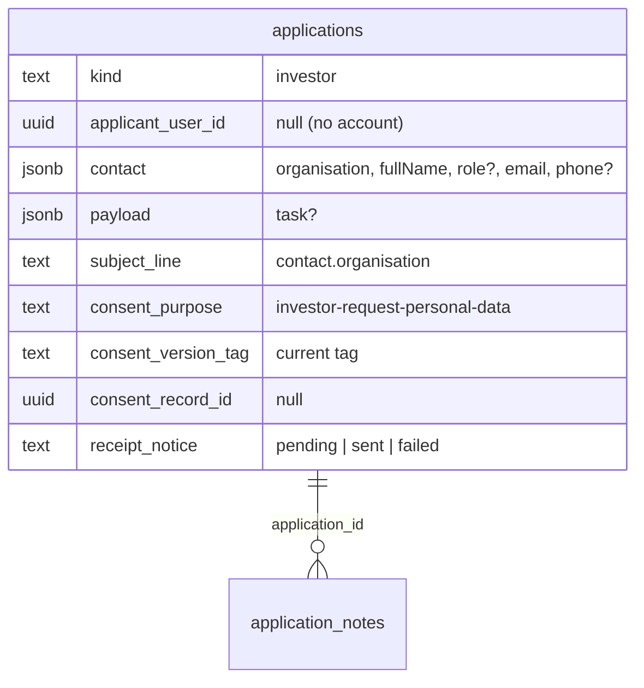

# 034 — Investors, slice 1: the «Как это работает» page with «Обсудить проект» into the shared queue (Design)

Requirements: [`034-requirements-en.md`](./034-requirements-en.md) · PRD: [`034-product.md`](./034-product.md) · Queue: [`033-design.md`](../033-author-application/033-design.md) «Request kinds (the 034 seam)» · Domain: ADR-0016 §2, §4, §6, §7, §8 · PD lifecycle: ADR-0009 §2.3, §2.6 · Egress: ADR-0011 §2 channel 7.

## Current behaviour → replacement delta

| Today                                                                                                                                                   | Slice 1                                                                                                                         |
| ------------------------------------------------------------------------------------------------------------------------------------------------------- | ------------------------------------------------------------------------------------------------------------------------------- |
| No investor page exists; the canvas home's «Партнёрам / Инвесторам → Как это работает» entries point nowhere.                                           | `apps/portal` route `/investors` (EARS-1…EARS-8, EARS-11, EARS-13); the 029 home points its entries at it.                      |
| The live home's interim partnership form (`#partner-form`) is the only organisation contact; 033 #4032 re-points it at the queue as kind `partnership`. | Unchanged by 034 — it stays 033's and leaves with the 029 home. Investor requests arrive as their own kind `investor` (EARS-6). |
| The 013 PRD partner lead capture (US-5…US-9) is frozen; no queue kind for an organisation's request with a receipt exists.                              | The 033 queue gains `investor` with `receiptTo: contact-email` — the case 033 decision 20 reserved for it (EARS-9).             |

Prior art is the frozen 013 PRD (US-5…US-7) and 015 PRD (US-9 / US-10), mapped here by the functional map §E; the only stored organisation requests are the interim partnership files, which 033 #4032 imports as kind `partnership` — 034 migrates nothing.

## Placement

- `packages/schemas/src/applications/` — `ApplicationKind` gains `investor`; `InvestorRequestContact` (`organisation`, `fullName`, `role?`, `email`, `phone?`), `InvestorRequestPayload` (`task?`), `InvestorRequestIntake` (contact + payload + `consent: { accepted: true, versionTag }`); the consent text and current version tag of `investor-request-personal-data` next to them, so the page and the intake read one value.
- `apps/api/src/applications/` — the `APPLICATION_KINDS` entry `investor: { payloadSchema, contactSchema, subjectLine: (_, c) => c.organisation, intake: "public", consentPurpose: "investor-request-personal-data", receiptTo: "contact-email" }`; `applications.public.controller.ts` gains `POST /v1/public/applications/investor` with `@BotProtected("investor-request")` (the `BotProtectionAction` union gains the action).
- `apps/api/drizzle/` — forward migration widening the `applications.kind` check to `investor`; no new column (`contact`, `payload`, `subject_line`, `consent_purpose`, `consent_version_tag` already exist; `consent_record_id` stays null for a no-account kind).
- `packages/applications` (`@ds/applications`) — `InvestorsPage` route component (blocks, form, states), its RU copy module, the browser call to the public intake; it reuses the package's form fields, consent row, failure banner and sent-state from the «Подать заявку» page (033 #4031) — the same blocks with the investor field set, never a second rendition.
- `apps/portal/app/investors/page.tsx` — route file mounting `InvestorsPage`; no other host file.
- `apps/admin/app/applications/` — no new screen: the kind label «Инвестор», the filter «Инвесторы» and the detail field labels come from the kinds table (033 «Request kinds»).
- [`capability-ownership.md`](../../product/two-site-ia/capability-ownership.md) row «Application queue» — the host-file cell names the `/investors` route file (this PR).

## Data



Idempotency follows the 033 public-kind rule: the key is unique per kind and a replay counts only when the stored body equals the new one (033 «Idempotency on the row»). The erasure tombstone of 033 nulls `contact` and `subject_line` and sets `payload = {"erased": true}`.

## Intake and notification sequence (EARS-6, EARS-9)

```mermaid
sequenceDiagram
  participant P as apps/portal /investors
  participant A as apps/api applications
  participant DB as Postgres
  participant M as mailer chain
  P->>A: POST /v1/public/applications/investor (Idempotency-Key, x-smartcaptcha-token)
  A->>A: BotProtectionGuard → 403 codes; Zod → 400; consent tag ≠ current → 400
  A->>DB: BEGIN; idempotency lookup; insert applications (kind investor, team/receipt = pending); COMMIT
  A-->>P: 201 { id }
  A--)M: team notice (kind, time, admin link) to each platform_admin
  A--)M: «Заявка получена» (generic) to contact.email
  A->>DB: team_notice, receipt_notice outcomes
```

The sends are 033's (#4029): the investor kind only supplies `receiptTo: contact-email`, which the 033 receipt resolver reads; neither body takes the request as an argument, so no organisation, name, task or phone can reach an email (ADR-0011 §2 channel 7, 033 decision 19).

## UI composition

### Academy (canvas, Stage A pending)

Canvas `design-source/academy-invest.dc.html` (owner-drawn R4, vendored in #1451), switches «Объём» = «срез 1», «Заявка» = А, «Вход» = гость. The page look is a sponsor-facing screen: its Stage A is the owner's pick on the page Issue (AGENTS.md §6). Stage-A items: the page look; the sent-state text (decision 6); the «Как оформляются отношения» line «внесено → фонд → начисления» (EARS-1).

| State           | Canvas branch                                                                                     | Notes                                                                                                         |
| --------------- | ------------------------------------------------------------------------------------------------- | ------------------------------------------------------------------------------------------------------------- |
| `page`          | header, «Как это работает», «Что получает инвестор», «Как оформляются отношения», «Следующий шаг» | header badge «приём заявок открыт»; slice-1 step texts; no marketplace, no «Организация, не персона» (EARS-1) |
| `form`          | «Заявка» = А, empty / filled                                                                      | fields, «необязательно» marks, consent row; the «Проекты» line (EARS-3, EARS-4, EARS-11)                      |
| `form-errors`   | attempted                                                                                         | «Заполните поле», «Похоже, в адресе опечатка», consent error (EARS-5)                                         |
| `network-error` | not drawn — approved-non-canvas, the 033 «сбой сети» state                                        | banner + «Попробовать ещё раз», the same package block as 033 EARS-8 (EARS-7)                                 |
| `sent`          | `formSent`                                                                                        | «Запрос отправлен», the Stage-A text, «Отправить ещё одну заявку» (EARS-8)                                    |

The «Как оформляются отношения» line «внесено → фонд → начисления» of the canvas names the steps of the project accounting the page explains; it promises no payment on the platform and is built as drawn, subject to the Stage-A pick (EARS-1).

### Admin (approved-non-canvas, 033)

The 033 `applications-list` and `application-detail` states with the investor kind: list kind «Инвестор», subject line = organisation, filter «Инвесторы»; detail rows «Организация», «ФИО», «Роль в организации», «Рабочая почта», «Телефон», «Задача» and the consent row. No new state.

## Retention (ADR-0009 §2.6 row)

Investor requests are rows of `applications` and follow its matrix row (033 design «Retention»); the investor intake Issue adds the purpose `investor-request-personal-data` to that row's legal-basis cell in the master matrix (ADR-0009 design §3) in the same PR as the migration. The purge, the expiry and the 010 masking apply by table and column, unchanged.

## Dependencies

| Edge                                                                                               | Rationale (technical)                                                                                                                                                                                                                                                                                                                                                                |
| -------------------------------------------------------------------------------------------------- | ------------------------------------------------------------------------------------------------------------------------------------------------------------------------------------------------------------------------------------------------------------------------------------------------------------------------------------------------------------------------------------ |
| Investor request kind `blocked_by` **033 #4028** (queue core)                                      | The kind is a member of the enum, a row of the kinds table and a widening of the `kind` check that #4028 creates; there is nothing to extend before it.                                                                                                                                                                                                                              |
| Investor request kind `blocked_by` **033 #4029** (notifications)                                   | The receipt to the work email is the `contact-email` branch of the receipt resolver #4029 builds; EARS-9 cannot be delivered or tested before it.                                                                                                                                                                                                                                    |
| Admin labels `blocked_by` **033 #4030** (admin queue) and the investor kind                        | The labels and filter are the kinds-table projection of the «Заявки» screens #4030 builds, over rows the investor kind creates.                                                                                                                                                                                                                                                      |
| «Инвесторам» page `blocked_by` the investor kind and **033 #4031** («Подать заявку» page)          | The form posts to the investor intake; #4031 creates `packages/applications` and the form, consent, failure and sent blocks the page reuses (Placement).                                                                                                                                                                                                                             |
| Projects link `blocked_by` the page and **030 #3506** (catalog `/projects`)                        | The link targets `/projects`, which #3506 ships; no link to a missing page (EARS-11).                                                                                                                                                                                                                                                                                                |
| **030 #3506 / #3507** edges on #1824 → rewired to the page Issue                                   | 030 blocked its catalog and project-page packages on #1824 so no «Стать партнёром» link points at a missing page. Kept on the parent they would deadlock with the projects-link package (which waits for #3506 and must close before #1824); `open-ears-issues` moves them to the «Инвесторам» page Issue, the precise prerequisite — the 033 precedent (033 design «Dependencies»). |
| **029 #1799** (home) `blocked_by` #1824                                                            | Existing edge, kept: the home entries point at `/investors`.                                                                                                                                                                                                                                                                                                                         |
| 003 bot protection, the mailer chain, 047 `platform_admin`, 010 audit, `/documents/privacy-policy` | On `main`, no edge.                                                                                                                                                                                                                                                                                                                                                                  |

## Delivery slices

1. **Investor request kind** (EARS-4 server, EARS-6, EARS-9, EARS-12) — after #4028 and #4029. Head.
2. **Investor requests in the admin queue** (EARS-10) — after 1 and #4030.
3. **«Инвесторам» page** (EARS-1…EARS-5, EARS-7, EARS-8, EARS-13) — after 1 and #4031; carries the page's Stage A.
4. **Projects link of the page** (EARS-11, V-10) — after 3 and 030 #3506; its own scenario, outside the browser journeys.
5. **Browser journeys** (V-6…V-9) — integration, after 2 and 3.

## Lead decisions

The PRD's _agent-proposed — UNCONFIRMED_ and lead items, specified as the PRD writes them, plus the design choices made here:

1. **Route** `academy.doctor.school/investors` — the page and the persona say «Инвесторам» (PRD naming); the home's «Партнёрам» card and «Инвесторам» entries both point at it (EARS-1, EARS-2).
2. **No account** (US-4): the form is open to every visitor; the cabinet is 035's (EARS-3).
3. **Field set and bounds** follow the canvas: organisation, full name, work email required; role, phone and task optional (the canvas validates none of the three); bounds as 033 (EARS-3).
4. **Consent** (US-5, lead-asserted 152-ФЗ constraint): its own purpose `investor-request-personal-data`, the canvas text and the existing `/documents/privacy-policy`; recorded on the row like the 033 partnership kind (`033-design.md`), since `consent_records.user_id` is NOT NULL and the request has no account (EARS-4).
5. **Failure state** (US-6): the canvas draws none; the 033 «сбой сети» block with its wording, so the queue's two public pages fail the same way (EARS-7).
6. **Sent-state text** (US-7): the owner's canvas text until the Stage A pick; the agent lead's canvas variant is shown beside it at Stage A (EARS-8; PRD «Product acceptance criteria»).
7. **Receipt to the work email** through the 033 `contact-email` resolver, with the generic body (EARS-9).
8. **Admin labels** «Инвестор» / «Инвесторы» and the organisation as subject line (EARS-10).
9. **One link out**: «Во что инвестировать — Проекты», shipped after `/projects` exists; the 030 edges move to the page Issue (EARS-11, «Dependencies»).
10. **Bot protection only** against floods, as every public intake (`@BotProtected("investor-request")`); no own rate limit (EARS-6).
11. **Retention** = the `applications` row, its legal basis gaining the investor purpose (EARS-12).
