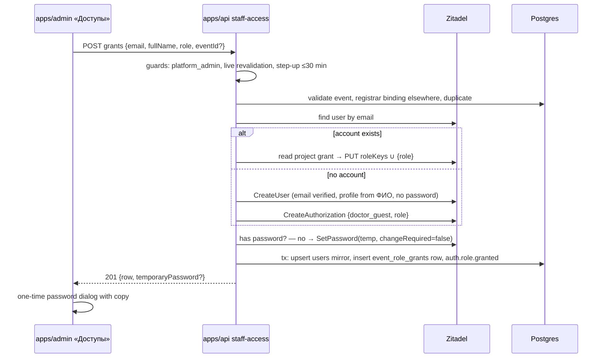

# 047 — Staff access (Design)

Requirements: [`047-requirements-en.md`](./047-requirements-en.md) · Builds on: 011 (admin session), [`044-design.md`](../044-congress-signup/044-design.md) (`event_role_grants`), [`046-design.md`](../046-congress-submissions/046-design.md) (committee binding) · Today's manual mechanism this replaces: `apps/docs/content/operations/admin-onboarding.md`.

## Placement

- **Admin route** `apps/admin/app/access/page.tsx` («Доступы»), added to `ADMIN_SECTION_NAV` in `apps/admin/lib/admin-access.ts` after the existing sections. `ADMIN_SECTION_NAV` is drawn only for `full` access (`platform_admin`), so a registrar or committee member never sees the link, and `canAccessPath` already refuses the route for them. The chrome is a projection; the API refusal (EARS-1) is the authority.
- **API module** `apps/api/src/staff-access/` — controller, service, repository; the IdP calls go through the existing `IdpClient` port (`apps/api/src/auth/idp/idp.types.ts`) with new methods on `ZitadelIdpClient` and the fake.
- **Contract** `packages/schemas/src/admin/staff-access.ts` — `GRANTABLE_STAFF_ROLES` (`platform_admin`, `event-registrar`, `congress-program-committee`, `pd_officer`), the list row, the grant request and response, the revoke request. The API and the admin form read the same list, so a future role is one edit.
- No new table. The coarse role stays in the Zitadel project grant, the event binding in `event_role_grants` (ADR-0001 §1).

## Endpoints

| Route                                     | Classification                                                                                                                                |
| ----------------------------------------- | --------------------------------------------------------------------------------------------------------------------------------------------- |
| `GET /v1/admin/staff-access`              | `roles: [platform_admin]`, `revalidate: "live"`, read                                                                                         |
| `POST /v1/admin/staff-access/grants`      | `roles: [platform_admin]`, `revalidate: "live"`, `stepUp: true`, `audit: high-stakes`, CSRF double-submit; response `Cache-Control: no-store` |
| `POST /v1/admin/staff-access/revocations` | `roles: [platform_admin]`, `revalidate: "live"`, `stepUp: true`, `audit: high-stakes`, CSRF double-submit; body `{ userId, role, eventId? }`  |
| `POST /v1/admin/auth/step-up`             | `access: authenticated` (any admin session), `audit: high-stakes`, rate-limited and timing-equalized like 011 `mfa/verify`; body `{ code }`   |

Revocation is a `POST` of a revocation command rather than a `DELETE` with a body: the row identity is a triple with an optional event, and a command body keeps it in one validated Zod object.

## The list (EARS-2)

The authority for «who holds a staff role» is the Zitadel project grant, not the `users.role` mirror (which keeps only the highest-precedence staff role, `staff-role.ts`). The list is built by:

1. one IdP read of every project grant whose `roleKeys` intersect `GRANTABLE_STAFF_ROLES` (user-grant search scoped to the project, see «IdP calls»);
2. one DB read of `users` (by `zitadel_sub`) for ФИО (`display_name`) and email, and of `event_role_grants` joined to `events` for the bindings;
3. expansion to rows: one row per (person, role) for `platform_admin` / `pd_officer`, one row per (person, role, event) for the event-bound roles. An event-bound role in the IdP grant with no binding row is listed with an empty event, so a half-finished grant is visible and revocable.

An IdP fault on the list read is a `503` the admin shows with «Повторить», never an empty list.

## Grant cascade (EARS-3…EARS-6, EARS-9)

- **Validation first** (EARS-3), before any IdP write: Zod shape; event required exactly for the two event-bound roles and existing; `event-registrar` refused when the person already has a registrar binding to another event; refused when the person already holds the role (or the role for that event). The duplicate check reads the IdP grant and `event_role_grants` — both are cheap and the IdP grant is the authority for the non-bound roles.
- **Existing account** (EARS-4) — found by email through the IdP (the mirror may lack a row for an operator-created account). The role is added with `PUT /management/v1/users/{userId}/grants/{grantId}` carrying the union of the current `roleKeys` and the new role; a `POST` would answer `409` for a user who already holds a grant (proven on stage 2026-10-13). An account with no grant at all (rare: an IdP user never granted) gets `CreateAuthorization {doctor_guest, role}`. The profile name is not touched.
- **New account** (EARS-5) — `CreateUser` on the existing adapter path with `credential: "none"` and the submitted profile (the 044 EARS-4 passwordless variant), email `isVerified: true` (the administrator vouches for the address, as the runbook does), then `CreateAuthorization {doctor_guest, role}`. **ФИО** is one field; it is split on the first whitespace into `familyName` (first word) and `givenName` (the rest — name and patronymic), and requires at least two words; `displayName` and the mirror `display_name` are the full string as typed. No consent row and no declaration are written: staff accounts are not doctor registrations (021 EARS-4/5).
- **Temporary password** (EARS-6) is set **last** among the IdP writes, and for any account that has no password (`hasPassword`, already in the adapter) — a new account, or an existing passwordless one (a 044 congress account made into a committee member cannot sign in to the admin without a password). Setting it last makes a retry after a partial failure converge: the second attempt finds the account, finds no password, sets one and shows it. An existing account with a password keeps it and the response carries none. Generation follows the runbook rule: 16 characters from an unambiguous alphabet (no `0 O o 1 l I`), upper, lower and digit, one symbol from `-_!@#%` not at either end, from `crypto.randomInt`. `changeRequired: false` because the admin sign-in has no forced-change step (runbook step 4). The password exists in the request scope and the `201` body only: no log line, no audit field, no DB column; the response is `no-store`. Handing it over is the administrator's act (Scope → Out).
- **Mirror and binding** — one DB transaction under `withRequestAuditContext`: upsert the `users` row (`zitadel_sub`, email, `email_verified`, `display_name` on create; `role` = `mirrorRoleFromClaims` of the new role set), insert the `event_role_grants` row, append `auth.role.granted`. The 010 trigger records the binding row with the administrator as the actor.
- **Order and failure.** IdP writes precede the DB transaction. A DB failure after the IdP grant leaves an event-bound role with no binding, which 044 EARS-38 / 046 EARS-26 already refuse everywhere but the session endpoints — fail-closed — and the list shows the row with an empty event; repeating the grant converges. A role newly added to a person takes effect at their next admin sign-in (the session record holds the roles of its sign-in); an added event of a role already held takes effect on the next request, because bindings are read per request.

## Revoke cascade (EARS-7, EARS-9)

1. Refuse when `userId` is the caller and `role` is `platform_admin` (no self-lockout; the last administrator therefore can never remove themselves).
2. DB transaction: delete the `event_role_grants` row for an event-bound role; append `auth.role.revoked`.
3. IdP: when the person has no remaining binding of that role (or for `platform_admin` / `pd_officer`), `PUT` the grant with `roleKeys` minus the role — `doctor_guest` and the other roles stay.
4. Sessions: `AdminSessionService.forceLogout(sub)` (011 EARS-10, `auth.session.terminated` reason `force` per session), plus a new `PendingAuthStore.deleteBySub(sub)` with a `sub → refs` index mirroring the session store, so a sign-in that passed the password step before the revocation cannot mint a session from its 5-minute role snapshot.
5. Mirror `users.role` re-projected from the remaining roles.

All admin sessions of the person end, even when they keep other staff roles: the session record is a role snapshot, and ending it is the one way to make the revocation exact. They sign in again with what remains. This closes #2420 for these roles; the runbook «Offboarding» section is rewritten to «Отозвать» in the same slice.

## Step-up re-elevation (EARS-8)

The guard half of ADR-0001 §10 runs in production (#1304): `AdminAuthorityGuard` refuses a `stepUp` route when the session's `mfaVerifiedAtMs` is older than 30 minutes, with `401 STEP_UP_REQUIRED` and `stepUpUrl`. What is missing is the way back: `STEP_UP_URL` points at 011 `mfa/verify`, a pending-auth route that refuses a caller who already holds a session, and the admin does not intercept the error. Grant and revoke are the first step-up routes an operator will reach more than 30 minutes after signing in, so 047 builds the minimal return path:

- `POST /v1/admin/auth/step-up {code}` verifies the code against the caller's registered TOTP factor (the 011 `checkTotpCode` path, same lockout budget, same uniform refusal) and sets `mfaVerifiedAtMs = now` on the session record. `STEP_UP_URL` points to it. Each attempt writes `auth.step_up.requested` / `succeeded` / `failed`, the class ADR-0001 §10 registers.
- The admin data provider maps `401 STEP_UP_REQUIRED` to a dialog «Подтвердите действие» with one «Код из приложения» field (`InputOTP`), posts the code, and on success repeats the original request; the form state is kept. `503 IDP_REVALIDATION_UNAVAILABLE` shows retry, a `403 …_REQUIRED` shows no-access (ADR-0001 §10).
- #1198 (build the step-up mechanism, graduate the 011 factor-removal route) keeps the graduation of `DELETE /v1/admin/users/:id/mfa`; it is `blocked_by` this slice, which delivers the re-elevation it needs.

## Audit (EARS-9)

`auth.role.granted` / `auth.role.revoked` — ADR-0001 design §7.3 fields `user_id`, `role`, `by_admin`, `ts`, plus `event_id` when the role is event-bound (metadata inside the registered class, the same within-a-class idiom as `tier`). Written in the DB transaction of the change, through the same auth-audit writer as the 011 rows. The account creation itself is the `users` insert in the 010 change audit; no new class is registered. The temporary password never appears in any audit field.

## IdP calls and their live proof

| Call                                                                                     | Status in the adapter                                            |
| ---------------------------------------------------------------------------------------- | ---------------------------------------------------------------- |
| user search by email                                                                     | exists privately (`resolveUserId`); exposed as `findUserByEmail` |
| `CreateUser` passwordless with profile                                                   | exists (044 EARS-4)                                              |
| `CreateAuthorization`                                                                    | exists (`grantProjectRole`), widened to several role keys        |
| user-grant read for one user (`POST /management/v1/users/grants/_search`, `userIdQuery`) | exists (`getProjectRoles`); widened to return the grant id       |
| grant update `PUT /management/v1/users/{userId}/grants/{grantId}` `{roleKeys}`           | new — the shape the runbook uses on prod                         |
| project grant search by project and role keys                                            | new — wire shape to be proven on the dev-stand before it ships   |
| `hasPassword`, `SetPassword`                                                             | exist (003 EARS-41)                                              |

Each new call is pinned by an adapter test on the wire shape proven live on the dev-stand (verification V-8), the rule `getProjectRoles` documents: a quiet `200` with a different shape must fail a test, not empty a list.

## `pd_officer`

`pd_officer` is granted, listed and revoked like the others. It is not in `MFA_REQUIRED_BY_ROLE`, so it opens no admin session by itself, and no admin route admits it alone today; its reach is the ADR-0009 surfaces when they exist. Granted to a platform administrator it adds that reach on top. 047 does not change the MFA policy: adding `pd_officer` there is the change of the feature that first gives it a screen.

## UI composition

From `@ds/design-system`, on the existing admin chrome:

- **List** — `AdminDataList` (`apps/admin/components/admin-data-list.tsx`, the design-system composition every admin registry uses, e.g. `apps/admin/app/event-kinds/page.tsx`) with the columns ФИО, email, роль (the RU role label), мероприятие; a row action «Отозвать»; a primary «Выдать доступ» button; `EmptyState` when nobody holds a grantable role.
- **Grant form** — `Dialog` with `Form` + `Input` (email, ФИО), `NativeSelect` (role, RU labels), `Combobox` (event, shown only for the two event-bound roles; events by title and date, newest first); server refusals shown at the field or as a form `Alert`.
- **One-time password** — `Dialog` with the password in a read-only field, a copy `Button`, and the line that it is shown once; closing it ends the display.
- **Revoke** — `AlertDialog` naming the person, role and event, «Отозвать» / «Отмена».
- **Step-up** — `Dialog` with `InputOTP`.

RU role labels: «Администратор платформы», «Администратор Конгресса», «Программный комитет», «Ответственный за ПДн». Final copy and layout are decided at Stage A.

## Delivery slices

| Slice                   | EARS                          | Depends on                                                                           |
| ----------------------- | ----------------------------- | ------------------------------------------------------------------------------------ |
| Step-up re-elevation    | EARS-8                        | —                                                                                    |
| Section, list and grant | EARS-1…EARS-6, EARS-9 (grant) | step-up (the grant route is `stepUp`; the form must recover from `STEP_UP_REQUIRED`) |
| Revoke                  | EARS-7, EARS-9 (revoke)       | section and list (the action lives in the list's rows)                               |

Every slice ships its UI with its backend (F-22). **Stage-A gate:** the «Доступы» list, the grant form, the one-time password dialog, the revoke confirmation and the step-up dialog need an approved design before their UI is implemented (`build-ui-from-design-system`); the backend half of each slice may proceed in the same PR before the UI half lands.
