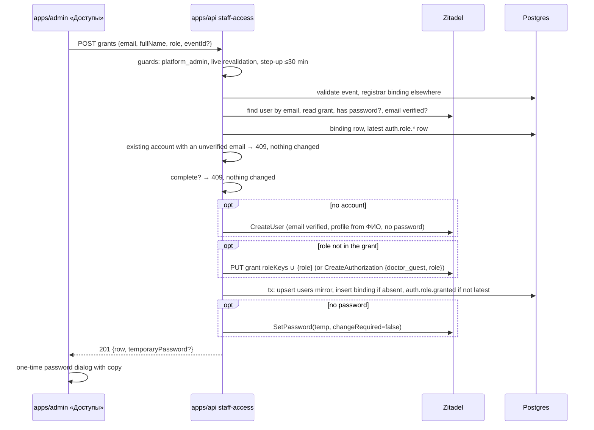

# 047 — Staff access (Design)

Requirements: [`047-requirements-en.md`](./047-requirements-en.md) · Builds on: 011 (admin session), [`044-design.md`](../044-congress-signup/044-design.md) (`event_role_grants`), [`046-design.md`](../046-congress-submissions/046-design.md) (committee binding), ADR-0001 §10 (step-up) · Today's manual mechanism this replaces: `apps/docs/content/operations/admin-onboarding.md`.

## Placement

- **Admin route** `apps/admin/app/access/page.tsx` («Доступы»), added to `ADMIN_SECTION_NAV` in `apps/admin/lib/admin-access.ts` after the existing sections. `ADMIN_SECTION_NAV` is drawn only for `full` access (`platform_admin`), so a registrar or committee member never sees the link, and `canAccessPath` already refuses the route for them. The chrome is a projection; the API refusal (EARS-1) is the authority.
- **API module** `apps/api/src/staff-access/` — controller, service, repository; the IdP calls go through the existing `IdpClient` port (`apps/api/src/auth/idp/idp.types.ts`) with new methods on `ZitadelIdpClient` and the fake.
- **Contract** `packages/schemas/src/admin/staff-access.ts` — `GRANTABLE_STAFF_ROLES` (`platform_admin`, `event-registrar`, `congress-program-committee`), the list row, the grant request and response, the revoke request. The API and the admin form read the same list, so a future role is one edit.
- No new table. The coarse role stays in the Zitadel project grant, the event binding in `event_role_grants` (ADR-0001 §1).

## Endpoints

| Route                                     | Classification                                                                                                                                |
| ----------------------------------------- | --------------------------------------------------------------------------------------------------------------------------------------------- |
| `GET /v1/admin/staff-access`              | `roles: [platform_admin]`, `revalidate: "live"`, read                                                                                         |
| `POST /v1/admin/staff-access/grants`      | `roles: [platform_admin]`, `revalidate: "live"`, `stepUp: true`, `audit: high-stakes`, CSRF double-submit; response `Cache-Control: no-store` |
| `POST /v1/admin/staff-access/revocations` | `roles: [platform_admin]`, `revalidate: "live"`, `stepUp: true`, `audit: high-stakes`, CSRF double-submit; body `{ userId, role, eventId? }`  |

Revocation is a `POST` of a revocation command rather than a `DELETE` with a body: the row identity is a triple with an optional event, and a command body keeps it in one validated Zod object. The step-up re-verification route is an admin-auth route, listed under «Fresh second factor».

An IdP fault on any staff-access write is the existing `IdpUnavailableError` → `503` mapping (the one `admin-users.controller.ts` uses); the admin shows it with «Повторить», never as a credential refusal.

## The list (EARS-2)

The authority for «who holds a staff role» is the Zitadel project grant, not the `users.role` mirror (which keeps only the highest-precedence staff role, `staff-role.ts`). The list is built by:

1. one IdP read of every project grant whose `roleKeys` intersect `GRANTABLE_STAFF_ROLES` (user-grant search scoped to the project, see «IdP calls»);
2. one DB read of `users` (by `zitadel_sub`) for ФИО (`display_name`) and email, and of `event_role_grants` joined to `events` for the bindings;
3. expansion to rows: one row per (person, role) for `platform_admin`, one row per (person, role, event) for the event-bound roles. An event-bound role in the IdP grant with no binding row is listed with an empty event, so a half-finished grant or revocation is visible and revocable.

An IdP fault on the list read is a `503` the admin shows with «Повторить», never an empty list.

## Completeness and retry (EARS-3, EARS-7, EARS-9)

A grant and a revocation each span the IdP, Postgres, the session store and the audit ledger, so neither can be one transaction. Both are therefore written as a fixed sequence of **idempotent steps**, and a failure part-way is repaired by repeating the same command — the same grant form, the same «Отозвать» — which skips the steps already done and finishes the rest.

- **A grant of (person, role, event) is complete** when all of these hold: the IdP grant carries the role; for an event-bound role, the `event_role_grants` row for that event exists; the account has a password; its `users` row exists; and the latest `auth.role.*` row in `audit_ledger` for that person, role and event is `auth.role.granted`.
- **A revocation of (person, role, event) is complete** when the binding row is absent, the IdP grant no longer carries the role unless another binding of it remains, and the latest `auth.role.*` row for that person, role and event is `auth.role.revoked`.
- **The «already holds» refusal of EARS-3 applies only to a complete grant.** An incomplete one is finished by the form. Symmetrically, a revocation of a row whose revocation is complete is refused as already revoked, and an incomplete one is finished.
- **The audit row is the completion mark and is written once**: appended only after every authoritative step of the command succeeded, and only when the latest row for that person, role and event is not already the same event. A retry after a failure before the audit row appends it; a retry after it is refused.

The ledger is the mark because it is the one record that exists for every role: `platform_admin` has no binding row, and the `users.role` mirror is re-projected by sign-in self-heal (`mirror-self-heal.service.ts`), so neither can say whether a grant finished. A person who holds a role granted by the runbook before this section existed has no `auth.role.granted` row; a grant of that role to them changes nothing in the IdP or the bindings and records the row — the first ledger entry for that role.

## Grant cascade (EARS-3…EARS-6, EARS-9)

- **Validation first** (EARS-3), before any write: Zod shape; event required exactly for the two event-bound roles and existing; `event-registrar` refused when the person already has a registrar binding to another event; refused when the account exists and its email is not verified (below); refused when the grant is complete («Completeness and retry»). The completeness read is the IdP user search, user read, grant read and `hasPassword` plus two indexed DB reads — cheap for a few dozen staff rows.
- **Serialization.** The whole cascade, from the completeness read to the answer, runs under a per-email lock: a transaction holding `pg_advisory_xact_lock(hashtextextended('staff-access-grant:' || email, 0))` (the idiom of the 046 submissions and the taxonomy repositories) that commits only after the cascade settles, so Postgres releases the lock on every exit. Two grants for one person never interleave — the second reads the state the first left and is refused as complete. The lock serializes grants only; the binding invariants are the `event_role_grants` unique indexes — `(user_id, role, event_id)` taken with `ON CONFLICT DO NOTHING`, and the partial one-registrar-per-user index, whose violation (a binding written outside the grant lock after the read) rolls the step (3) transaction back and answers `REGISTRAR_BOUND_ELSEWHERE`; a mirror row created by a concurrent sign-in is taken over through `ON CONFLICT (zitadel_sub)`.
- **Write order.** (1) create the account when none exists; (2) add the role to the IdP grant when absent; (3) one DB transaction — mirror, binding, audit; (4) the temporary password when the account has none. Every step checks its own state first, so a repeat skips it. The authoritative IdP change precedes the audit row (EARS-9), and the password is last so that a password is only ever set by a request that then answers `201` with it: a failure at (4) leaves the account without a password, and the repeat sets one and shows it.
- **Existing account** (EARS-4) — found by email through the IdP (the mirror may lack a row for an operator-created account). The role is added with `PUT /management/v1/users/{userId}/grants/{grantId}` carrying the union of the current `roleKeys` and the new role; a `POST` would answer `409` for a user who already holds a grant (proven on stage 2026-10-13). An account with no grant at all (rare: an IdP user never granted) gets `CreateAuthorization {doctor_guest, role}`. The profile name and the password are not touched. Only an account whose email is **verified** counts as the person's own: anyone can register (003) or submit the congress form (044) with a staff member's address before the grant, and that account's credentials and sessions belong to whoever did it. So an existing account whose email is not verified is refused at the validation step with `409 STAFF_GRANT_EMAIL_UNVERIFIED`, before any write: nothing changes at the IdP, in the `users` mirror, in `event_role_grants`, in the ledger or in the account's sessions. The person verifies the address themselves on Academy or doctor.school — the email-code sign-in «Войти по коду из письма» sends a verification code to an unverified account and marks the email verified (003), as does the password reset by email code (003 EARS-35) — and the administrator repeats the grant, which then takes this path. The account found by a lost `CreateUser` race (the email taken between the read and the create) is checked the same way. An unanswered user read is an IdP fault (`503`), never «unverified».
- **New account** (EARS-5) — `CreateUser` on the existing adapter path with `credential: "none"` and the submitted profile (the 044 EARS-4 passwordless variant), email `isVerified: true` (the administrator vouches for the address, as the runbook does), then `CreateAuthorization {doctor_guest, role}`. **ФИО** is one field; it is split on the first whitespace into `familyName` (first word) and `givenName` (the rest — name and patronymic), and requires at least two words; `displayName` and the mirror `display_name` are the full string as typed. No consent row and no declaration are written: staff accounts are not doctor registrations (021 EARS-4/5).
- **Temporary password** (EARS-6) for any account that has no password (`hasPassword`, already in the adapter) — a new account, or an existing passwordless one with a verified email (a 044 congress account made into a committee member cannot sign in to the admin without a password). An existing account with a verified email and a password keeps it and the response carries none. Generation follows the runbook rule: 16 characters from an unambiguous alphabet (no `0 O o 1 l I`), upper, lower and digit, one symbol from `-_!@#%` not at either end, from `crypto.randomInt`. `changeRequired: false` because the admin sign-in has no forced-change step (runbook step 4). The password exists in the request scope and the `201` body only: no log line, no audit field, no DB column; the response is `no-store`. Handing it over is the administrator's act (Scope → Out).
- **Mirror, binding and audit** — one DB transaction under `withRequestAuditContext`: upsert the `users` row (`zitadel_sub`, email, `email_verified`, `display_name` on create; `role` = `mirrorRoleFromClaims` of the new role set), insert the `event_role_grants` row when absent, append `auth.role.granted` when it is not already the latest row. The 010 trigger records the binding row with the administrator as the actor.
- **Partial failure.** A failure at (2) leaves the account without the role; at (3), the person holds the role in the IdP with no binding and no audit row — an event-bound role with no binding is refused everywhere but the session endpoints (044 EARS-38 / 046 EARS-26, fail-closed) and the list shows it with an empty event; at (4), an account without a password, which cannot sign in. In each case the administrator sees the error and repeats the same grant, which finishes it. A role newly added to a person takes effect at their next admin sign-in (the session record holds the roles of its sign-in); an added event of a role already held takes effect on the next request, because bindings are read per request.

## Revoke cascade (EARS-7, EARS-9)

1. **Refuse** when `userId` is the caller and `role` is `platform_admin` (no self-lockout; the last administrator therefore can never remove themselves), and when the revocation is already complete («Completeness and retry»).
2. **Binding** — for an event-bound role, delete the `event_role_grants` row when present (one DB statement under `withRequestAuditContext`; the 010 trigger records the delete). Removing the binding first is fail-closed: from this point the person has no reach to that event, whatever happens next.
3. **IdP** — when the person has no remaining binding of that role (or for `platform_admin`) and the grant still carries it, `PUT` the grant with `roleKeys` minus the role; `doctor_guest` and the other roles stay.
4. **Sessions** — always, including when step 3 failed: `AdminSessionService.forceLogout(sub)` (011 EARS-10, `auth.session.terminated` reason `force` per session), plus a new `PendingAuthStore.deleteBySub(sub)` with a `sub → refs` index mirroring the session store, so a sign-in that passed the password step before the revocation cannot mint a session from its 5-minute role snapshot. Running after the IdP change closes the race in which a sign-in started between the two would read the old roles.
5. **Mirror and audit** — only when steps 2–4 succeeded: one DB transaction re-projects `users.role` from the remaining roles and appends `auth.role.revoked` when it is not already the latest row.

**IdP failure at step 3** answers `503` and records no revocation: no `auth.role.revoked` row, the mirror unchanged. The person's admin sessions and pending sign-ins are still ended (step 4) — fail-safe, because the administrator's intent is to remove access and ending a session costs the person only a sign-in, while leaving it open would keep a role the administrator is removing for up to 30 days. Until the repeat succeeds, the person can sign in again only with what the IdP still grants (for an event-bound role, without the binding removed in step 2). The repeat of the same «Отозвать» finishes the revocation; the row stays in the list until then (for an event-bound role, with an empty event). A failure at step 4 or 5 is also a `5xx` with no `auth.role.revoked`, finished by the same repeat.

All admin sessions of the person end, even when they keep other staff roles: the session record is a role snapshot, and ending it is the one way to make the revocation exact. They sign in again with what remains. This closes #2420 for these roles; the runbook «Offboarding» section is rewritten to «Отозвать» in the same slice.

## Fresh second factor (EARS-8)

Grant and revoke declare `stepUp: true`, and ADR-0001 §10 applies as written: the operator re-elevates the current session at `stepUpUrl`, the admin console keeps the context and retries the original request, and every step-up attempt is audited. The mechanism reuses the TOTP check, the code screen and the guard that run in production, and adds the smallest piece the guard needs: a re-verify mode of the existing challenge screen and endpoint.

**What exists today**

- `AdminAuthorityGuard` (#1304) refuses a `stepUp` route when the session record's `mfaVerifiedAtMs` is absent or older than `STEP_UP_MAX_AGE_MS` (30 minutes), with `401 STEP_UP_REQUIRED` and `stepUpUrl` from `STEP_UP_URL` (`apps/api/src/authz/authz.types.ts`); it runs after live revalidation, so a revoked operator is never sent to re-elevate. No route declares `stepUp` today.
- `mfaVerifiedAtMs` is stamped once, when the session is minted at sign-in (`admin-session.service.ts`).
- `STEP_UP_URL` is `/v1/admin/auth/mfa/verify` — the sign-in challenge route, `access: pending-auth`, which refuses a caller who already holds a session.
- The admin code screen `apps/admin/app/mfa/challenge/page.tsx` serves only a pending sign-in and redirects an active session to `/events`.
- `guardedTotpCheck` with `IdpClient.checkTotpCode(sub, code)` checks a current code for a signed-in operator on the same per-user window, lockout and `auth.mfa.failure` row as the sign-in challenge (011 EARS-13 uses it).
- The admin console has no `STEP_UP_REQUIRED` handling: `authProvider.onError` signs the operator out on every `401`.

**What 047 adds** (in the «Section, list and grant» slice; the revoke slice reuses it)

- **API — `POST /v1/admin/auth/mfa/reverify`**, the re-verify mode of the challenge endpoint, in `admin-auth.controller.ts` beside `mfa/verify`: `access: "authenticated"`, the same three staff roles, CSRF double-submit, `@RateLimited`, `@TimingEqualized`, body `{ code, endpoint }`. It is a sibling route rather than a second mode of `mfa/verify` because the authorization matrix gives each route one access kind, and `mfa/verify` is a `pending-auth` route reading the pending cookie. It runs `guardedTotpCheck` with `checkTotpCode(session.sub, code)` (stage `step_up`), and on success sets `mfaVerifiedAtMs = now` on the **current** session record through a new `AdminSessionStore.markMfaVerified(sid, atMs)` that keeps the record's TTL — no new session, no cookie change, the session expiry unchanged (ADR-0001 §10 «Session lifetime after step-up»). A wrong code is the uniform `401` of the challenge screen and spends the same budget; an IdP fault is `503`. Like `mfa/verify`, it joins `REVALIDATION_EXEMPT` (`admin-revalidation-coverage.spec.ts`) with its reason: it changes no grant, and the `stepUp` route the operator retries re-asks the IdP before it acts.
- **`STEP_UP_URL` = `/mfa/challenge?mode=reverify`** — an admin-app path on the admin origin, where the operator re-elevates. Only `stepUp` routes read it, and none exists outside 047, so the change reaches nothing else.
- **Screen — `/mfa/challenge?mode=reverify&returnTo=<path>&endpoint=<METHOD route>`**: the same page, card, heading, description and code field. In this mode it serves an **active** session (any other state goes to `/login`), submits the code with the `endpoint` named in its URL (the refused route, e.g. `POST /v1/admin/staff-access/grants`, which `mfa/reverify` writes to its audit row) to `mfa/reverify`, and after an accepted code navigates to `returnTo` — a same-origin admin path starting with a single `/`, parsed and normalised, otherwise `/events`. Without `mode=reverify` the screen behaves as today.
- **Console — a new step-up branch in the admin data layer.** A `401` whose body carries `errorCode: "STEP_UP_REQUIRED"` is not a lost session and does not reach `authProvider.onError`'s sign-out. The console saves the original request — method, path and body — in `sessionStorage` under one key, then navigates to `stepUpUrl` with `returnTo=/access` and `endpoint=<METHOD route>` of the refused request. On return, «Доступы» reads and removes the saved request, restores it into the grant form or the revoke confirmation, and sends it once; the outcome shows as for a first submission (the password dialog, or the refusal at the form). Neither body carries a secret (the temporary password exists only in a response). If nothing is saved (storage cleared or blocked), the page opens as usual and the administrator repeats the action. A second `STEP_UP_REQUIRED` on the retry shows the refusal instead of looping.
- **Audit** (ADR-0001 §10, identity-auth-rbac-design §7.3 classes): `auth.step_up.requested` is written by `AdminAuthorityGuard` when it answers `STEP_UP_REQUIRED`, with the refused route as `endpoint`; `auth.step_up.succeeded` / `auth.step_up.failed` are written by `mfa/reverify`, with `endpoint` from the request body (the saved request's route, accepted only when it is a `stepUp` route in the `@Authz` registry, else `400` before any check). Fields `user_id`, `endpoint`, `acr_before`, `acr_after`, `mfa_method: "totp"`, `ip`, `ua`. The admin tier holds no `acr` claim (§10), so `acr_before` / `acr_after` record the session's elevation state: `mfa-stale` before, `mfa-fresh` after a success, `mfa-stale` after a failure. A failed code also writes the existing `auth.mfa.failure` row (stage `step_up`). The classes are added to the auth-audit writer the 011 rows use.

**Within the window.** A grant or revocation within 30 minutes of an accepted code passes the guard with no code asked (§10). Because `mfaVerifiedAtMs` is otherwise stamped only at sign-in and the session lives 30 days, the first grant or revocation of a working session will usually ask for a code; that is the intended cost for a few dozen staff changes, not a defect.

**Relation to #1198.** #1198 tracks building the §10 step-up mechanism and graduating the 011 factor-removal route onto it. 047 builds the mechanism (the guard already exists; the re-verify route, the screen mode, the console branch and the step-up audit rows are 047's); #1198 keeps graduating the factor-removal route onto it.

`503 IDP_REVALIDATION_UNAVAILABLE` shows retry, a `403 …_REQUIRED` shows no-access (ADR-0001 §10).

## Audit (EARS-9)

`auth.role.granted` / `auth.role.revoked` — ADR-0001 design §7.3 fields `user_id`, `role`, `by_admin`, `ts`, plus `event_id` when the role is event-bound (metadata inside the registered class, the same within-a-class idiom as `tier`). Written once per completed change, after its authoritative IdP step, through the same auth-audit writer as the 011 rows («Completeness and retry»). The account creation itself is the `users` insert in the 010 change audit; no new class is registered for it. The temporary password never appears in any audit field. The `auth.step_up.*` rows are under «Fresh second factor».

## IdP calls and their live proof

| Call                                                                                     | Status in the adapter                                            |
| ---------------------------------------------------------------------------------------- | ---------------------------------------------------------------- |
| user search by email                                                                     | exists privately (`resolveUserId`); exposed as `findUserByEmail` |
| `CreateUser` passwordless with profile                                                   | exists (044 EARS-4)                                              |
| `CreateAuthorization`                                                                    | exists (`grantProjectRole`), widened to several role keys        |
| user-grant read for one user (`POST /management/v1/users/grants/_search`, `userIdQuery`) | exists (`getProjectRoles`); widened to return the grant id       |
| grant update `PUT /management/v1/users/{userId}/grants/{grantId}` `{roleKeys}`           | new — the shape the runbook uses on prod                         |
| project grant search by project and role keys                                            | new — wire shape to be proven on the dev-stand before it ships   |
| `hasPassword`, `SetPassword`                                                             | exist (003 EARS-41)                                              |
| user read (`getUser`, email verified)                                                    | exists (003)                                                     |
| TOTP check for a signed-in user (`checkTotpCode`)                                        | exists (011 EARS-13)                                             |

Each new call is pinned by an adapter test on the wire shape proven live on the dev-stand (verification V-8), the rule `getProjectRoles` documents: a quiet `200` with a different shape must fail a test, not empty a list.

## `pd_officer` not grantable yet

`pd_officer` is left out of `GRANTABLE_STAFF_ROLES` (owner, 2026-10-13): it is not in `MFA_REQUIRED_BY_ROLE` and no admin route admits it, so a grant would open nothing. When the personal-data screens (ADR-0009) exist, that feature adds it to the MFA policy and to `GRANTABLE_STAFF_ROLES`, and it joins this section with no new spec for the section.

## UI composition

From `@ds/design-system`, on the existing admin chrome:

- **List** — `AdminDataList` (`apps/admin/components/admin-data-list.tsx`, the design-system composition every admin registry uses, e.g. `apps/admin/app/event-kinds/page.tsx`) with the columns ФИО, email, роль (the RU role label), мероприятие; a row action «Отозвать»; a primary «Выдать доступ» button; `EmptyState` when nobody holds a grantable role.
- **Grant form** — `Dialog` with `Form` + `Input` (email, ФИО), `NativeSelect` (role, RU labels), `Combobox` (event, shown only for the two event-bound roles; events by title and date, newest first); server refusals shown at the field or as a form `Alert`; `STAFF_GRANT_EMAIL_UNVERIFIED` reads «Почта этой учётной записи не подтверждена. Попросите сотрудника подтвердить почту и повторите выдачу».
- **One-time password** — `Dialog` with the password in a read-only field, a copy `Button`, and the line that it is shown once; closing it ends the display.
- **Revoke** — `AlertDialog` naming the person, role and event, «Отозвать» / «Отмена».
- **Code screen, re-verify mode** — the existing `/mfa/challenge` card and `OtpField` with their heading and description unchanged.

RU role labels: «Администратор платформы», «Администратор Конгресса», «Программный комитет». Final copy and layout are decided at Stage A.

## Delivery slices

| Slice                   | EARS                                  | Depends on                                             |
| ----------------------- | ------------------------------------- | ------------------------------------------------------ |
| Section, list and grant | EARS-1…EARS-6, EARS-8, EARS-9 (grant) | —                                                      |
| Revoke                  | EARS-7, EARS-8, EARS-9 (revoke)       | section and list (the action lives in the list's rows) |

The step-up mechanism of EARS-8 (re-verify route, screen mode, console branch, `auth.step_up.*` rows, `STEP_UP_URL`) ships in the first slice; the revoke slice reuses it for the revocation request. Every slice ships its UI with its backend (F-22). **Stage-A gate:** the «Доступы» list, the grant form, the one-time password dialog, the revoke confirmation and the re-verify lines of the code screen need an approved design before their UI is implemented (`build-ui-from-design-system`); the backend half of each slice may proceed in the same PR before the UI half lands.
