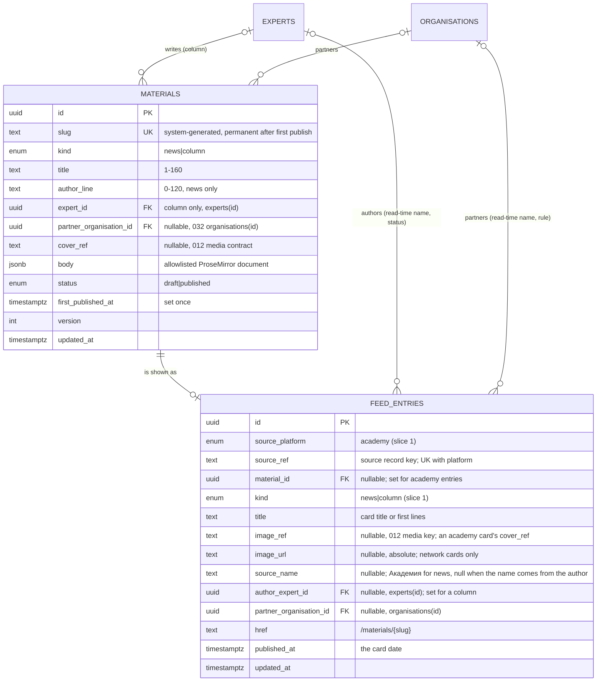
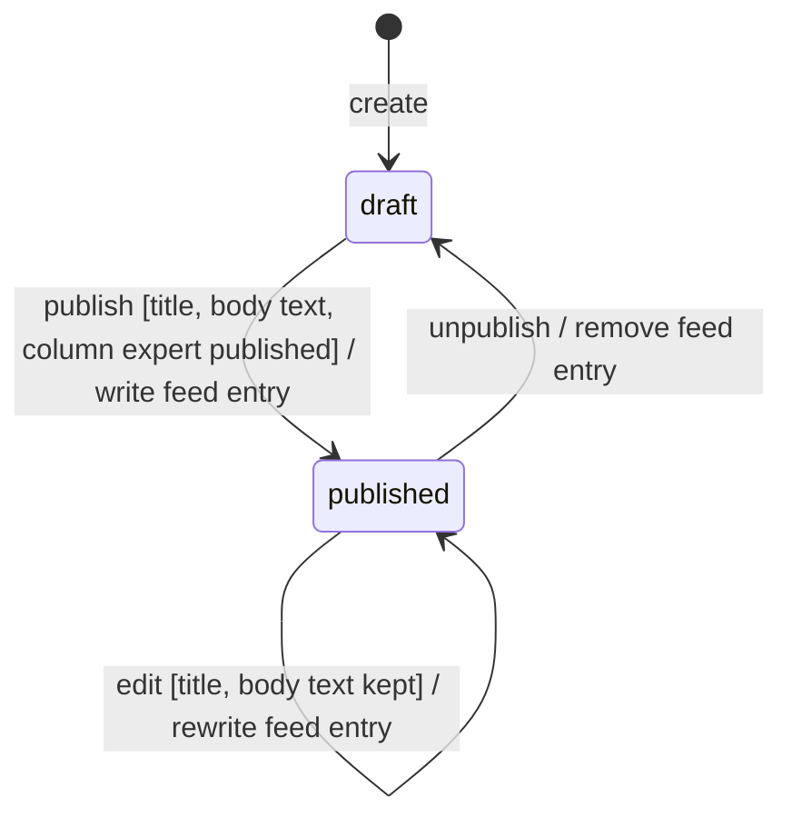
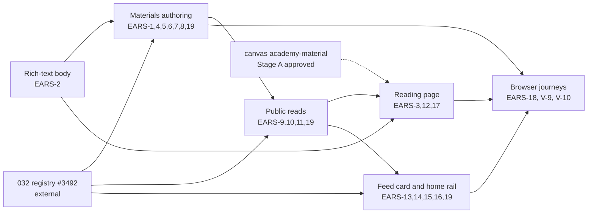
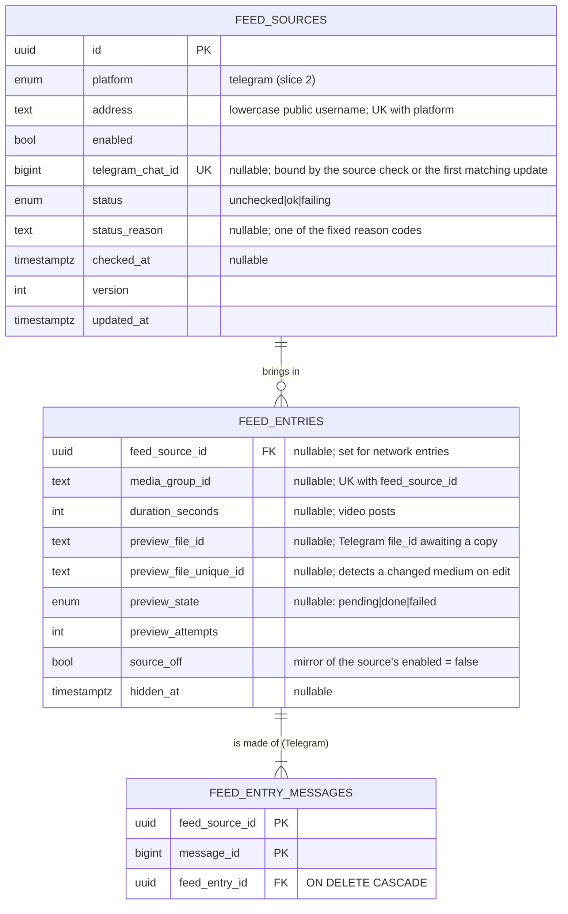
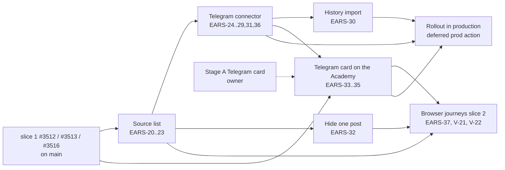

# 048 — Materials feed: own materials, the reading page, the rail on the Academy home and the Telegram connector (Design, slices 1–2)

Requirements: [`048-requirements-en.md`](./048-requirements-en.md) · PRD: [`048-product.md`](./048-product.md) · Connector research: [`048-platform-access-research.md`](./048-platform-access-research.md) · Domain: ADR-0016 §4 (project container), §8 (storefront ownership) · Experts directory and media: [`012-design.md`](../012-content-taxonomy/012-design.md) · Partner (organisation registry): [`032-design.md`](../032-investors-leaderboard/032-design.md) «Data model» · Access: [`047-design.md`](../047-staff-access/047-design.md) · Admin kit precedent: [`030-design.md`](../030-projects-catalog-and-page/030-design.md).

## Current behaviour → replacement delta

There is **no running counterpart**: no table, contract, endpoint, admin section or storefront route for news, blog posts, articles or a feed exists (`packages/db/src/schema/`, `packages/schemas/src/`, `apps/api/src/`, `apps/admin/app/`, `apps/portal/app/` — inventory of 2026-10-29; PR #3500 found the home blocks unbuilt too).

| Exists today                                                                                                                                                                                                  | Slice 1                                                                                                                                                                   |
| ------------------------------------------------------------------------------------------------------------------------------------------------------------------------------------------------------------- | ------------------------------------------------------------------------------------------------------------------------------------------------------------------------- |
| `apps/portal/app/academy-home-view.tsx` — sections `EventsSection`, `WhatSection`, `WhySection`, `ProjectsSection`, `ExpertsSection`, …; **no** «Новости и блог» or «Рилсы и видео» block                     | a `MaterialsFeedSection` after `EventsSection` mounts the shared rail over the public feed read (EARS-14)                                                                 |
| `packages/db/src/schema/taxonomy.ts` `experts` (retained-row lifecycle `draft                                                                                                                                 | published                                                                                                                                                                 | retired`, public display name composed by the 012 public projection) | read-only source of a column's author; no change |
| `organisations` of the 032 registry (`packages/db/src/schema/taxonomy.ts`, specified by [`032-design.md`](../032-investors-leaderboard/032-design.md) «Data model», built by #3492 — not on `main` yet)       | read-only source of a material's partner (EARS-19); no change                                                                                                             |
| 012 cover media: `apps/api/src/taxonomy/media/still-image-normalizer.ts`, `upload-reconcile.service.ts`, `media-cleanup.service.ts` + `packages/db/src/schema/media-cleanup-jobs.ts`; `apps/api/src/storage/` | reused for the material cover (normalized WebP, server-generated storage key, cleanup on replace)                                                                         |
| `packages/design-system/src/primitives/media-dropzone.tsx`                                                                                                                                                    | the cover slot of the material form                                                                                                                                       |
| `packages/design-system/src/lib/markdown-document.ts` — a hand-written mdast → React walker with no `dangerouslySetInnerHTML` (028 legal pages)                                                               | precedent for the rich-text renderer: same «walk the tree into design-system typography, drop what is not allowed» contract, over a ProseMirror document instead of mdast |
| No TipTap, ProseMirror or HTML sanitiser in any `package.json`                                                                                                                                                | TipTap enters `@ds/design-system` as the rich-text editor primitive (ADR-0004 design); no HTML sanitiser is added because no HTML is ever stored                          |
| `apps/admin/lib/admin-access.ts` `ADMIN_SECTION_NAV` (full-access items «События», «Проекты», «Эксперты», …)                                                                                                  | gains «Материалы» → `/materials` as a `full`-access (`platform_admin`) entry (EARS-8)                                                                                     |
| `apps/api/src/taxonomy/public-event-cursor.ts` — the exact (microsecond) keyset cursor rule of the public event reads                                                                                         | the feed cursor follows the same rule on `(published_at, id)` (EARS-9)                                                                                                    |

**Slice 2 (Telegram).** The legacy Doctor.School system has no repository-traceable automation that loaded its social posts onto the site: a scout of the sanctioned legacy sources (the legacy BBM repository, the Bubble and Directual exports, the knowledge base) found only a Directual support / chat bot `ds_fk_bot` with no channel-post ingestion, dormant Zapier / WebFlow settings stubs, and RuTube as a per-event video embed. The owner's remark of 2026-11-11 «мы делали разные автоматизации для подгрузки наших постов из соцсетей, но почему-то это у нас потерялось» refers to automations that lived outside these sources. Nothing is migrated: the Telegram connector is new. In this repository no Telegram client, webhook, `feed_sources` table or Bot API configuration exists; `apps/doctor/lib/contacts.ts` only links the Doctor.School channel and is untouched.

## Placement

- **Schema** `packages/db/src/schema/materials.ts` — `materials`, `feed_entries`, enums `material_kind`, `material_status`, `feed_entry_kind`, `feed_source_platform`. One forward migration in `apps/api/drizzle/` with the 010 audit triggers.
- **API** new module `apps/api/src/materials/` — `materials.admin.controller.ts` + `materials.service.ts` + `materials.repository.ts` (authoring, EARS-1…EARS-8), `feed-entries.repository.ts` (the only reader and writer of `feed_entries`), `own-materials.feed-source.ts` (the own-materials writer, EARS-10), `public-feed.controller.ts` and `public-materials.controller.ts` (EARS-9, EARS-11, EARS-19). The idempotency service, problem filter and media services of `apps/api/src/taxonomy/` are reused, not copied. Nothing in `apps/api/src/taxonomy/` is changed: the 012 expert and the 032 organisation are read, never written, by this module (Lead decision 11).
- **Contract** `packages/schemas/src/materials/` — `material.ts` (admin form, list, detail), `material-body.ts` (the allowlisted body document, shared by the API validator, the editor and the renderer), `feed.ts` (card, page, cursor), `public-material.ts`.
- **Admin** `apps/admin/app/materials/` (list `page.tsx`, `create/`, `[id]/`), `apps/admin/components/material-form.tsx`; the editor loads through `next/dynamic` (ADR-0004 bundle rule, TipTap ≈ 80 KB).
- **Design system** primitive `packages/design-system/src/primitives/rich-text-editor.tsx` (`RichTextEditor`, TipTap with exactly the extensions of the allowlist); blocks `rich-text-content.tsx` (`RichTextContent`, the renderer), `feed-card.tsx` (`FeedCard`), `feed-rail.tsx` (`FeedRail`: layout, arrows, keyboard, drag, paging trigger, live region, states), `material-article.tsx` (`MaterialArticle`, the reading-page body shared with the admin preview).
- **Academy routes** `apps/portal/app/materials/[slug]/page.tsx` — a route-file-registry row `— host-only surface (Academy materials; ADR-0016 §8 — no doctor projection)`, `permanent`; the route only fetches through `@ds/api-client` and composes `MaterialArticle`. The home section lives in `academy-home-view.tsx` and fetches the next pages through `@ds/api-client` handed to `FeedRail` as its loader.
- **Storefront ownership** (ADR-0016 §8): `materials` and `feed_entries` are `academy`; the admin is the only writer of `materials`. `apps/doctor` imports none of the feed or material contract and has no `/materials` route (EARS-17).

### Capability owner (ADR-0013 §A1)

The feed card and the rail serve every source — own materials now, each network later — and must not fork per source or per page (PRD «one common card shape»). The PRD registers the row when the design spec is written, so this spec adds it to [`capability-ownership.md`](../../product/two-site-ia/capability-ownership.md) «Registry»: «Materials feed (feed card + home rail + reading page, 048)», canonical location `@ds/design-system` `FeedCard` / `FeedRail` / `MaterialArticle` / `RichTextContent` + `apps/api/src/materials/public-{feed,materials}*` + `packages/schemas/src/materials/`, kind shared package, Academy consumer `apps/portal` (home section, `/materials/{slug}`), doctor consumer none (ADR-0016 §8, Lead decision 4), status «Spec 048 slice 1; implementation Issues to follow». The implementation PRs keep the row in step with the tree as they land each file. No cross-host projection exists, so no boundary line is written. No stub package is graduated.

## Data model



- **`feed_entries` is the feed.** Every card the rail shows is one row; the public read joins it only to the directory rows the row references — `experts` through `author_expert_id`, `organisations` through `partner_organisation_id` — and never to `materials` (EARS-10). An own material's row is written by `own-materials.feed-source.ts` in the transaction of its publish, edit or unpublish (EARS-4…EARS-6), keyed `(source_platform = 'academy', source_ref = material id)` unique. Each network slice adds one `source_platform` value, its `kind` values (`post`, `video`) and its own nullable card columns (`duration_seconds` for video), may fill the same `partner_organisation_id`, and its connector writes rows of its platform; the read, the cursor, the rail and the materials of slice 1 are unchanged (US-10).
- **The card image is a durable reference, signed at the read.** An own material's card stores the cover's 012 media key in `image_ref` (the same key as `materials.cover_ref`) and leaves `image_url` null; a network card whose preview is copied into our storage (Telegram, slice 2) stores its media key in `image_ref` too, and a network card whose platform forbids copying stores an absolute `image_url` and no `image_ref`. CHECK `image_ref IS NULL OR image_url IS NULL` and `source_platform <> 'academy' OR image_url IS NULL`; a card without a cover holds neither. A stored URL is never a signed one: object storage serves the private bucket through short-lived presigned GETs (`ObjectStorage.urlFor`), which expire, so the public feed read signs `image_ref` at read time into the card's `image.url`. `feed_entries.image_ref` is registered in the 012 media-slot registry next to `materials.cover_ref`, so neither media sweep deletes a cover a card still references.
- **The card is denormalized on purpose, except for directory records.** Writing `title`, the image reference, `source_name` and `href` at the write side makes every card render from its row, which a network card must do anyway (its source lives on another platform); an own material's card is rewritten on each edit of a published material. What another feature owns and changes on its own — the expert's name and status (012), the organisation's title, status and name rule (032) — is referenced by id and evaluated at the read, so no write path of 012 or 032 ever touches the feed.
- **Column expert's name and status at read time.** A column's entry carries `author_expert_id`; the feed read joins `experts` and keeps an entry only while `author_expert_id IS NULL OR experts.status = 'published'`, and the card's `source.name` is `coalesce(source_name, expertShortName(experts))` composed at the read: `expertShortName` — a shared formatter added next to `expertDisplayName` in `packages/schemas/src/taxonomy/taxonomy.schema.ts` — builds «Фамилия И. О.» («Страхов М. А.») from the 012 name parts `family_name`, `given_name`, `patronymic` (the patronymic initial only when there is one), the form every column card of the vendored canvases shows (Lead decision 21). The material read's author keeps the full 012 display name (`expertDisplayName`). A column leaves the feed while its expert is not public and returns when the expert is published again, with no write into 012 (`apps/api/src/taxonomy/experts.service.ts` is untouched). The material read applies the same join (Lead decision 11).
- **Partner at read time** (EARS-19). `materials.partner_organisation_id` is set or cleared on the form; the writer copies it onto the entry. The reads left-join `organisations` and project `partner = { name: organisations.title }` only when `organisations.status = 'published' AND organisations.public_name_visible`, else `null` — the 032 EARS-5 name rule, so a hidden organisation is never named. A retired or unknown organisation is refused on write (field `partner`); one that later retires or hides its name simply loses the mark. Both FKs are `ON DELETE RESTRICT` (organisations are retained rows).
- **Body** `jsonb` NOT NULL, a ProseMirror document (`{ type: "doc", content: [...] }`) validated by `material-body.ts` on every write; a draft may hold an empty document, publish requires at least one text character (EARS-4).
- **Kind-dependent author**: CHECK `(kind = 'column') = (expert_id IS NOT NULL)` and `(kind = 'news' OR author_line = '')`. A column's expert must be non-retired on write and `published` at publish (EARS-1, EARS-4); `expert_id` is `ON DELETE RESTRICT` (experts are retained rows anyway).
- **Status** is a two-value enum: an unpublished material is a draft again (Lead decision 3). `first_published_at` is trigger-pinned once set (012 pattern), so a re-publish restores the card at its first date (EARS-6).
- **Slug** from the title through `apps/api/src/taxonomy/taxonomy-slug.ts` (Cyrillic transliteration, collision suffix), editable by nobody, frozen at the first publish. `feed` and other route words are reserved.
- **Indexes**: `feed_entries (published_at DESC, id DESC)` for the read, `feed_entries (author_expert_id)` and `(partner_organisation_id)` for the joins; unique `(source_platform, source_ref)`; `materials (updated_at DESC)` for the admin list; trigram on `materials.title` for admin search if the 012 list search uses one, else `ILIKE` as 012 does.

### Public predicate

A feed entry exists only while its source record is published (it is deleted on unpublish) and is public while its author, if any, is published, judged at the read: `feed_entries LEFT JOIN experts ON experts.id = author_expert_id WHERE author_expert_id IS NULL OR experts.status = 'published'` (EARS-9, EARS-10). The material read (EARS-11) states the same rule on `materials`: `status = 'published' AND (kind = 'news' OR experts.status = 'published')`. The partner never decides whether a material is public (EARS-19).

## Rich-text body (EARS-2, EARS-12)

| Allowed node / mark         | Attributes                                                                 |
| --------------------------- | -------------------------------------------------------------------------- |
| `doc`, `paragraph`, `text`  | —                                                                          |
| `heading`                   | `level` ∈ {2, 3} (the page title is the only level 1)                      |
| `bulletList`, `orderedList` | `orderedList.start` integer ≥ 1                                            |
| `listItem`, `blockquote`    | —                                                                          |
| `hardBreak`                 | —                                                                          |
| marks `bold`, `italic`      | —                                                                          |
| mark `link`                 | `href` absolute `https:` / `http:` / `mailto:`, ≤ 2048 chars; nothing else |

- **One allowlist, three consumers.** `material-body.ts` exports the node/mark set and a Zod schema; `RichTextEditor` registers exactly the TipTap extensions of that set (StarterKit trimmed to it + Link with `protocols` limited and `autolink` on), so paste from Word or a browser drops images, tables, colours and fonts by schema; the API refuses any document the schema rejects (`400` with the field `body`); `RichTextContent` walks only that set and drops any node or mark outside the allowlist (the renderer tests assert the drop).
- **Limits**: 60 000 characters of text (a long column is ≈ 20 000), nesting depth 6 (block levels below `doc`), 2 000 nodes — bounds on the JSON a request can make the renderer walk.
- **No HTML anywhere**: nothing stored is HTML, nothing rendered uses `dangerouslySetInnerHTML`, so no sanitiser exists to be wrong (Lead decision 5). A link to another host renders `target="_blank" rel="noopener noreferrer"`; a link to `academy.doctor.school` renders in the same tab.
- **Plain-text projection** for length checks and the admin list search comes from the same walk (`bodyText(doc)`).

## Cascades

```mermaid
sequenceDiagram
  participant A as admin (platform_admin, MFA)
  participant API as materials.service
  participant DB as Postgres
  participant F as own-materials.feed-source
  A->>API: POST /v1/admin/materials/{id}/publish (Idempotency-Key, If-Match)
  API->>DB: BEGIN; lock material; check title, body text, column expert published
  alt requirement missing
    API-->>A: 409 PUBLISH_REQUIREMENTS_NOT_MET + field errors
  else ok
    API->>DB: status = published, first_published_at = coalesce(first_published_at, now()), version++
    API->>F: write(material)
    F->>DB: UPSERT feed_entries (academy, id) — title, image_ref = cover_ref (image_url null), source_name, author_expert_id, partner_organisation_id, href, published_at = first_published_at
    API->>DB: COMMIT (010 audit rows by trigger)
    API-->>A: 200 + ETag
  end
```

- **Edit of a published material** (EARS-5): the same transaction re-checks the title and the body text of the publish set and calls `write(material)`; `published_at` of the entry is never rewritten. The column expert's published state is not re-checked on edit: a column whose expert is unpublished stays editable and stays hidden by the read-time predicate until the expert returns (Lead decision 11).
- **Unpublish** (EARS-6): `status = draft`, `version++`, `F.remove(material)` deletes the entry. The admin confirms in an `AlertDialog` naming the consequence («Материал уйдёт с главной Академии, его страница станет недоступна»).
- **Draft edits** touch no entry.
- The home and the reading page read per request (no cache table), so a change shows on the next read without a release (US-2). The home's rail reads the feed in the browser on every visit (uncached `no-store` reads of `GET /v1/public/feed`), so its first-page placeholders and «Повторить» (EARS-16) never hold up the rest of the home; the reading page is rendered dynamically with an uncached (`no-store`) material read, because the partner mark is judged on every read (EARS-19).

## Public reads (EARS-9, EARS-11, EARS-19)

- `GET /v1/public/feed?cursor=&limit=` — `ORDER BY published_at DESC, id DESC`, keyset `(published_at, id) < (cursor)`; the cursor encodes `published_at` as Postgres renders it to the microsecond (the `public-event-cursor.ts` rule: a millisecond-truncated cursor would repeat a row forever) plus the id, base64url; a malformed cursor → `400`. `limit` 1–24, default 12; the rail asks 12 first and then 8 (desktop) / 6 (phone), the canvas page sizes (`FEED_FIRST`, `FEED_PAGE`).
- Card shape (`packages/schemas/src/materials/feed.ts`): a discriminated union on `kind`; slice 1 defines the `news` and `column` members, each `{ id, kind, title, publishedAt, image: { url } | null, source: { platform: "academy", name }, partner: { name } | null, href }`; `partner` is common to every member, since a network card can carry a partner too. A later member adds its own fields (`duration`, `text`, `external: true`) without changing these two.
- `GET /v1/public/materials/{slug}` — `{ slug, kind, title, publishedAt, cover: { url } | null, author: { name } | null, partner: { name } | null, body }`; `404` for draft, unknown and non-public alike. The column's author carries no slug or URL, so nothing can link to an expert page before 031.
- Both anonymous; `feed` is a literal path segment, not a parameter. The `endpoint-authz` and `route-mount` guards see the new routes as rows of their matrices.

## Endpoints

Headers (`Idempotency-Key`, `If-Match`), problem codes and the multipart cover contract follow today's `admin/projects` controller.

| Method + path                                                 | Purpose                                            | EARS             |
| ------------------------------------------------------------- | -------------------------------------------------- | ---------------- |
| `GET /v1/admin/materials`                                     | list with search and kind / status filters         | EARS-7           |
| `POST /v1/admin/materials` · `PATCH /v1/admin/materials/{id}` | create / edit fields, author, partner, cover, body | EARS-1, 2, 5, 19 |
| `GET /v1/admin/materials/{id}`                                | detail + ETag                                      | EARS-1           |
| `POST /v1/admin/materials/{id}/publish`                       | publish with the requirement set                   | EARS-4           |
| `POST /v1/admin/materials/{id}/unpublish`                     | back to draft, remove the feed entry               | EARS-6           |
| `GET /v1/public/feed`                                         | feed page                                          | EARS-9           |
| `GET /v1/public/materials/{slug}`                             | reading page                                       | EARS-11          |

Every admin route: `roles: [platform_admin]`, the MFA admin session, CSRF, `revalidate: "live"` on writes (EARS-8). No admin endpoint writes `feed_entries` directly.

## Lifecycle



## UI composition

### Academy — rail and card (canvases, approved by the owner at Stage A on 2026-11-11, #3516 comment 6796895267)

| Surface                | Canvas → state                                                                                                                                                                                       | Notes                                                                                                                                                                                                                                                                                                                                                                                                                                                |
| ---------------------- | ---------------------------------------------------------------------------------------------------------------------------------------------------------------------------------------------------- | ---------------------------------------------------------------------------------------------------------------------------------------------------------------------------------------------------------------------------------------------------------------------------------------------------------------------------------------------------------------------------------------------------------------------------------------------------- |
| Feed card              | `unit-feed-card.dc.html` — `source` = «академия» (news) / «колонка» (column), `media` = «картинка» / «нет», `partnerMark` = «нет» / «есть» («Партнёрский материал · <партнёр>», EARS-19), `skeleton` | The other `source` values (telegram, vk, rutube, vk-видео, дзен) and `media` = «видео» with duration are later slices. Hover presses the shadow `--shadow-lg` → `--shadow-md`, focus shows `--shadow-focus`; the `data-link` text underline is a canvas-runtime artefact and is **not** built (design-source README row). Own cards link in the same tab; the date is day + month in Moscow time, year appended when not current (Lead decision 10). |
| Home rail              | `academy-home.dc.html` section «Новости, блог и видео», `scope` = «срез 1», `railPosition` start / scrolled, `data` norm / load / empty / err                                                        | Desktop two rows, slot `clamp(260px, …/4.5, 340px)`, phone one row, slot ≈ 1/1.25 of the viewport; ← / → are `Button variant="outline" size="icon"` with the canvas `aria-label`s and `aria-controls="feed-rail"`; the rail is `role="region"` `aria-roledescription="лента"` with the canvas label; drag only for a mouse; live region texts from the canvas. Placement after the events block follows the canvas order (Lead decision 9).          |
| Rail next-page failure | **not drawn** — the trailing «Повторить» slot of EARS-15                                                                                                                                             | Composed from the error block of the rail's first-page error (canvas `data = err`) sized as one slot; a Stage-A item of the rail package.                                                                                                                                                                                                                                                                                                            |

### Academy — reading page (canvas, Stage A approved)

`design-source/academy-material.dc.html` was drawn by the owner on 2026-10-29 from its Claude Design prompt [#3403 comment 6487221951](https://github.com/doctor-school/ds-platform/issues/3403#issuecomment-6487221951) (prompt 2) and vendored into `design-source/` (#3403); the owner approved it at Stage A on 2026-11-04 ([#3514 comment 6624381206](https://github.com/doctor-school/ds-platform/issues/3514#issuecomment-6624381206)). `MaterialArticle` (`packages/design-system`) is built from it and mounted by `/materials/{slug}` and by the admin preview; the body goes through `RichTextContent` from the Rich-text body package. The canvas switches: `state` обычное / загрузка / ошибка (the read error with «Повторить»), `kind` новость / колонка эксперта (the column's byline is the expert's full name), `cover` есть / нет (the cover is the only image of the page), `length` длинный / короткий (the long body carries every allowlisted node), `partnerMark` нет / есть («Партнёрский материал · <партнёр>» under the byline — EARS-19 projects the partner on the material read, EARS-12 renders the mark on the page), with `signedIn` and `dark`. The quote's attribution line on the canvas is sample content; slice 1 builds no attribution node — an editor writes the attribution as an ordinary paragraph (EARS-2, Lead decision 23). Not drawn: the not-found state — an unknown or unpublished address renders the existing Academy not-found page, so the page has no not-found state of its own (EARS-12) — and the admin preview banner «Предпросмотр — материал не опубликован» (EARS-3), approved-non-canvas (lead decision 2026-10-29): an info `Alert` above the same `MaterialArticle`. The route has no route-level loading state: a loading boundary would start the streamed response with 200 before the read decides, so a draft, unknown or non-public address could no longer answer 404 (EARS-12). The canvas `state` = загрузка is built in `MaterialArticle` (a busy status with the skeleton) and is not mounted by the route; the page renders once the read has answered.

### Admin (approved-non-canvas; the editor at Stage A)

| State                | Composition                                                                                                                                                                                                                                                                                                                                                              |
| -------------------- | ------------------------------------------------------------------------------------------------------------------------------------------------------------------------------------------------------------------------------------------------------------------------------------------------------------------------------------------------------------------------ |
| `material-list`      | «Материалы»: `AdminDataList` (title, kind, status, first published, author) with search, kind and status filters, «Новый материал»; `EmptyState` when none; the mark «Не на сайте: эксперт не опубликован» on a published column with an unpublished expert                                                                                                              |
| `material-form`      | full-page form: «Вид» (radio «Новость» / «Колонка эксперта»), «Заголовок», «Автор» (text, news) or «Эксперт» (`Combobox` over non-retired experts, column), «Партнёр» (optional `Combobox` over non-retired 032 organisations, clearable; EARS-19), «Обложка» (012 media slot on `MediaDropzone`), «Текст» (`RichTextEditor`); «Сохранить»; field errors at their fields |
| `material-editor`    | `RichTextEditor` toolbar: H2, H3, bold, italic, bulleted list, numbered list, quote, link (dialog with URL field), undo / redo; keyboard shortcuts; **the one element outside the admin Stage-A baseline (012 EARS-18) — its look goes to the owner at Stage A as that element alone** (PRD Flows step 1)                                                                |
| `material-preview`   | «Предпросмотр» opens a full-screen `Sheet` rendering `MaterialArticle` from the form state with the banner «Предпросмотр — материал не опубликован»                                                                                                                                                                                                                      |
| `material-lifecycle` | «Опубликовать» (refusal lists the missing items at their fields); «Снять с публикации» with an `AlertDialog`; status badge «Черновик» / «Опубликован» with the first-publish date                                                                                                                                                                                        |
| `material-conflict`  | a stale `If-Match` save shows the reload notice of the 012 forms                                                                                                                                                                                                                                                                                                         |

## Room for network connectors (US-10)

Slice 1 builds no connector and no source list, and nothing in it waits for one. Slice 2 builds the shared parts every network slice reuses — the `feed_sources` table and the admin source list (US-3), the `hidden_at` hide action (US-5), the switched-off mark on entries and the external `post` card opening in a new tab (US-7) — together with the first connector, Telegram («Slice 2 — Telegram channel connector» below). Each later network slice adds, without touching slice-1 or slice-2 code paths, one `feed_source_platform` value, a `<platform>.feed-source.ts` writing `feed_entries` rows of its platform from the platform's documented push or read path (research §§2–4: VK Callback API, RuTube channel list after written confirmation, Dzen only with permission or by the reverse RSS path), its card fields, and a copied preview where the platform's links expire or a referenced one where storing is forbidden (VK Rules §1.6). The rail and the card render by `kind`, so a new kind is a new card variant in `FeedCard` and nothing else.

## Retention

Materials and their feed entries are editorial content, not personal data (an expert's name is a published directory field, an author line is a byline): they are retained rows kept for as long as the platform exists, with no time limit — the 012 «nothing is physically deleted» convention; an unpublished material stays a draft in the admin. A replaced cover is removed from storage by the 012 `media_cleanup_jobs` path. No row in the ADR-0009 retention matrix is needed (no PD table). The retention of network card data is set by each network slice together with its storage (PRD); Telegram: «Retention (slice 2)».

## Dependencies

- **012 experts directory and media** — on `main`; columns reference `experts` and read their status and name at read time, covers reuse the media services; nothing is written into 012. No edge.
- **047 `platform_admin` and the admin session with the second factor** — on `main`. No edge.
- **Canvas `academy-material.dc.html`** — drawn by the owner and vendored 2026-10-29 (#3403); the owner approved it at Stage A on 2026-11-04 (#3514), so it gates no package.
- **031 expert page** — the author link waits for it; slice 1 has no link, so no edge.
- **032 slice 1, organisation registry (#3492, its head EARS Issue)** — the partner of EARS-19 references `organisations` and reads its status and name rule. External `blocked_by` #3492 on **Materials authoring** (the FK and the form field), **Public reads** (the projection) and **Feed card and home rail** (the mark renders a projected partner); Rich-text body and Reading page carry no edge — the Reading page renders the partner that Public reads project.
- **Own materials stay** — slice 1 proceeds on the owner's preliminary yes («Предварительно да») recorded in the PRD «Open questions»; a later reversal would remove own materials, not change this design.
- **029 home re-layout** — consumes the rail section as built; 048 places it in today's home (EARS-14), so 029 moves it, never re-implements it.

## Delivery slices



- **Rich-text body** first: the form, the API validator and the renderer all consume its contract.
- **Materials authoring** carries the migration, the admin endpoints and the admin screens together, so no release has tables without their writer.
- **Materials authoring**, **Public reads** and **Feed card and home rail** also wait for the 032 registry (#3492), whose `organisations` table the partner references.
- **Public reads** depend only on the tables; **Feed card and home rail** and **Reading page** depend on the reads; the reading page is built from its Stage-A-approved canvas; the journeys close the slice.

The PRD's later slices (2 Telegram, 3 VK / VK Видео, 4 RuTube, 5 Dzen) follow this one, each adding its connector per «Room for network connectors»; slice 2: «Delivery slices (slice 2)».

## Lead decisions

The PRD's _agent-proposed — UNCONFIRMED_ items, specified as the PRD writes them (030 / 032 precedent), plus the design choices made here:

1. **Field set** (PRD Flows step 1, UNCONFIRMED): kind (news / expert column), title, text, optional cover, author line; a column's author is an expert chosen from the 012 directory, a news item's author line is optional free text (EARS-1).
2. **Empty-rail copy** (PRD branch, UNCONFIRMED): the canvas `academy-home.dc.html` `data = empty` text «Записей пока нет.» / «Здесь появятся новости Академии и публикации из наших соцсетей.» replaces the copy the PRD carried from the old «Новости и блог» block — the rail canvas is now drawn, and a canvas default is the decision (EARS-16).
3. **Error copy** (PRD branch, UNCONFIRMED): «Не удалось загрузить новости.» with «Повторить», as in the canvas `data = err` (EARS-16).
4. **No feed on the doctor storefront and no «all news» archive** (PRD out of scope, UNCONFIRMED): the doctor host has no route, no rail and no contract import (EARS-17); the rail is the only list of materials.
5. **Unpublish returns to draft**: no separate «retired» state for a material; a re-published material keeps its first date (EARS-6).
6. **Body is an allowlisted ProseMirror document, never HTML**: one allowlist shared by editor, API and renderer; no sanitiser, no `dangerouslySetInnerHTML` (EARS-2, EARS-12).
7. **No images or embeds inside the body in slice 1**: the cover is the only image; inline images would need the media pipeline per image and are not in the PRD's field set.
8. **The feed is one store of entries (`feed_entries`) from slice 1**, written by the own-materials source in the change's transaction and read by the public feed read with only the directory records it references, so a network slice adds rows of its platform and changes nothing here (EARS-10, US-10).
9. **The rail sits after the events block of today's Academy home**, the canvas order; 029 owns its final placement (EARS-14).
10. **Card date** = first publication instant, day + month in Moscow time, year added when not the current year (EARS-13).
11. **No write into 012; a column is public only while its expert is published, judged at the read.** The feed and material reads join the column's expert and exclude it while the expert is not published, and the card's author line is the expert's current «Фамилия И. О.» composed at the read (Lead decision 21); the column is marked in the admin list and returns when the expert is published again. The edit re-check of EARS-5 therefore leaves out the expert's published state: an edit of a published column whose expert is unpublished is accepted, and the column stays hidden by the read-time rule until the expert returns — otherwise every edit of such a column would be refused with 409 and the only exit would be to unpublish it. No `shown` flag exists and `apps/api/src/taxonomy/experts.service.ts` is untouched (EARS-7, EARS-9, EARS-10, EARS-11).
12. **Partner mark is in slice 1**: the vendored canvas and the PRD acceptance line carry it — the canvas `design-source/unit-feed-card.dc.html` prop `partnerMark` («Партнёрский материал · <партнёр>») and the PRD acceptance line «Every card has the common card shape (…, partner mark)» — so leaving it out would contradict them. The partner is an optional reference to the 032 registry, marked only while the organisation is published with its name rule on (EARS-19); the packages carrying it are `blocked_by` #3492.
13. **Next-page failure** keeps the loaded cards and offers «Повторить» in a trailing slot — not drawn on the canvas, a Stage-A item of the rail package (EARS-15).
14. **Reading-page canvas is the look**, not invented from prose: the page's behaviour is in EARS-12, its look is the vendored `academy-material.dc.html`, approved by the owner at Stage A on 2026-11-04.
15. **Capability row is registered with this design spec**, as the PRD says: «Materials feed (feed card + home rail + reading page, 048)» in `capability-ownership.md`, status «Spec 048 slice 1; implementation Issues to follow»; each implementation PR keeps it in step with the files it lands.
16. **Body bounds**: 60 000 characters of text, nesting depth 6 (block levels below `doc`), 2 000 nodes, links ≤ 2048 characters (EARS-2).
17. **Page sizes from the canvas**: first page 12, then 8 on a desktop and 6 on a phone; placeholders 10 / 3 for the first load (EARS-15, EARS-16).
18. **Retention**: materials and entries are retained editorial rows with no time limit; no PD retention-matrix row (Retention).
19. **US-1 field set gains the partner**: partner — optional, from the 032 registry; the PRD's acceptance line requires the mark (EARS-19).
20. **Partner is never a publish requirement and never hides a material**: a material without a visible partner stays public and simply shows no mark (EARS-19).
21. **Column source line is «Фамилия И. О.»**: every column card of `unit-feed-card.dc.html` and `academy-home.dc.html` shows the abbreviated form («Страхов М. А.»), and a canvas is the decision; 012 stores the name parts (`family_name`, `given_name`, `patronymic`), so the feed read builds the form from them at the read through the shared formatter `expertShortName` in `packages/schemas/src/taxonomy/taxonomy.schema.ts`, beside `expertDisplayName`; the reading page keeps the full display name (EARS-9, EARS-11, EARS-13).
22. **Partner mark on the reading page is built**: the owner drew it under the byline of `design-source/academy-material.dc.html` (`partnerMark`), so the reading page shows «Партнёрский материал · <name>» while the material read carries `partner` and no mark otherwise — EARS-19 projects the partner, EARS-12 renders it, in the **Reading page** package (EARS-12, EARS-19).
23. **No quote attribution node in slice 1**: the canvas `<footer>` cite inside the long body's quote is sample content; the EARS-2 allowlist keeps block quotes without a citation node or attribute, and an editor writes the attribution as an ordinary paragraph (EARS-2, EARS-12).

## Slice 2 — Telegram channel connector

Requirements: [`048-requirements-en.md`](./048-requirements-en.md) «Slice 2 — Telegram channel connector» (EARS-20…EARS-37) · PRD «Delivery slices» item 2, US-3, US-4, US-5, US-7, US-10 · Research [`048-platform-access-research.md`](./048-platform-access-research.md) §1 · Egress: ADR-0011 §2.2 channel #10. The slice-2 delta from today is in «Current behaviour → replacement delta» above.

### Placement (slice 2)

- **Schema** `packages/db/src/schema/materials.ts` gains `feed_sources`, `feed_entry_messages`, the enum values `feed_source_platform = telegram`, `feed_entry_kind = post`, the enum `feed_source_status` and the slice-2 columns of `feed_entries`; one forward migration in `apps/api/drizzle/` with the 010 audit triggers on `feed_sources` and on the hide columns of `feed_entries`.
- **API** in `apps/api/src/materials/`: `feed-sources.admin.controller.ts` + `feed-sources.service.ts` + `feed-sources.repository.ts` (EARS-20…EARS-23, EARS-32); `telegram/telegram-bot-api.client.ts` — the only code that calls `api.telegram.org` (ADR-0011 channel #10); `telegram/telegram-webhook.controller.ts` (EARS-24, EARS-25); `telegram/telegram.feed-source.ts` — the mapping and the writer of Telegram entries (EARS-26…EARS-28), the only writer of Telegram rows of `feed_entries` through `feed-entries.repository.ts`; `telegram/telegram-preview.service.ts` + the `@Cron` retry (EARS-29); `telegram/telegram-source-check.scheduler.ts` (`@Cron` hourly, EARS-31); `telegram/telegram-history-import.command.ts` and `telegram/telegram-webhook-register.command.ts` — committed one-off operator commands run with the API image (AGENTS.md §6: a one-off action needs no new subsystem). The public feed read gains the `post` member and the two row-local predicates; `public-materials.controller.ts` is unchanged.
- **Contract** `packages/schemas/src/materials/feed.ts` gains `FeedPostCardSchema` in the `FeedCardSchema` union (the `news` and `column` members untouched); `feed-source.ts` (admin source list, address normalization, status reasons, the posts list).
- **Admin** `apps/admin/app/materials/sources/page.tsx` («Источники») and `apps/admin/app/materials/sources/[id]/page.tsx` («Публикации»), reached from the «Материалы» section; no new navigation entry beyond the section (EARS-23).
- **Design system** the `post` variant of `FeedCard` (`packages/design-system/src/blocks/feed-card.tsx`); `FeedRail` is unchanged.
- **Storefront ownership** (ADR-0016 §8): `feed_sources` and `feed_entry_messages` are admin-only; Telegram rows of `feed_entries` are `academy`. `apps/doctor` stays without any of it (EARS-17).

### Data model (slice 2)



- **A Telegram entry** is a `feed_entries` row with `source_platform = telegram`, `kind = post`, `feed_source_id` set, `title` holding the post text of EARS-26 (the column the ER of slice 1 already describes as «card title or first lines»), `image_ref` the copied preview (EARS-29), `image_url` null, `source_name` «BBM Academy · Telegram», `partner_organisation_id` null, `href` `https://t.me/<address>/<smallest message id>`, `published_at` the post's `date`. `source_ref` is `<feed_source_id>:<smallest message id>`, keeping slice 1's unique `(source_platform, source_ref)`.
- **`feed_entry_messages` is the dedup key.** Every Telegram message id that went into an entry — one for a single post, each part of an album — is a row keyed `(feed_source_id, message_id)`. The webhook upserts through it, an edit finds its entry through it, and the import skips any message id it already holds (`ON CONFLICT DO NOTHING`), so a re-run and a webhook-delivered post can never meet as two entries (EARS-25, EARS-27, EARS-28, EARS-30). An album is found by `(feed_source_id, media_group_id)` unique.
- **Row-local public predicate.** The feed read adds `hidden_at IS NULL AND NOT source_off` to the slice-1 predicate. `source_off` is written onto every entry of the source in the transaction of «Выключить» / «Включить» and `href` is rewritten in the transaction of an address change, so the read joins nothing beyond what EARS-10 names and never touches `feed_sources` — the same write-side denormalization slice 1 applies to own materials (EARS-10, EARS-22, EARS-33). Index `feed_entries (feed_source_id, published_at DESC)` serves «Публикации» and the bulk mark.
- **CHECKs**: `(source_platform = 'academy') = (feed_source_id IS NULL)`; `kind = 'post'` only for a network platform; `duration_seconds IS NULL OR duration_seconds >= 0`. Every FK is `ON DELETE RESTRICT` except `feed_entry_messages.feed_entry_id`. `feed_entries.image_ref` of a Telegram entry uses the slot already registered in the 012 media-slot registry by slice 1, so no sweep deletes a preview a card still references; a preview replaced on edit is queued on `media_cleanup_jobs`.
- **Address** is the normalized public username (EARS-21). The channel's Telegram id is bound by the source check — `getChat(@<address>)`, run at once on add and hourly after, binds the returned `id` when the returned `username` equals the address ignoring case — or else on the first update whose `chat.username` equals it; the import refuses a source with no bound id (EARS-30, EARS-31); from then on the id decides, so a channel rename keeps delivering and the source check reports «Адрес канала изменился на t.me/<имя>» until the administrator edits the address, which rewrites `href` (EARS-21, EARS-31).

### Webhook (EARS-24, EARS-25)

```mermaid
sequenceDiagram
  participant TG as Telegram Bot API
  participant N as nginx (api host, 443)
  participant W as telegram-webhook.controller
  participant S as telegram.feed-source
  participant DB as Postgres
  participant P as telegram-preview.service
  TG->>N: POST /v1/integrations/telegram/webhook + X-Telegram-Bot-Api-Secret-Token
  N->>W: proxy (body limit 1 MB)
  alt connector not configured
    W-->>TG: 404
  else secret absent or wrong (constant-time compare, body unread)
    W-->>TG: 401
  else authenticated
    W->>W: parse Update (Zod); malformed / other type → log drop, 200
    W->>DB: find source by chat.id, else by chat.username (bind id)
    alt unlisted or switched off
      W-->>TG: 200 (log: update_id, chat id, message_id, reason)
    else listed and on
      W->>S: map(post)
      alt dropped type (forward, poll, service, other, empty)
        S-->>W: dropped(reason) → log, 200
      else card
        S->>DB: BEGIN; upsert entry via feed_entry_messages / media_group_id; COMMIT
        S->>P: copy preview (bounded 10 s)
        P->>TG: getFile(file_id) → GET /file/bot‹token›/‹path›
        P->>DB: image_ref = normalized key, preview_state = done (or pending on failure)
        W-->>TG: 200
      end
    end
  end
  Note over W,TG: a database failure answers 500 → Telegram redelivers (at-least-once; the writes are idempotent)
```

- The secret is compared before the body is parsed, and the comparison is constant-time: a Nest guard runs only after the global JSON body parser, so the check is a route-scoped middleware registered ahead of it, the global parser is mounted with this path excluded and the route parses its own body after the check, bounded by nginx's 1 MB limit. The route is anonymous for the platform's auth (`access: public` in the `endpoint-authz` matrix, the secret header being its credential), carries no CSRF or session, and is rate-limited by nginx like any public route. No IP allowlist is kept: the secret plus TLS authenticate Telegram ([setWebhook](https://core.telegram.org/bots/api#setwebhook) `secret_token`).
- A webhook needs HTTPS on port 443, 80, 88 or 8443 with a valid certificate and no redirect ([Bots FAQ](https://core.telegram.org/bots/faq)); the public API host already terminates TLS in nginx on `api-prod` (ADR-0012), so the route is one more location on the existing virtual host.
- Registration (`telegram-webhook-register.command.ts`, EARS-24) calls `setWebhook` with `url` = `TELEGRAM_WEBHOOK_URL`, `secret_token` = `TELEGRAM_WEBHOOK_SECRET`, `allowed_updates` = `["channel_post","edited_channel_post"]`, `drop_pending_updates` = false, and prints `getWebhookInfo` (URL, pending count, last error) with the token redacted. It is run once per environment and again only when the URL or the secret changes. Each environment has its own bot (production: the BBM Academy bot; stage: a test bot in a test channel), so no two environments compete for one webhook.

### Post mapping (EARS-26…EARS-28)

| Telegram content                                                                                                    | Card                                                                                                                     | Reason                                                                                                                   |
| ------------------------------------------------------------------------------------------------------------------- | ------------------------------------------------------------------------------------------------------------------------ | ------------------------------------------------------------------------------------------------------------------------ |
| `text` (with or without a link preview)                                                                             | `post`, text from `text`, no image                                                                                       | the canvas post card                                                                                                     |
| `photo` (+ `caption`)                                                                                               | `post`, text from `caption`, preview = largest `PhotoSize` ≤ 1280 px wide                                                | the canvas `media` = «картинка»                                                                                          |
| `video` (+ `caption`)                                                                                               | `post`, text from `caption`, preview = `video.thumbnail`, `duration` = `video.duration`; the video file is never fetched | the canvas `media` = «видео»; ToS §4.3, PRD «no video files»                                                             |
| album (`media_group_id`, photos / videos)                                                                           | one `post`: text from the captioned part, preview / duration / permalink from the smallest message id                    | Telegram shows an album as one post; one card per post                                                                   |
| forward (`forward_origin` set)                                                                                      | dropped                                                                                                                  | the card would attribute another author's post to «BBM Academy · Telegram»; only the official account's own posts appear |
| poll, sticker, animation, audio, voice, document, location, venue, contact, dice, game, story, paid media, giveaway | dropped                                                                                                                  | no card field carries them, and none is a material of the feed                                                           |
| service message (pinned, title / photo change, …)                                                                   | dropped                                                                                                                  | not a publication                                                                                                        |
| no text and no image                                                                                                | dropped                                                                                                                  | nothing to show                                                                                                          |

- **Text**: `text` / `caption` with its entities ignored (bold, links and custom emoji degrade to their plain text), whitespace collapsed, cut at the last word boundary within 500 characters plus «…». The card clamps it to the lines it holds; the full post is one tap away on `t.me`.
- **Date**: `date` (unix seconds) → `published_at`; `edit_date` never moves it. **Permalink**: `https://t.me/<address>/<message_id>` — the documented post-widget form `data-telegram-post="<channel>/<id>"` ([Post widget](https://core.telegram.org/widgets/post)); the Bot API returns no URL field.
- **Not stored**: `author_signature` (a staff member's name — personal data under ADR-0009, not needed by the card), `from` / `sender_chat`, entities, reactions, views and the raw update.
- **Edits** (`edited_channel_post`, «a new version of a channel post that is known to the bot and was edited», [Update](https://core.telegram.org/bots/api#update)) rewrite text and, when `file_unique_id` of the edited part's medium changed, the preview; `published_at`, `hidden_at` and `source_off` are kept.
- **Deletions** have no update for channels (the Update object carries no channel deletion field; `deleted_business_messages` concerns business accounts only), so a deleted post is hidden by the administrator (EARS-32) — the known limit of the requirements.

### Preview (EARS-29)

- `getFile(file_id)` → `https://api.telegram.org/file/bot<token>/<file_path>`; «bots can download files of up to 20MB in size» and «the link will be valid for at least 1 hour» ([getFile](https://core.telegram.org/bots/api#getfile)) — so the image is copied, never linked. The chosen `PhotoSize` or thumbnail carries `file_size`; a size over 20 MB is refused before the call.
- The download goes through the 012 `still-image-normalizer` (WebP, bounded dimensions) into object storage under a server-generated key; `image_ref` is signed at the read like an own cover.
- A failure leaves `preview_state = pending`; a `@Cron` every 10 minutes retries pending previews (a fresh `getFile` each time, since `file_id` stays valid) with backoff for 24 hours, then sets `failed`; the card shows its no-image layout meanwhile.

### Source check (EARS-31)

Hourly (`@Cron`) and on add / edit / switch-on, for each switched-on Telegram source:

| Check (Bot API)                                                    | Failing reason                                |
| ------------------------------------------------------------------ | --------------------------------------------- |
| token or secret not configured                                     | «Telegram не подключён на сервере»            |
| `getWebhookInfo.url` ≠ `TELEGRAM_WEBHOOK_URL`                      | «Вебхук Telegram не зарегистрирован»          |
| `getChat` (bound id, else `@address`) errors                       | «Канал не найден или бот не добавлен в канал» |
| `getChatMember(chat, getMe().id).status` ∉ {administrator, member} | «Бот не состоит в канале»                     |
| `getChat.username` ≠ address                                       | «Адрес канала изменился на t.me/<имя>»        |
| `getWebhookInfo.last_error_date` within the last hour              | «Telegram не может доставить новые посты»     |
| timeout / network error                                            | «Telegram недоступен»                         |

The check writes `status`, `status_reason` and `checked_at` of the source and, while `telegram_chat_id` is null, binds it from `getChat(@<address>)` when the returned `username` equals the address ignoring case (EARS-31), so a source added under EARS-21, which runs the check at once, is bound before any import; Telegram's own error text goes to the log, not to the admin. The admin-requirement question is answered in «Lead decisions (slice 2)» item 5.

### One-off history import (EARS-30)

```mermaid
sequenceDiagram
  participant O as operator
  participant C as telegram-history-import.command
  participant DB as Postgres
  participant ST as object storage
  O->>C: run --source t.me/bbmacademy --export <dir>/result.json
  C->>C: parse whole file (Zod over the fields used); type is a channel; source has a bound id; export id matches it
  alt invalid, or source has no bound id
    C-->>O: exit 1 with the reason, nothing written
  else valid
    loop each message (date order)
      C->>C: map (EARS-26): skip service, forward, no-text, other content
      C->>DB: INSERT feed_entry_messages ON CONFLICT DO NOTHING → skip if held
      C->>ST: normalize exported photo / thumbnail file (when present)
      C->>DB: INSERT feed_entries (source_off from the source, hidden_at null)
    end
    C-->>O: read / written / skipped-existing / skipped-media-no-text / dropped-by-reason / previews-failed
  end
```

- **Input**: the official Telegram Desktop «Export chat history» in the machine-readable JSON format, with photos (and video thumbnails) selected, made by a channel administrator. The fields used are `type`, `id` and `name` of the export and, per message, `id`, `type` (`message` / `service`), `date_unixtime`, `text` (a string or an array of strings and `{ type, text }` pieces), `photo`, `thumbnail`, `media_type`, `duration_seconds` and `forwarded_from`. No official document describes the export schema — **UNCONFIRMED**; the import validates exactly these fields and refuses a file that lacks them, and its Issue fixes the schema against a real export of `t.me/bbmacademy`. The export writes the channel id without the Bot API `-100` prefix — **UNCONFIRMED**, checked by the same Issue before the comparison is coded.
- **Albums**: the export carries no `media_group_id` (**UNCONFIRMED**); the import keeps only messages that carry text, so an album imports as its captioned message with that message's own medium as the preview. A media-only message — an album part or a single photo or video with no caption — is skipped and counted on its own line of the totals (requirements Constraints, known limit).
- **Unbound source**: the channel comparison needs the source's bound id; a source whose check has not yet bound it (Telegram was unreachable at the add) is refused with «the source has no bound Telegram id; run the source check (EARS-31)», never imported unchecked.
- **Idempotency**: every write goes through `feed_entry_messages`; a held message id is skipped, so a re-run, an overlap with webhook-delivered posts and a hidden entry are never touched. The command writes per message in its own transaction, so an interrupted run is completed by running it again.
- **Gap recovery**: posts published while a source was off, or during a webhook outage longer than Telegram's 24-hour window, are brought back by a fresh export and a re-run.

### Card contract and UI composition (slice 2)

`FeedPostCardSchema` = `{ id, kind: "post", text, publishedAt, image: { url } | null, duration: number | null, source: { platform: "telegram", name: "BBM Academy · Telegram" }, partner: null, href: <absolute https://t.me/… URL>, external: true }`, a member of the slice-1 discriminated union; `FeedCardSourceSchema` of `news` / `column` stays `platform: "academy"`.

| Surface               | Canvas → state / composition                                                                                                                                                                                                                                                                                                                                                                                                                                                                                                                                                                                                                                                                                           |
| --------------------- | ---------------------------------------------------------------------------------------------------------------------------------------------------------------------------------------------------------------------------------------------------------------------------------------------------------------------------------------------------------------------------------------------------------------------------------------------------------------------------------------------------------------------------------------------------------------------------------------------------------------------------------------------------------------------------------------------------------------------- |
| Telegram card         | `unit-feed-card.dc.html` `source` = «telegram», `media` = «картинка» / «видео» / «нет»: source «BBM Academy · Telegram» with the logo avatar and the chip «TG» (`aria-label` «Telegram»), no kind badge, the post text in body type clamped by the canvas line rule, the no-image field mark «Telegram», play mark and duration for a video, «Telegram ↗» plus the hidden «, откроется в новой вкладке на площадке Telegram», `target="_blank" rel="noopener noreferrer"`. **Drawn, not yet approved**: the Stage-A approval of 2026-11-11 (#3516 comment 6796895267) covers `source` = «академия» / «колонка» only, so the Telegram variant goes to the owner at Stage A as that element before its package is built. |
| Rail                  | unchanged slice-1 `FeedRail`; a Telegram card is one more card in it                                                                                                                                                                                                                                                                                                                                                                                                                                                                                                                                                                                                                                                   |
| Admin `sources-list`  | «Источники»: `AdminDataList` (platform, `t.me/<имя>`, «Включён» / «Выключен», status badge «Работает» / «Ошибка: <причина>» / «Не проверен» with the check time, posts in the feed), «Добавить источник»; `EmptyState` «Источников пока нет.»                                                                                                                                                                                                                                                                                                                                                                                                                                                                          |
| Admin `source-form`   | `Dialog`: «Площадка» (`Select`, «Telegram» only), «Адрес канала» (text, hint «Например, t.me/bbmacademy»), «Сохранить»; field errors «Укажите адрес публичного канала в виде t.me/имя», «Этот канал уже есть в списке»                                                                                                                                                                                                                                                                                                                                                                                                                                                                                                 |
| Admin `source-toggle` | «Выключить» with an `AlertDialog` «Посты этого канала уйдут из ленты Академии и перестанут поступать. Сами посты сохранятся.»; «Включить» without a dialog                                                                                                                                                                                                                                                                                                                                                                                                                                                                                                                                                             |
| Admin `source-posts`  | «Публикации»: `AdminDataList` (first line, date, «В ленте» / «Скрыт» / «Источник выключен», «Открыть в Telegram ↗»), «Скрыть из ленты» with an `AlertDialog` «Пост уйдёт из ленты Академии. В Telegram он останется.», «Вернуть в ленту»; the note «Пост, удалённый в Telegram, остаётся в ленте, пока его не скрыть.»                                                                                                                                                                                                                                                                                                                                                                                                 |

The admin screens are approved-non-canvas (the admin-screen default, slice 1 «Admin»); their copy is the lead's.

### Endpoints (slice 2)

| Method + path                                                       | Purpose                                                 | EARS             |
| ------------------------------------------------------------------- | ------------------------------------------------------- | ---------------- |
| `GET /v1/admin/feed-sources`                                        | source list with status and post counts                 | EARS-20          |
| `POST /v1/admin/feed-sources` · `PATCH /v1/admin/feed-sources/{id}` | add / edit the address (with the `href` rewrite)        | EARS-21          |
| `POST /v1/admin/feed-sources/{id}/disable` · `/enable`              | switch off / on with the entry marks                    | EARS-22          |
| `GET /v1/admin/feed-sources/{id}/entries`                           | the source's posts, newest first, cursor                | EARS-32          |
| `POST /v1/admin/feed-entries/{id}/hide` · `/unhide`                 | hide / return one network entry (own materials refused) | EARS-32          |
| `POST /v1/integrations/telegram/webhook`                            | Telegram updates (secret header)                        | EARS-24, EARS-25 |
| `GET /v1/public/feed`                                               | unchanged route; gains the `post` member                | EARS-33          |

Every admin route: `roles: [platform_admin]`, the MFA admin session, CSRF, `Idempotency-Key` and `If-Match` on writes (EARS-23). Hide and unhide refuse an `academy` entry with `409` — an own material leaves the feed by unpublish (EARS-6).

### Egress, ingress and configuration (ADR-0011)

- **Egress** — ADR-0011 §2.2 channel #10 «Telegram Bot API»: only `telegram-bot-api.client.ts` calls `https://api.telegram.org`, with the methods `setWebhook`, `getWebhookInfo`, `getMe`, `getChat`, `getChatMember`, `getFile` and the file download. What is sent: the bot token (in the URL path), our webhook URL and secret (registration only), the channel username or id, the bot's id, a `file_id`. No personal data is sent. Sanitizer: the client exposes only these typed methods with Zod-validated parameters built from server config and the source list, validates every response with Zod, and redacts the token from every URL it logs or throws. Audit: one structured log line per call (method, HTTP status, duration, outcome). Kill switch: unset `TELEGRAM_BOT_TOKEN` / `TELEGRAM_WEBHOOK_SECRET` (environment-level — the webhook answers `404` and the check reports «Telegram не подключён на сервере») or switch the source off (per channel).
- **Ingress** — the webhook is a public route on the API host behind the existing nginx TLS termination (ADR-0012), authenticated by the secret token; nothing else Telegram sends is accepted.
- **Configuration** — `TELEGRAM_BOT_TOKEN`, `TELEGRAM_WEBHOOK_SECRET` (1–256 characters `A-Za-z0-9_-`, the `setWebhook` rule) and `TELEGRAM_WEBHOOK_URL` are server-side runtime secrets of `apps/api`, absent from every client bundle, response and log (EARS-36). Both secrets are optional at boot: their absence turns the connector off rather than failing the API.
- **Reachability** of `api.telegram.org` from the production network (Timeweb ru-3) is not established by a primary source; the rollout checks it from `api-prod` before the webhook is registered (Rollout step 1). Nothing found shows the Bot API unreachable from the RF hosting network.

### Retention (slice 2)

Telegram entries are BBM Academy's own public editorial posts, kept as card data only (text ≤ 500 characters, date, permalink, the copied preview, duration, message ids) for as long as their source row exists — switched on or off, hidden or not —, because US-3 keeps what a switched-off account brought in and the Bot Developer ToS §4.3 allows what is essential to the service. Nothing personal is stored (no `author_signature`, no `from`), so no ADR-0009 retention-matrix row is needed. Raw updates live only in the request that processes them, logs carry ids and outcomes only, and Telegram file links are never stored. A preview replaced on edit is removed through `media_cleanup_jobs`. Retiring the Telegram connector altogether — the end of operations under ToS §4.2(c) — deletes its entries, message rows and previews; that is a separate decision taken when it arises.

### Dependencies (slice 2)

- **Slice 1 on `main`** — `feed_entries`, the feed read, `FeedCard` and `FeedRail`: **Source list** waits for Materials authoring (#3512, the table); **Telegram card on the Academy** waits for Public reads (#3513) and Feed card and home rail (#3516).
- **ADR-0011 channel #10** — revised with this spec, so it gates nothing further.
- **Stage A of the Telegram card variant** (owner) — the variant is drawn on `unit-feed-card.dc.html` but outside the 2026-11-11 approval; it gates **Telegram card on the Academy**.
- **Production rollout** — owner-side steps (below) gate only the rollout row, never the code packages; CI and the stage use a Telegram double and a test bot.
- **VK slice (#3944)** — independent; it reuses `feed_sources`, `hidden_at`, `source_off` and the `post` card built here.

### Delivery slices (slice 2)



- **Source list** first: the connector matches updates to its rows and every Telegram entry references one.
- **Telegram connector** carries the egress client, the webhook, the mapping, the preview and the check together, so no release accepts updates it cannot map.
- **Telegram card on the Academy** ships the `post` member of the read and its card together, so the read never serves a kind the card cannot render.
- **Rollout in production** last: it turns the built connector on for `t.me/bbmacademy`.

### Rollout (slice 2) — deferred production action

Its own Issue (repo-conventions «Deferred prod action»), executed after the code packages are released; the PR that releases the connector links it in prose. Steps and owners:

1. The lead checks from `api-prod` that `https://api.telegram.org` answers (`getMe` with the production token) — evidence: the redacted response.
2. Owner / marketing (a Telegram account that administers `t.me/bbmacademy`): create the production bot with @BotFather and hand the token to the lead through the secret channel; add the bot to `t.me/bbmacademy` as an administrator with no posting rights needed; make the Telegram Desktop JSON export of the channel with photos and video thumbnails.
3. The lead puts `TELEGRAM_BOT_TOKEN`, a generated `TELEGRAM_WEBHOOK_SECRET` and `TELEGRAM_WEBHOOK_URL` into the production runtime config (an env change, redeployed on the owner's word), runs the registration command — evidence: `getWebhookInfo` with the production URL, `pending_update_count` and no `last_error_date` (token redacted).
4. A platform administrator adds `t.me/bbmacademy` in «Источники»; the check run at the add binds the channel id (EARS-21, EARS-31) — evidence: status «Работает».
5. Only after step 4 shows «Работает», the lead runs the history import once with the export (an unbound source is refused, EARS-30) — evidence: the printed counts; a second run printing `written: 0`.
6. Post-release acceptance: a fresh channel post appears in the Academy rail and opens `t.me` in a new tab — evidence: a capture.

### Lead decisions (slice 2)

1. **Mechanism — Bot API webhook** with `secret_token` and `allowed_updates` limited to `channel_post` and `edited_channel_post`; `getUpdates` polling is not used because a webhook delivers in seconds and needs no long-running poller. Only posts of an enabled listed channel are accepted; others are dropped and logged (EARS-24, EARS-25).
2. **Edited posts** update the existing entry in place, keeping its date and hidden state (EARS-28).
3. **Deleted posts** — no deletion update exists for channels ([Update](https://core.telegram.org/bots/api#update): only `deleted_business_messages`, for business accounts); a deleted post leaves the rail only when the administrator hides it. A known limit, stated in the requirements Constraints (EARS-32).
4. **Media size** — `getFile` serves files up to 20 MB and its link is valid for at least one hour ([getFile](https://core.telegram.org/bots/api#getfile)); previews are therefore copied into our storage, videos are never fetched, and a preview over 20 MB is not taken (EARS-29).
5. **Must a channel bot be an admin?** — **UNCONFIRMED** in the primary sources: the Bots FAQ says «All bots, regardless of settings, will receive: … All messages from channels where they are a member» ([Bots FAQ](https://core.telegram.org/bots/faq)), and neither the Bot API reference nor [Bot features](https://core.telegram.org/bots/features) states that receiving `channel_post` requires administrator rights (the reference requires admin only for `chat_member`, reactions and boosts updates). In-app fact: the Telegram app adds a bot to a channel only as an administrator. The rollout adds the bot as an administrator (no posting rights needed), and the source check accepts the membership status `administrator` or `member`, so the check never reports a false failure whichever rule holds. It changes nothing the user sees, so it is not an owner question.
6. **History** — the PRD's one-off import, because the Bot API cannot read channel history; the import reads the official Telegram Desktop JSON export, runs as a committed operator command, is idempotent on `(source, message_id)` and is a deferred production action with its own rollout row (EARS-30).
7. **Card shape** — a Telegram post is the common card's kind «network post» (`post`): its first lines, the platform's date, the copied preview, the video duration, the `t.me` permalink, the source «BBM Academy · Telegram» (the PRD's source line, drawn on the canvas), no partner (EARS-26, EARS-33).
8. **Post types** — text, photo, video and albums become cards; an album is one card; forwards, polls and every other content type, service messages and empty posts are dropped (mapping table; EARS-26, EARS-27).
9. **Stored data** — card data only (ToS §4.3); no raw update, no `author_signature`, no video file, no Telegram file link (EARS-36); retention as «Retention (slice 2)».
10. **Secrets** — the bot token and the webhook secret are server-side config only, redacted from every logged URL, never in the admin UI (EARS-36).
11. **Switched-off and hidden are row-local marks** written in the change's transaction, so the feed read keeps the EARS-10 join set and never reads `feed_sources` (EARS-22, EARS-33).
12. **Failing source** — an hourly check with the fixed reasons of EARS-31; a failed preview is a per-post matter and never fails the source.
13. **Egress** — the Telegram Bot API is ADR-0011 §2.2 channel #10 with its sanitizer, audit and kill switch, and the webhook is ingress on the API host; ADR-0011 is revised inline with this spec.
14. **Admin** — «Источники» and «Публикации» under «Материалы», `platform_admin` with the second factor, approved-non-canvas, copy by the lead (EARS-20…EARS-23, EARS-32).
15. **Academy** — the `post` variant renders inside the slice-1 `FeedCard` and rail (ADR-0013 §A1); it is drawn on `unit-feed-card.dc.html` but not covered by the 2026-11-11 Stage-A approval, so its package waits for the owner's Stage-A pick of that variant.
16. **Storefronts** — `academy-only`: the doctor storefront shows nothing of the feed (EARS-17 holds).
17. **Text length** — 500 characters cut at a word boundary: enough for every line the card holds at any width, short enough to keep card data minimal (ToS §4.3).
18. **One bot per environment** — production and stage each run their own bot and channel, so no environment's `setWebhook` displaces another's.
