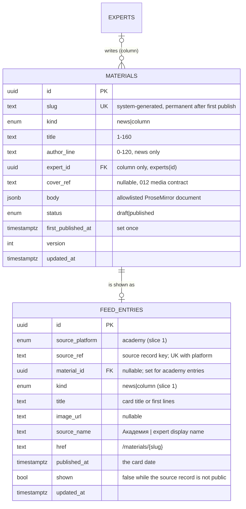
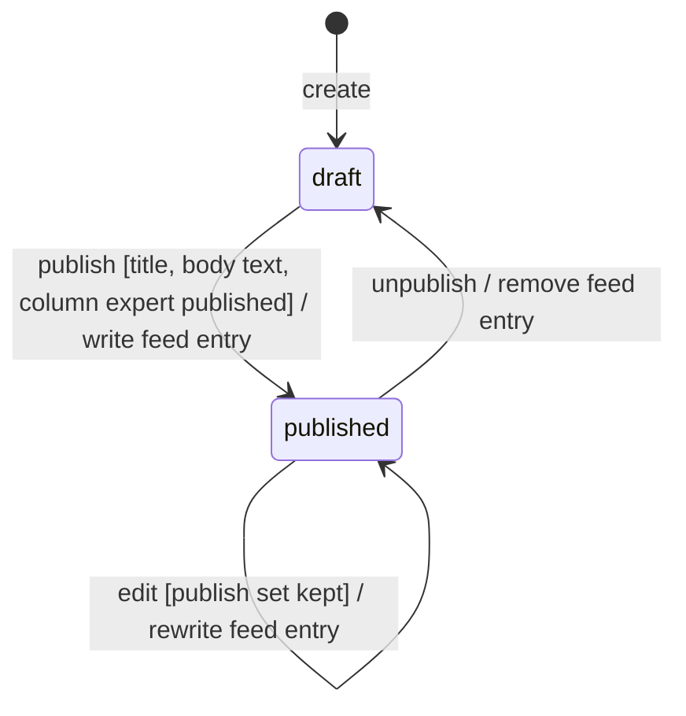
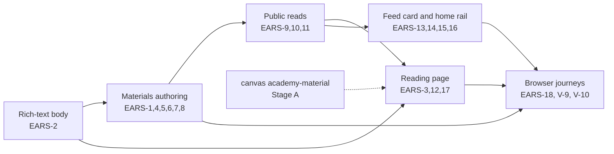

# 048 — Materials feed: own materials, the reading page and the rail on the Academy home (Design, slice 1)

Requirements: [`048-requirements-en.md`](./048-requirements-en.md) · PRD: [`048-product.md`](./048-product.md) · Connector research: [`048-platform-access-research.md`](./048-platform-access-research.md) · Domain: ADR-0016 §4 (project container), §8 (storefront ownership) · Experts directory and media: [`012-design.md`](../012-content-taxonomy/012-design.md) · Access: [`047-design.md`](../047-staff-access/047-design.md) · Admin kit precedent: [`030-design.md`](../030-projects-catalog-and-page/030-design.md).

## Current behaviour → replacement delta

There is **no running counterpart**: no table, contract, endpoint, admin section or storefront route for news, blog posts, articles or a feed exists (`packages/db/src/schema/`, `packages/schemas/src/`, `apps/api/src/`, `apps/admin/app/`, `apps/portal/app/` — inventory of 2026-10-29; PR #3500 found the home blocks unbuilt too).

| Exists today                                                                                                                                                                                                  | Slice 1                                                                                                                                                                   |
| ------------------------------------------------------------------------------------------------------------------------------------------------------------------------------------------------------------- | ------------------------------------------------------------------------------------------------------------------------------------------------------------------------- |
| `apps/portal/app/academy-home-view.tsx` — sections `EventsSection`, `WhatSection`, `WhySection`, `ProjectsSection`, `ExpertsSection`, …; **no** «Новости и блог» or «Рилсы и видео» block                     | a `MaterialsFeedSection` after `EventsSection` mounts the shared rail over the public feed read (EARS-14)                                                                 |
| `packages/db/src/schema/taxonomy.ts` `experts` (retained-row lifecycle `draft                                                                                                                                 | published                                                                                                                                                                 | retired`, public display name composed by the 012 public projection) | read-only source of a column's author; no change |
| 012 cover media: `apps/api/src/taxonomy/media/still-image-normalizer.ts`, `upload-reconcile.service.ts`, `media-cleanup.service.ts` + `packages/db/src/schema/media-cleanup-jobs.ts`; `apps/api/src/storage/` | reused for the material cover (normalized WebP, server-generated storage key, cleanup on replace)                                                                         |
| `packages/design-system/src/primitives/media-dropzone.tsx`                                                                                                                                                    | the cover slot of the material form                                                                                                                                       |
| `packages/design-system/src/lib/markdown-document.ts` — a hand-written mdast → React walker with no `dangerouslySetInnerHTML` (028 legal pages)                                                               | precedent for the rich-text renderer: same «walk the tree into design-system typography, drop what is not allowed» contract, over a ProseMirror document instead of mdast |
| No TipTap, ProseMirror or HTML sanitiser in any `package.json`                                                                                                                                                | TipTap enters `@ds/design-system` as the rich-text editor primitive (ADR-0004 design); no HTML sanitiser is added because no HTML is ever stored                          |
| `apps/admin/lib/admin-access.ts` `ADMIN_SECTION_NAV` (full-access items «События», «Проекты», «Эксперты», …)                                                                                                  | gains «Материалы» → `/materials` as a `full`-access (`platform_admin`) entry (EARS-8)                                                                                     |
| `apps/api/src/taxonomy/public-event-cursor.ts` — the exact (microsecond) keyset cursor rule of the public event reads                                                                                         | the feed cursor follows the same rule on `(published_at, id)` (EARS-9)                                                                                                    |

## Placement

- **Schema** `packages/db/src/schema/materials.ts` — `materials`, `feed_entries`, enums `material_kind`, `material_status`, `feed_entry_kind`, `feed_source_platform`. One forward migration in `apps/api/drizzle/` with the 010 audit triggers.
- **API** new module `apps/api/src/materials/` — `materials.admin.controller.ts` + `materials.service.ts` + `materials.repository.ts` (authoring, EARS-1…EARS-8), `feed-entries.repository.ts` (the only reader and writer of `feed_entries`), `own-materials.feed-source.ts` (the own-materials writer, EARS-10), `public-feed.controller.ts` and `public-materials.controller.ts` (EARS-9, EARS-11). The idempotency service, problem filter and media services of `apps/api/src/taxonomy/` are reused, not copied.
- **Contract** `packages/schemas/src/materials/` — `material.ts` (admin form, list, detail), `material-body.ts` (the allowlisted body document, shared by the API validator, the editor and the renderer), `feed.ts` (card, page, cursor), `public-material.ts`.
- **Admin** `apps/admin/app/materials/` (list `page.tsx`, `create/`, `[id]/`), `apps/admin/components/material-form.tsx`; the editor loads through `next/dynamic` (ADR-0004 bundle rule, TipTap ≈ 80 KB).
- **Design system** primitive `packages/design-system/src/primitives/rich-text-editor.tsx` (`RichTextEditor`, TipTap with exactly the extensions of the allowlist); blocks `rich-text-content.tsx` (`RichTextContent`, the renderer), `feed-card.tsx` (`FeedCard`), `feed-rail.tsx` (`FeedRail`: layout, arrows, keyboard, drag, paging trigger, live region, states), `material-article.tsx` (`MaterialArticle`, the reading-page body shared with the admin preview).
- **Academy routes** `apps/portal/app/materials/[slug]/page.tsx` — a route-file-registry row `— host-only surface (Academy materials; ADR-0016 §8 — no doctor projection)`, `permanent`; the route only fetches through `@ds/api-client` and composes `MaterialArticle`. The home section lives in `academy-home-view.tsx` and fetches the next pages through `@ds/api-client` handed to `FeedRail` as its loader.
- **Storefront ownership** (ADR-0016 §8): `materials` and `feed_entries` are `academy`; the admin is the only writer of `materials`. `apps/doctor` imports none of the feed or material contract and has no `/materials` route (EARS-17).

### Capability owner (ADR-0013 §A1)

`capability-ownership.md` has no feed row today. The feed card and the rail serve every source — own materials now, each network later — and must not fork per source or per page (PRD «one common card shape»), so the first implementation PR that lands `FeedCard` adds the row «Materials feed card + rail + feed read»: owner **`@ds/design-system` `FeedCard` / `FeedRail` + `apps/api/src/materials/public-feed*`**, Academy consumer `apps/portal` (home section, `/materials/{slug}`), doctor column «none (ADR-0016 §8)». The row is written with the code it describes, as for 030, because the registry must agree with the tree. No cross-host projection exists, so no boundary line is written. No stub package is graduated.

## Data model



- **`feed_entries` is the feed.** Every card the rail shows is one row; the public read touches no other table (EARS-10). An own material's row is written by `own-materials.feed-source.ts` in the transaction of its publish, edit or unpublish (EARS-4…EARS-6), keyed `(source_platform = 'academy', source_ref = material id)` unique. Each network slice adds one `source_platform` value, its `kind` values (`post`, `video`) and its own nullable card columns (`duration_seconds` for video, the partner reference with 032), and its connector writes rows of its platform; the read, the cursor, the rail and the materials of slice 1 are unchanged (US-10).
- **The card is denormalized on purpose.** Writing `title`, `image_url`, `source_name` and `href` at the write side makes every card render from its row alone, which a network card must do anyway (its source lives on another platform). The cost is that an own material's card is rewritten on each edit of a published material and on a change of the column expert's public name.
- **Column expert's name and status.** `source_name` is the expert's 012 public display name at the write. The 012 expert write path calls `own-materials.feed-source.refreshExpert(expertId)` in its transaction when the expert's display name or status changes; it rewrites `source_name` and sets `shown` to whether the expert is `published`, so a column leaves the feed while its expert is not public and returns when the expert is published again, without the feed read joining any other table. (Lead decision 11.)
- **Body** `jsonb` NOT NULL, a ProseMirror document (`{ type: "doc", content: [...] }`) validated by `material-body.ts` on every write; a draft may hold an empty document, publish requires at least one text character (EARS-4).
- **Kind-dependent author**: CHECK `(kind = 'column') = (expert_id IS NOT NULL)` and `(kind = 'news' OR author_line = '')`. A column's expert must be non-retired on write and `published` at publish (EARS-1, EARS-4); `expert_id` is `ON DELETE RESTRICT` (experts are retained rows anyway).
- **Status** is a two-value enum: an unpublished material is a draft again (Lead decision 3). `first_published_at` is trigger-pinned once set (012 pattern), so a re-publish restores the card at its first date (EARS-6).
- **Slug** from the title through `apps/api/src/taxonomy/taxonomy-slug.ts` (Cyrillic transliteration, collision suffix), editable by nobody, frozen at the first publish. `feed` and other route words are reserved.
- **Indexes**: `feed_entries (published_at DESC, id DESC) WHERE shown` for the read; unique `(source_platform, source_ref)`; `materials (updated_at DESC)` for the admin list; trigram on `materials.title` for admin search if the 012 list search uses one, else `ILIKE` as 012 does.

### Public predicate

A feed entry exists only while its source record is published (it is deleted on unpublish) and is public while `shown`; the feed read is `WHERE shown` on `feed_entries` alone (EARS-10). The writer keeps `shown` true for a news item and equal to «the expert is `published`» for a column. The material read (EARS-11) states the same rule on `materials`: `status = 'published' AND (kind = 'news' OR experts.status = 'published')`.

## Rich-text body (EARS-2, EARS-12)

| Allowed node / mark         | Attributes                                                                 |
| --------------------------- | -------------------------------------------------------------------------- |
| `doc`, `paragraph`, `text`  | —                                                                          |
| `heading`                   | `level` ∈ {2, 3} (the page title is the only level 1)                      |
| `bulletList`, `orderedList` | `orderedList.start` integer ≥ 1                                            |
| `listItem`, `blockquote`    | —                                                                          |
| `hardBreak`                 | —                                                                          |
| marks `bold`, `italic`      | —                                                                          |
| mark `link`                 | `href` absolute `https:` / `http:` / `mailto:`, ≤ 2048 chars; nothing else |

- **One allowlist, three consumers.** `material-body.ts` exports the node/mark set and a Zod schema; `RichTextEditor` registers exactly the TipTap extensions of that set (StarterKit trimmed to it + Link with `protocols` limited and `autolink` on), so paste from Word or a browser drops images, tables, colours and fonts by schema; the API refuses any document the schema rejects (`400` with the field `body`); `RichTextContent` walks only that set and throws in tests on anything else.
- **Limits**: 60 000 characters of text (a long column is ≈ 20 000), nesting depth 6, 2 000 nodes — bounds on the JSON a request can make the renderer walk.
- **No HTML anywhere**: nothing stored is HTML, nothing rendered uses `dangerouslySetInnerHTML`, so no sanitiser exists to be wrong (Lead decision 5). A link to another host renders `target="_blank" rel="noopener noreferrer"`; a link to `academy.doctor.school` renders in the same tab.
- **Plain-text projection** for length checks and the admin list search comes from the same walk (`bodyText(doc)`).

## Cascades

```mermaid
sequenceDiagram
  participant A as admin (platform_admin, MFA)
  participant API as materials.service
  participant DB as Postgres
  participant F as own-materials.feed-source
  A->>API: POST /v1/admin/materials/{id}/publish (Idempotency-Key, If-Match)
  API->>DB: BEGIN; lock material; check title, body text, column expert published
  alt requirement missing
    API-->>A: 409 PUBLISH_REQUIREMENTS_NOT_MET + field errors
  else ok
    API->>DB: status = published, first_published_at = coalesce(first_published_at, now()), version++
    API->>F: write(material)
    F->>DB: UPSERT feed_entries (academy, id) — title, image_url, source_name, href, published_at = first_published_at
    API->>DB: COMMIT (010 audit rows by trigger)
    API-->>A: 200 + ETag
  end
```

- **Edit of a published material** (EARS-5): the same transaction re-checks the publish set and calls `write(material)`; `published_at` of the entry is never rewritten.
- **Unpublish** (EARS-6): `status = draft`, `version++`, `F.remove(material)` deletes the entry. The admin confirms in an `AlertDialog` naming the consequence («Материал уйдёт с главной Академии, его страница станет недоступна»).
- **Draft edits** touch no entry.
- The home and the reading page read per request (no cache table); `revalidate` follows the public taxonomy reads, so a change shows on the next read without a release (US-2).

## Public reads (EARS-9, EARS-11)

- `GET /v1/public/feed?cursor=&limit=` — `ORDER BY published_at DESC, id DESC`, keyset `(published_at, id) < (cursor)`; the cursor encodes `published_at` as Postgres renders it to the microsecond (the `public-event-cursor.ts` rule: a millisecond-truncated cursor would repeat a row forever) plus the id, base64url; a malformed cursor → `400`. `limit` 1–24, default 12; the rail asks 12 first and then 8 (desktop) / 6 (phone), the canvas page sizes (`FEED_FIRST`, `FEED_PAGE`).
- Card shape (`packages/schemas/src/materials/feed.ts`): a discriminated union on `kind`; slice 1 defines the `news` and `column` members, each `{ id, kind, title, publishedAt, image: { url } | null, source: { platform: "academy", name }, href }`. A later member adds its own fields (`duration`, `text`, `partner`, `external: true`) without changing these two.
- `GET /v1/public/materials/{slug}` — `{ slug, kind, title, publishedAt, cover: { url } | null, author: { name } | null, body }`; `404` for draft, unknown and non-public alike. The column's author carries no slug or URL, so nothing can link to an expert page before 031.
- Both anonymous; `feed` is a literal path segment, not a parameter. The `endpoint-authz` and `route-mount` guards see the new routes as rows of their matrices.

## Endpoints

Headers (`Idempotency-Key`, `If-Match`), problem codes and the multipart cover contract follow today's `admin/projects` controller.

| Method + path                                                 | Purpose                                    | EARS         |
| ------------------------------------------------------------- | ------------------------------------------ | ------------ |
| `GET /v1/admin/materials`                                     | list with search and kind / status filters | EARS-7       |
| `POST /v1/admin/materials` · `PATCH /v1/admin/materials/{id}` | create / edit fields, author, cover, body  | EARS-1, 2, 5 |
| `GET /v1/admin/materials/{id}`                                | detail + ETag                              | EARS-1       |
| `POST /v1/admin/materials/{id}/publish`                       | publish with the requirement set           | EARS-4       |
| `POST /v1/admin/materials/{id}/unpublish`                     | back to draft, remove the feed entry       | EARS-6       |
| `GET /v1/public/feed`                                         | feed page                                  | EARS-9       |
| `GET /v1/public/materials/{slug}`                             | reading page                               | EARS-11      |

Every admin route: `roles: [platform_admin]`, the MFA admin session, CSRF, `revalidate: "live"` on writes (EARS-8). No admin endpoint writes `feed_entries` directly.

## Lifecycle



## UI composition

### Academy — rail and card (canvases, Stage A pending)

| Surface                | Canvas → state                                                                                                                                | Notes                                                                                                                                                                                                                                                                                                                                                                                                                                                                        |
| ---------------------- | --------------------------------------------------------------------------------------------------------------------------------------------- | ---------------------------------------------------------------------------------------------------------------------------------------------------------------------------------------------------------------------------------------------------------------------------------------------------------------------------------------------------------------------------------------------------------------------------------------------------------------------------- |
| Feed card              | `unit-feed-card.dc.html` — `source` = «академия» (news) / «колонка» (column), `media` = «картинка» / «нет», `partnerMark` = «нет», `skeleton` | The other `source` values (telegram, vk, rutube, vk-видео, дзен), `media` = «видео» with duration and `partnerMark` = «есть» are later slices. Hover presses the shadow `--shadow-lg` → `--shadow-md`, focus shows `--shadow-focus`; the `data-link` text underline is a canvas-runtime artefact and is **not** built (design-source README row). Own cards link in the same tab; the date is day + month in Moscow time, year appended when not current (Lead decision 10). |
| Home rail              | `academy-home.dc.html` section «Новости, блог и видео», `scope` = «срез 1», `railPosition` start / scrolled, `data` norm / load / empty / err | Desktop two rows, slot `clamp(260px, …/4.5, 340px)`, phone one row, slot ≈ 1/1.25 of the viewport; ← / → are `Button variant="outline" size="icon"` with the canvas `aria-label`s and `aria-controls="feed-rail"`; the rail is `role="region"` `aria-roledescription="лента"` with the canvas label; drag only for a mouse; live region texts from the canvas. Placement after the events block follows the canvas order (Lead decision 9).                                  |
| Rail next-page failure | **not drawn** — the trailing «Повторить» slot of EARS-15                                                                                      | Composed from the error block of the rail's first-page error (canvas `data = err`) sized as one slot; a Stage-A item of the rail package.                                                                                                                                                                                                                                                                                                                                    |

### Academy — reading page (Stage-A gate, canvas not drawn)

`academy-material.dc.html` does not exist yet; its Claude Design prompt is [#3403 comment 6487221951](https://github.com/doctor-school/ds-platform/issues/3403#issuecomment-6487221951) (prompt 2), pending with the owner. The **Reading page** package therefore carries a Stage-A gate: no UI of `MaterialArticle` or `/materials/{slug}` is built until the canvas is drawn, vendored into `design-source/` and approved; the package's backend-independent parts (route wiring to the read, not-found, the renderer `RichTextContent` from the Rich-text body package) are specified by EARS-11 / EARS-12 and do not wait. The states the canvas must draw: loaded (news with cover, column without cover), long body with every allowlisted node, not-found (the Academy not-found page, existing), read error with «Повторить», and the admin preview banner «Предпросмотр — материал не опубликован».

### Admin (approved-non-canvas; the editor at Stage A)

| State                | Composition                                                                                                                                                                                                                                                                                               |
| -------------------- | --------------------------------------------------------------------------------------------------------------------------------------------------------------------------------------------------------------------------------------------------------------------------------------------------------- |
| `material-list`      | «Материалы»: `AdminDataList` (title, kind, status, first published, author) with search, kind and status filters, «Новый материал»; `EmptyState` when none; the mark «Не на сайте: эксперт не опубликован» on a published column with an unpublished expert                                               |
| `material-form`      | full-page form: «Вид» (radio «Новость» / «Колонка эксперта»), «Заголовок», «Автор» (text, news) or «Эксперт» (`Combobox` over non-retired experts, column), «Обложка» (012 media slot on `MediaDropzone`), «Текст» (`RichTextEditor`); «Сохранить»; field errors at their fields                          |
| `material-editor`    | `RichTextEditor` toolbar: H2, H3, bold, italic, bulleted list, numbered list, quote, link (dialog with URL field), undo / redo; keyboard shortcuts; **the one element outside the admin Stage-A baseline (012 EARS-18) — its look goes to the owner at Stage A as that element alone** (PRD Flows step 1) |
| `material-preview`   | «Предпросмотр» opens a full-screen `Sheet` rendering `MaterialArticle` from the form state with the banner «Предпросмотр — материал не опубликован»                                                                                                                                                       |
| `material-lifecycle` | «Опубликовать» (refusal lists the missing items at their fields); «Снять с публикации» with an `AlertDialog`; status badge «Черновик» / «Опубликован» with the first-publish date                                                                                                                         |
| `material-conflict`  | a stale `If-Match` save shows the reload notice of the 012 forms                                                                                                                                                                                                                                          |

## Room for network connectors (US-10)

Slice 1 builds no connector and no source list, and nothing in it waits for one. What a later network slice adds, each in its own spec slice, without touching slice-1 code paths: a `feed_sources` table (platform, address, on / off) behind the admin source list (US-3); a `<platform>.feed-source.ts` writing `feed_entries` rows of its platform from the platform's documented push or read path (research §§1–4: Telegram bot `channel_post`, VK Callback API, RuTube channel list after written confirmation, Dzen only with permission or by the reverse RSS path); a `hidden_at` column and admin action for one entry (US-5); the external card variant opening in a new tab (US-7); a copied preview image where the platform's links expire (Telegram) or a referenced one where storing is forbidden (VK Rules §1.6). The rail and the card render by `kind`, so a new kind is a new card variant in `FeedCard` and nothing else.

## Retention

Materials and their feed entries are editorial content, not personal data (an expert's name is a published directory field, an author line is a byline): they are retained rows kept for as long as the platform exists, with no time limit — the 012 «nothing is physically deleted» convention; an unpublished material stays a draft in the admin. A replaced cover is removed from storage by the 012 `media_cleanup_jobs` path. No row in the ADR-0009 retention matrix is needed (no PD table). The retention of network card data is set by each network slice together with its storage (PRD).

## Dependencies

- **012 experts directory and media** — on `main`; columns reference `experts`, covers reuse the media services. No edge.
- **047 `platform_admin` and the admin session with the second factor** — on `main`. No edge.
- **Canvas `academy-material.dc.html`** — not drawn (owner's Claude Design prompt pending, #3403); a Stage-A gate of the Reading page package, not a `blocked_by` edge on the other packages.
- **031 expert page** — the author link waits for it; slice 1 has no link, so no edge.
- **032 slice 1 (#3492)** — only the later partner-mark slice depends on it; slice 1 has no edge.
- **029 home re-layout** — consumes the rail section as built; 048 places it in today's home (EARS-14), so 029 moves it, never re-implements it.

## Delivery slices



- **Rich-text body** first: the form, the API validator and the renderer all consume its contract.
- **Materials authoring** carries the migration, the admin endpoints and the admin screens together, so no release has tables without their writer.
- **Public reads** depend only on the tables; **Feed card and home rail** and **Reading page** depend on the reads; the reading page also waits for its canvas at Stage A; the journeys close the slice.

The PRD's later slices (2 Telegram, 3 VK / VK Видео, 4 RuTube, 5 Dzen) follow this one, each adding its connector per «Room for network connectors».

## Lead decisions

The PRD's _agent-proposed — UNCONFIRMED_ items, specified as the PRD writes them (030 / 032 precedent), plus the design choices made here:

1. **Field set** (PRD Flows step 1, UNCONFIRMED): kind (news / expert column), title, text, optional cover, author line; a column's author is an expert chosen from the 012 directory, a news item's author line is optional free text (EARS-1).
2. **Empty-rail copy** (PRD branch, UNCONFIRMED): the canvas `academy-home.dc.html` `data = empty` text «Записей пока нет.» / «Здесь появятся новости Академии и публикации из наших соцсетей.» replaces the copy the PRD carried from the old «Новости и блог» block — the rail canvas is now drawn, and a canvas default is the decision (EARS-16).
3. **Error copy** (PRD branch, UNCONFIRMED): «Не удалось загрузить новости.» with «Повторить», as in the canvas `data = err` (EARS-16).
4. **No feed on the doctor storefront and no «all news» archive** (PRD out of scope, UNCONFIRMED): the doctor host has no route, no rail and no contract import (EARS-17); the rail is the only list of materials.
5. **Unpublish returns to draft**: no separate «retired» state for a material; a re-published material keeps its first date (EARS-6).
6. **Body is an allowlisted ProseMirror document, never HTML**: one allowlist shared by editor, API and renderer; no sanitiser, no `dangerouslySetInnerHTML` (EARS-2, EARS-12).
7. **No images or embeds inside the body in slice 1**: the cover is the only image; inline images would need the media pipeline per image and are not in the PRD's field set.
8. **The feed is one store of entries (`feed_entries`) from slice 1**, written by the own-materials source in the change's transaction and read alone by the public feed read, so a network slice adds rows of its platform and changes nothing here (EARS-10, US-10).
9. **The rail sits after the events block of today's Academy home**, the canvas order; 029 owns its final placement (EARS-14).
10. **Card date** = first publication instant, day + month in Moscow time, year added when not the current year (EARS-13).
11. **A column whose expert stops being published leaves the site** (feed and reading page) and is marked in the admin list; it returns when the expert is published again (EARS-7, EARS-9, EARS-11).
12. **Partner mark is out of slice 1**: neither the slice-1 item of the PRD's «Delivery slices» nor the US-1 field set carries a partner; it comes with a later slice taking the partner from the 032 registry (#3492).
13. **Next-page failure** keeps the loaded cards and offers «Повторить» in a trailing slot — not drawn on the canvas, a Stage-A item of the rail package (EARS-15).
14. **Reading-page canvas is a Stage-A gate**, not invented from prose: the page's behaviour is in EARS-12, its look waits for `academy-material.dc.html`.
15. **Capability row is added by the first implementation PR** that lands `FeedCard`, so the registry describes files that exist (030 precedent), although the PRD says it is «registered when the design spec is written».
16. **Body bounds**: 60 000 characters of text, nesting depth 6, 2 000 nodes, links ≤ 2048 characters (EARS-2).
17. **Page sizes from the canvas**: first page 12, then 8 on a desktop and 6 on a phone; placeholders 10 / 3 for the first load (EARS-15, EARS-16).
18. **Retention**: materials and entries are retained editorial rows with no time limit; no PD retention-matrix row (Retention).
